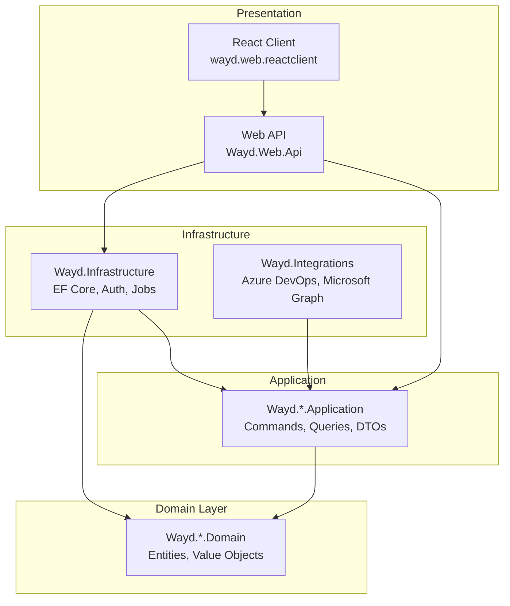

# Architecture

Wayd follows **Clean Architecture** with **Domain-Driven Design (DDD)** principles, organized as a **modular monolith** with a shared database.

## Clean Architecture Layers



### Dependency Rules

- **Domain** (innermost) - Zero external dependencies. Contains entities, value objects, domain events, and interfaces.
- **Application** - Depends on its own Domain and the Common projects only. Contains commands, queries, handlers, DTOs, and validators.
- **Infrastructure** - Depends on Application and Domain. Contains EF Core, authentication, background jobs, and external integrations.
- **Web API** - Depends on all layers. Thin controllers that delegate to handlers via `IDispatcher` (Wolverine).

Services are isolated from each other as well: a service's Domain depends on no other service's Domain, and
its Application depends on its own Domain and the `Wayd.Common*` projects, never on another service's Domain
or Application. Application projects may reference `Wayd.Integrations.Abstractions` but no concrete
integration, and the `Wayd.Integrations.*` projects depend only on the `Wayd.Common*` projects. A module
that needs another module's data asks through a request in `Common.Application/Requests` (see
[Reading another domain at query time](#reading-another-domain-at-query-time)).

### Architecture tests

`Wayd.ArchitectureTests` enforces these rules with NetArchTest and reflection, so breaking one fails the
build's test run rather than a review. Run it after changing a project reference.

| Test class | What it holds |
|---|---|
| `CrossProjectDependencyTests` | The layer and service-isolation rules above |
| `DatabaseContextTests` | Domain projects never reference EF Core or a context; Application projects use the `IXxxDbContext` interfaces, never `WaydDbContext`; contexts and entity configurations live in Infrastructure |
| `CqrsPatternTests` | Commands and queries are public sealed records named `*Command` / `*Query`; handlers are public and named `*Handler`; each command or query has exactly one handler (Wolverine silently combines duplicates); handlers never inject another handler; command handlers return `Result`; only the dispatch seams touch Wolverine's `IMessageBus`, and only the `SaveChanges` drain touches `IEventPublisher` |
| `DemandManagementBoundaryTests` | Demand Management reaches the database only through `IDemandManagementDbContext`, which does not extend `IWaydDbContext`, and references no other module — see [One context, many interfaces](./database.mdx#one-context-many-interfaces) |
| `ServiceLayeringTests` | The service and saga tiers in [Services and sagas](#services-and-sagas) |
| `TransactionScopeTests` | Only the context opens a transaction, and nothing turns on a retrying execution strategy — see [What a save commits](./domain-events.mdx#what-a-save-commits) |
| `EventCoverageTests` | An evented aggregate changes only through events — see [Domain Events](./domain-events.mdx#an-evented-aggregate-changes-only-through-events) |
| `FileStructureTests`, `TestProjectTests` | Projects sit in `src/` and `tests/` folders, test projects are named after the project they test, reference it, and use xUnit |

## Solution Structure

```
Wayd/
  Wayd.Common/           # Shared libraries and base abstractions
    src/
      Wayd.Common              # Utilities, extensions, helpers
      Wayd.Common.Domain       # Base entities, domain events, the shared Employee, interfaces
      Wayd.Common.Application  # Dispatch interfaces, cross-module requests, persistence interfaces
    tests/
      Wayd.Tests.Shared        # Shared test utilities, traits and cross-cutting fakers
      Wayd.TestData.Core       # PrivateConstructorFaker<T>
      Wayd.Tests.Containers    # The shared SQL Server Testcontainers image

  Wayd.Services/         # Vertical slice domain services
    Wayd.Work/           # Work items, sprints and the work sync
    Wayd.Organization/   # Teams and employees
    Wayd.Planning/       # Planning intervals, PI iterations and sprint mappings
    Wayd.ProductManagement/  # Product catalog, versions, releases, deployments
    Wayd.ProjectPortfolioManagement/  # Portfolios, programs, projects, tasks
    Wayd.StrategicManagement/   # Visions, strategies, strategic themes
    Wayd.DemandManagement/      # Intake desks, channels and intake requests
    Wayd.AppIntegration/ # Integration configuration and the sync runners
    Wayd.Links/          # Cross-entity relationships

  Wayd.Infrastructure/   # EF Core, migrations, auth, messaging, jobs
  Wayd.Integrations/     # External system clients (Azure DevOps, Microsoft Graph, Workday)
  Wayd.Web/              # Presentation layer: Wayd.Web.Api, wayd.web.reactclient, Wayd.Mcp
  Wayd.Tools/            # Developer tools (data generation)
  Wayd.AppHost/          # .NET Aspire host for local development
  Wayd.ArchitectureTests/  # Architecture rules, at the root with no src/ or tests/ folder
```

## Key Patterns

### CQRS with Wolverine

All business operations are modeled as commands (writes) or queries (reads), dispatched through `IDispatcher` (backed by Wolverine). Controllers are thin and contain no business logic. Handlers must be `public` — Wolverine generates the code that invokes them and cannot call internal types.

Handler **dependencies** are constructor-inlined by Wolverine's codegen, and service location is disabled (`ServiceLocationPolicy.NotAllowed`). A dependency whose registered implementation is `internal` (public interface, internal class) cannot be inlined; it must be added to the `AlwaysUseServiceLocationFor<T>()` allow-list in `WolverineConfiguration` — or the implementation made public. Getting this wrong fails with an `InvalidServiceLocationException` naming the offending type: in CI when `codegen write` generates the handler tree, and locally the first time the handler is dispatched, since local runs compile handlers at runtime.

```csharp
// Command
public sealed record CreateWorkItemCommand(string Title, Guid WorkspaceId) : ICommand<Guid>;

// Query
public sealed record GetWorkItemQuery(Guid Id) : IQuery<WorkItemDto>;
```

### Result Pattern

Command handlers return `Result` or `Result<T>` from CSharpFunctionalExtensions instead of throwing exceptions:

```csharp
public async Task<Result<Guid>> Handle(CreateWorkItemCommand request, CancellationToken ct)
{
    var workspace = await _workDbContext.Workspaces.FindAsync([request.WorkspaceId], ct);
    if (workspace is null)
        return Result.Failure<Guid>("Workspace not found.");

    var workItem = workspace.CreateWorkItem(request.Title);
    await _workDbContext.SaveChangesAsync(ct);

    return Result.Success(workItem.Id);
}
```

Every command handler's `Handle` returns `Task<Result>` or `Task<Result<T>>`: under Wolverine, a value a
published handler returns is cascaded as a new message, and a `Result` never is. Query handlers return
`Task<TResponse>`, because they are only ever invoked: usually a DTO that is `null` when nothing matched, and
a `Result<TDto>` only when the query can fail for another reason.

### Services and sagas

Below and above the handlers sit two more tiers, and dependencies flow one way through them:

```text
saga  →  handlers  →  service  →  DbContext / domain
```

- A **service** (a class implementing `IScopedService` or `ITransientService`, which also registers it) does
  one job against the database and the domain. It may take framework primitives — `IDateTimeProvider`,
  `ICurrentUser`, `IUserService` — but never another service and never `IDispatcher`, so the graph below a
  handler stays a tree.
- A **saga** (`ISaga`) coordinates several handlers to complete one piece of work, so unlike a service it
  may hold `IDispatcher`. The sync runners (`IWorkSyncRunner`, `IPeopleSyncRunner`) and
  `IAzureDevOpsInitManager` are sagas.
- A handler never injects another handler; it dispatches through `IDispatcher` instead.

`ServiceLayeringTests` enforces the service rules, with an exact list of the violations that predate it.

### Identity vs Principal

The current caller is split into two abstractions: `ICurrentUser` is pure identity — *who* is calling (user id, name, email, employee link, authenticated) — and `ICurrentPrincipal` answers *what the caller may do* (`HasPermission` / `HasAnyPermission`), deriving the permission set from the identity plus the permission store and caching it per request/message scope. Inject the one that matches the question being asked; don't add permission or claim APIs to `ICurrentUser`.

`ICurrentUser.Kind` classifies the caller as one of three `ActorKind`s: **User** (an authenticated request, or a background scope acting on a specific user's behalf), **Anonymous** (a live HTTP request with no authenticated user — denied all permissions), or **System** (no HTTP request and no acting user: scheduled jobs, durable message delivery, startup work — granted all permissions). System scopes are audited with the well-known `SystemIdentity.UserId` instead of an empty value, so platform-initiated writes are always attributable.

Only real user ids are propagated across execution boundaries (job parameters, message envelope headers); a scope with neither an HTTP context nor a propagated user id resolves to System by definition — the "nobody = system" rule lives in `CurrentUser.Kind` and nowhere else. This rests on one assumption worth knowing: **background work never originates from anonymous callers.** Anonymity doesn't survive a detach — once execution leaves the HTTP context with no user id, an anonymous origin is indistinguishable from a platform origin, so work enqueued by an anonymous endpoint would run as System (grant-all). Today no anonymous endpoint enqueues work; if one ever must, propagate an explicit anonymous marker so `Kind` can resolve it correctly across the boundary.

### Permission-based vs membership-based authorization

Most of the application authorizes on the permission claim alone: a `[MustHavePermission]` attribute on the controller decides whether the caller may reach the endpoint, and the handler does the work.

**PPM is the exception.** Changing a project, program, or portfolio additionally requires that the caller *leads* the record — Owner or Manager on it or on an ancestor. That question can only be answered against the record itself, so it is enforced **in the domain**, not at the controller:

- The command record implements `IRequireLinkedEmployee` — a managed PPM action is always attributable to an employee.
- The handler resolves a `PpmActor` via `ResolvePpmActor(ICurrentUser, CancellationToken)` on `ICurrentPrincipal`, pairing the employee id with whether they hold the domain-wide administrator grant, plus the acting user id. It takes `ICurrentUser` alongside the principal rather than reading the user id from it, because the two interfaces are a deliberate identity/authorization split — `ICurrentPrincipal` answers only what the caller may do. The user id is carried because records that freeze attribution at write time (such as project status history) need both: the user-to-employee link is mutable, so an action attributed only by employee cannot later be traced to the account that performed it.
- The handler's query **must load the ancestor roles** — `Portfolio.Roles`, and `Program.Roles` when assigned — and pass them in as `ProjectAncestryRoles`.
- The aggregate method checks `CanManageProject` / `CanManageProgram` / `CanManagePortfolio` before any state change.

Every mutating method on those three aggregates takes a `PpmActor`; there is no ungated public overload, so the compiler will not let a new handler forget. Paths with no human actor (importers, creation) pass `PpmActor.System` — grep for it to audit every membership bypass in the codebase.

:::warning[Forgetting an `.Include` fails silently]
`AncestryRoles()` reads `project.Portfolio?.Roles ?? []`. If the handler's query omits the ancestor includes, the navigation is null, ancestry comes back empty, and a legitimately authorized portfolio Owner is **denied** — with no error to trace. Unit tests using in-memory fakes cannot catch this, because `.Include` is a no-op there and the test populates the navigation directly.
:::

The read side mirrors the same rule as `canManageProject` / `canManageProgram` / `canManagePortfolio` DTO fields so the UI can hide actions the server would reject. Those projections and the aggregate predicates must agree — if they drift, the UI either hides valid actions or offers ones that fail on submit.

`ProjectDetailsDto.BackwardStatusTargets` follows the same principle for [reverting a project's status](../user-guide/ppm/projects.mdx#reverting-a-project-status): rather than the UI re-deriving which earlier statuses are reachable, the server answers from `ProjectStatusLifecycle` — the same table and entry requirements `Project.RevertStatus` enforces. Adding a status requirement in one place without the other is what makes the dropdown offer a transition that then fails.

:::warning[Not every derived field can be computed in the projection]
`GetProjectQuery` builds its DTO with `ProjectToType`, so every mapping clause must translate to SQL. `BackwardStatusTargets` cannot — building it calls a static factory inside a `Select` over a collection — so the mapping `.Ignore`s it and `ResolveBackwardStatusTargets()` fills it after materialisation. A clause that fails to translate throws only under a real provider; in-memory fakes run the projection as LINQ-to-Objects and evaluate anything, so changes to this mapping need a test in `Wayd.ProjectPortfolioManagement.IntegrationTests`.
:::

**Sprints are the other membership-gated area.** Starting, completing and reopening a sprint needs `Permissions.Iterations.Update` and membership of the sprint's team or its direct team of teams, which `Permissions.Iterations.Administer` waives. Membership lives in Organization, so the Work handlers answer it through `IsTeamMemberQuery` (`SprintAuthorization.CanManageTeamSprints`) rather than in the aggregate; the aggregate enforces only the lifecycle rules, through `TeamSprintTimeline`. `SprintDetailsDto` exposes both — `CanManageSprint` and `CanStart`/`CanComplete`/`CanReopen` — computed by the same code the commands run.

**Intake requests are gated by desk role alone, and read in tiers.** Demand Management follows a different principle from PPM and sprints: a claim says what someone may do anywhere, a role on a container says what they may do in it, and no action needs both. So acting on a request needs only being an Agent or Desk Admin on its desk (`IntakeDeskMember.Role`), and its endpoints need only a signed-in user; the handler decides through `IntakeRequestReader.IsAgentOn` and `IsDeskAdminOn`, which read memberships from the database and treat an inactive employee as a member of nothing. `Permissions.IntakeRequests.View` only widens what a reader browses, and `Administer` is the top role on every desk rather than a waiver beside a resource permission. Submitting, and reading one's own requests, need no claim at all. The motive is administration: a claim that does nothing until its holder is also named on a container has to be kept in step with that container by a different person on a different screen, and drift shows up only as someone who cannot act. Reads are stricter than anywhere else: a request is read in summary, substance and internal tiers, and the desk's visibility decides who holds which. `IntakeRequestReader.CanSeeSummary` and `CanSeeSubstance` are expressions that every query and command applies in SQL, so a private desk's requests are absent from lists and counts rather than redacted, and a command on a request the caller cannot see fails exactly as a missing one does (`IntakeRequestAuthorization.NotFoundError`, 404). The DTOs are one object per tier, and every request event declares its tier (`IIntakeRequestEvent.ReadTier`) so the request's history is filtered by event type before paging. Working one desk grants nothing on another. In-memory fakes cannot prove the expressions translate; `DemandManagementReadTests` and `DemandManagementCommandTests` run them on SQL Server.

See [Permissions](../user-guide/settings/permissions.mdx) for the user-facing rule.

### No Repository Pattern

Application handlers use EF Core `DbContext` directly for data access. There is no repository abstraction layer.

### Vertical Slices

Each service follows consistent Domain/Application layering:

```
Wayd.Services/Wayd.\{ServiceName\}/
  src/
    Wayd.\{ServiceName\}.Domain/        # Entities, value objects, interfaces
    Wayd.\{ServiceName\}.Application/   # Commands, queries, DTOs, validators
  tests/
    Wayd.\{ServiceName\}.Domain.Tests/
    Wayd.\{ServiceName\}.Application.Tests/
    Wayd.\{ServiceName\}.IntegrationTests/   # where the service has Testcontainers tests
```

`Wayd.Links` is the one service without the split: it is a single `Wayd.Links` project.

### Feature Folders

Application layer is organized by aggregate root/feature:

```
Wayd.Work.Application/
  WorkItems/
    Commands/
      CreateWorkItemCommand.cs
      CreateWorkItemCommandValidator.cs
    Queries/
      GetWorkItemQuery.cs
    Dtos/
      WorkItemDto.cs
```

### Cross-domain replication

Domains do **not** share entity rows. Each domain keeps its own local projection of concepts owned by
another domain, kept aligned two ways:

1. **Event replication (copy).** The owning domain raises a domain event; consuming domains have
   public handlers with a `Handle(TEvent, CancellationToken)` method that create a local projection carrying the **same Id**.
   For example, `Organization.Team` is the source of truth; `PpmTeam`, `PlanningTeam`, and `WorkTeam` are
   read-model copies written by handlers for `TeamCreated`/`DetailsUpdated`/`Activated`/`Deactivated`.
   Delivery is durable, so events arrive late, twice and out of order: each copy keeps a watermark per group
   of fields and skips a change older than one it already holds, and a missing copy is built from the owner's
   current state. See [Consuming an event](./domain-events.mdx#consuming-an-event).
2. **Shared table.** `Employee` lives in `Wayd.Common.Domain` — one row, referenced by Guid everywhere.
   No replication needed.

#### Replication edges

| Source domain | Aggregate | Event(s) | Consumers (projection written) |
|---|---|---|---|
| Organization | `Team` / `TeamOfTeams` | `TeamCreated/DetailsUpdated/Activated/Deactivated` | PPM `PpmTeam`, Planning `PlanningTeam`, Work `WorkTeam` |
| PPM | `Project` | `ProjectCreated/DetailsUpdated/KeyChangedV2/Deleted` | Work `WorkProject`, Demand Management `DemandProject` |
| StrategicManagement | `StrategicTheme` (**the source**) | `StrategicThemeCreated/DetailsUpdated/Activated/Archived/Deleted` | PPM `PpmStrategicThemes` |
| Work | `Iteration` (sprints) | `IterationCreatedV3/DetailsUpdated/DateRangeChangedV2/TeamChanged/Deleted` | Planning `PlanningSprint` |
| Common | `Employee` | — (shared table) | referenced by Guid everywhere |

`StrategicTheme` is owned by **StrategicManagement**; PPM only holds a copy — author themes in
StrategicManagement.

#### The load-bearing consequence

Because these projections are populated by events, code that **creates** a replicated concept must go
through the owning domain's command so its `SaveChanges` dispatches the events — never insert a projection
row directly, and never bulk-insert source rows with a raw `AddRange` that skips the domain path (the
[data generation tool](./tools/data-generation.mdx) goes through the import endpoints for this reason).

The copies are **eventually consistent**. These events are delivered durably and asynchronously (see
`DurableEventRoutes`), after the command that raised them has returned, so a copy can be missing for a
moment after its source was created. Anything that references a copy by foreign key must check it exists
and fail cleanly rather than let the save fault: `PlanningInterval.ManageTeams(teamIds)` adds
`PlanningIntervalTeam { TeamId }` with no existence check of its own, so both of its callers —
`ManagePlanningIntervalTeamsCommand` and `PlanningIntervalImportDefinition` — verify every requested
`PlanningTeam` first and report that the team "may still be syncing" instead of an FK violation. A new caller
of `ManageTeams`, or any new FK to a copy, needs the same guard.

#### Reading another domain at query time

A copy is worth keeping when a domain writes against the concept or reads it on every request. A report
that only needs another domain's data now and then asks the owner instead, through a request in
`Common.Application/Requests` that the owning module handles. The team work distribution report
(`GetTeamWorkDistributionQuery`, Work) does this twice:

- `GetTeamStructureQuery` (Organization) returns a team and every team beneath it over a date range as
  **dated membership edges** plus each team's sizing periods, not one resolved tree — a team can change
  parents inside the window, and work belongs to the parent it had on the day it was done.
- `GetProjectClassificationsQuery` (PPM) returns each project's portfolio, program and **effective themes**
  (the project's own, or its program's when it has none).

Keep the calculation out of the handler: `WorkDistributionCalculator` is a pure function over those results and
the queried work items, so its rules are unit tested without a context or a dispatcher.

The sprint burn-down's ideal line does the same for capacity. Work owns the sprint, its working week and its
team days off; Organization owns allocations, holiday calendars and time away. `SprintScopeHistoryLoader`
sends `GetTeamDayAvailabilityQuery` and gets back, for each day, how much of the team's allocated delivery
time is there, then applies its own two facts on top. The feature flag is checked once, in the Organization
handler, which answers null when it is off — so with the flag off nothing outside Organization can read an
allocation, and Work draws the line as it did before allocations existed.

A sprint's capacity against its scope works the same way. `GetSprintCapacityQuery` sends one
`GetTeamsCapacityByPeriodQuery` for the sprint and the prior sprints its velocity comes from, each period
carrying that sprint's team days off, and gets back the delivery person-days of each. A team day off
(`TeamDayOff`, in Common) is a date and the percent of the day the team is off; Organization folds it into each
`TeamDay` as the share worked, so a half day halves everyone's time there exactly as the ideal line halves
the day's weight. Organization answers any
number of teams and periods in a fixed number of reads, and null with the flag off; Work keeps the comparison
with scope (`SprintCapacityComparison`) on its side, as a pure function.

A planning interval's capacity crosses three modules. Planning owns the interval, its teams and iterations;
`GetPlanningIntervalCapacityQuery` asks Work for every team's sprint days off in the interval
(`GetTeamDaysOffQuery`, one read) and Organization for every team over every iteration in one
`GetTeamsCapacityByPeriodQuery`, passing those days off per team. Neither read grows with the number of teams or
iterations.

### Tagging

Every module that tags its records builds on `Wayd.Common.Domain/Tagging`, so tagging behaves the same everywhere while each module keeps its own tables, events and authorization.

- **`TagCategoryBase<TTag>`** is an axis and owns its tags: name uniqueness on the axis, the system-axis guard, activation, reordering and deletion. The derived axis supplies its tag list, its "in use" messages and one factory per event, so the base raises the module's own events.
- **`TagBase`** is a tag. One on an axis changes only through the axis. A **free tag** has no `CategoryId` and is its own aggregate: created by typing a name, renamed, merged or deleted by an admin, never deactivated. Its name is unique among the module's free tags through the `(CategoryId, Name)` unique index, mapped with `HasFilter(null)` so SQL Server compares the null axes as equal.
- **`TagSet`** holds the set rules a tagged aggregate applies to its own assignment list — skip a tag already carried, replace on a single-value axis, never displace on a free tag, swap one tag for another in a merge — and reports a `TagChange` for the aggregate's event. Whether the record may be tagged at all (an inactive tag, an axis a desk does not offer, free tags turned off) is the aggregate's or handler's to check first.

A handler that removes tags from a record — untagging, deleting the record — also deletes any free tag nothing else carries, in the same save. To add tagging to another module, derive its axis and tag from these bases, give its assignment `ITagAssignment`, route its `Tag`/`Untag`/`ReplaceTag` through `TagSet`, and follow the Products and Demand Management handlers for tag-by-name, merge and free-tag clean-up.

### Domain events and the activity log

Every domain event drained by `SaveChanges` is captured in the activity log, and events follow one set of
conventions for naming, payloads, versioning and consumption in every module. See
[Domain Events](./domain-events.mdx).

### Following

A follow (`Common.Domain/Following`, table `Notifications.Follows`) is keyed by an owner type string and a
record id, the convention status workflows use, so Common holds no module's vocabulary. Making a record
followable is a registration in its module, not a schema change:

1. Declare a `FollowOwnerDescriptor` as a static field in the module's domain project (`PpmFollowOwners`,
   `PlanningFollowOwners`, `DemandManagementFollowOwners`). The key is persisted — namespace it by module and never rename it.
2. Implement `IRecordReadRule` (`Common.Application/Records`) in the module's Application project:
   - `Readable(search)` returns the records the caller may read, by **exactly** the rule the record's own read
     endpoints apply, as `RecordFacts` rows (id, `IsUnhealthy`, `IsClosed`) in a query the database can run. A
     search matches the record's name, or its key in the record's own form.
   - `Describe(ids)` returns a `RecordSummary` per record for one page: key, name, parent, status and its
     `LifecycleCategory`, health, progress, the people who lead it with their roles, and dates.
   - `VisibleActivity(activity)` and `ReadActivity(id)` hold the record's history to what its own Activity
     endpoint shows the caller. A record whose history every reader sees whole passes the activity through
     and reads it with `IActivityLogReader.Read`. One read in tiers — an intake request — narrows both by the
     same rules as its Activity endpoint, or "last changed" and "what has happened since you followed it"
     would show a follower what that endpoint withholds.
   - `VisibleNotifications(notifications)` holds the caller's notifications to changes they may see. Most owner
     types pass them through; an intake request keeps a notification only when the reader holds the tier of
     the change it names (`IntakeRequestNotificationTiers`), so a summary-only follower is not told its
     details changed.
   - `ActorHiddenOn(ids)` names the records on which the caller may not be told who made a change; the list
     leaves the actor out for those. An intake request hides it from readers without its substance.
3. Register both in `Infrastructure/Following/ConfigureServices.AddFollowing`. `FollowRegistrationTests`
   fails until every registered owner type has exactly one read rule.

The Following list joins the caller's follows to each owner type's `Readable` rows and combines the types with
`UNION ALL`, so filtering, counting, sorting and paging all happen in SQL. That is why `RecordFacts` carries
only plain columns: a converted value (a value-object key, a string-stored enum) has a different store type in
each table and breaks the union. `FollowQueryTranslationIntegrationTests` runs every real read rule in that
union against SQL Server. "Last changed" and "what has happened since you followed it" come from the activity
log, through the read rule's `VisibleActivity` and `ReadActivity`.

**Following grants nothing.** `Readable` only ever narrows: never consult follows from an authorization
check, and never widen a read because a follow exists. Readability is applied before counting, so a record the
caller has lost access to leaves both the list and its total. Keep follows apart from participants, who are
given a record and the access that goes with it.

### Notifications

A notification (`Common.Domain/Notifications`, table `Notifications.Notifications`) is one person told about
one change to one followable record. It stores facts, never prose: recipient, owner type and id, the domain
event's `EventId` (the key of its activity log entry, which holds the full change), a `NotificationEvent`
(`StatusChanged`, `HealthReported`, …), the actor's kind and employee, the instant, the `NotificationReason`
set, and when it was read. The wording is produced when the list is read, from the record as it is then.

- **Written only from domain events.** No module calls anything to notify. Each owning module has one Wolverine
  handler per owner type (`ProjectNotificationEventHandler`, `ProgramNotificationEventHandler`,
  `PlanningIntervalObjectiveNotificationEventHandler`, `IntakeRequestNotificationEventHandler`) that picks which of its events notify, reads who is
  involved in the record as it is now, each with a reason (a `NotificationRecipient`), and hands both to
  `INotificationWriter`. The notifying events are routed
  durably in `DurableEventRoutes`, so a failure to notify never fails the change. Making a new owner type
  notify is a handler in its module and its events in that list.
- **The writer decides the audience.** Followers (`Following`) plus the people the module names as involved,
  each with their own reason — `Role` for a project's or program's role holders and an objective's team;
  `Requester`, `Assigned` and `Participant` for an intake request's requester, assignee, and participants and
  submitter —
  merged so each person gets one notification carrying every reason; minus the actor; minus deleted and
  inactive employees, whose follows and roles outlive them. It writes nothing for a change no person made
  directly — an import, a sync or the platform's own work — and nothing while the `following` flag is off.
- **Mutes apply as the notification is written.** The writer drops anyone with a `RecordMute` on the record
  (`Notifications.RecordMutes`) and removes each person's `ReasonMute` reasons (`Notifications.ReasonMutes`)
  from their set, telling nobody left without a reason. A muted change is never recorded, so the list and count
  read no mutes and unmuting brings nothing back. Mutes, like follows, are never an input to authorization or
  participation, and muting a record runs its read rule first, as following does.
- **One per person per event.** `(EventId, RecipientEmployeeId)` is unique, so a redelivered event writes
  nothing; `INotificationStore` turns a concurrent duplicate into that outcome.
- **Read through the record's read rule, every time.** The list and the unread count join each owner type's
  notifications, narrowed by its `VisibleNotifications`, to its `Readable` rows and combine the types with
  `UNION ALL`, as the Following list does, then
  collapse each record's notifications into one entry (newest change, counts, every reason) in SQL. A
  notification about a record its recipient can no longer read is never shown or counted.
  `NotificationQueryTranslationIntegrationTests` runs the real read rules in that union against SQL Server.
- **Not an audit trail.** A nightly job (`notification-retention-sweep`, 03:30) deletes notifications more than
  90 days old, read or not; the activity log keeps what happened.

`Mentioned` and `Thread` (you started or replied in a conversation thread) are produced by an intake request's
conversation. `Desk` (a request waiting unassigned on a desk you work on) is defined, but nothing produces it yet. Only the reasons in
`NotificationReasons.Produced` can be muted; a producer of a new reason adds it there first — the writer throws
for any other reason — or its mute would be refused.

### Discussions

A conversation on a record (`Common.Domain/Discussions`, schema `Discussions`) is a **channel** — one per record,
keyed by a channel type string and the record's id, opened by the first post — holding **messages**. A top-level
message may carry a subject and starts a **thread**; replies go one level deep and take their parent's kind,
`Public` or `InternalNote`, so a thread is wholly one or the other and its reply count never reveals a hidden note.
A **section** groups channels for a later chat area and is never stored. Making a record discussable is a
registration in its module, not a schema change:

1. Declare a `DiscussionChannelTypeDescriptor` as a static field in the module's domain project — key, display
   name, section, whether it supports internal notes and subjects — and register it with `DiscussionChannelTypes`.
   Spell the key as the record's follow owner type; it is persisted, so never rename it.
2. Implement `IDiscussionChannelType` (`Common.Application/Discussions`) in the module's Application project:
   - `Resolve(ownerId)` returns what the caller may do — read and post internal notes, post, moderate — or null
     when they cannot read the record, which every caller reports as 404. Decide from the record as it is now,
     by the same rule as its own read endpoints, and return null when the module's feature flag is off: the
     discussion endpoints sit outside the module's controllers.
   - `MentionableAmong(ownerId, ids, kind)` narrows a message's mentions to those its author may make. Keep a
     mention in an internal note to the internal audience, or the mention tells someone a note exists.
   - `OnPosted(channel, message)` applies what posting means to the module's own aggregate — adding a participant —
     tracked in the same save, because it can grant access. `OnEdited(channel, message, addedMentionIds)` does the
     same for mentions an edit adds, so editing is no way around the rule for who may widen a record.
3. Register both in `Infrastructure/Discussions/ConfigureServices.AddDiscussions`. Make the implementation
   `public` — Wolverine's generated handlers construct it directly — and give it the same key as the record's
   `IRecordReadRule`: the conversation shows the record's activity through that rule, once the rule admits the
   caller, and shows messages only when no rule has the key. `DiscussionRegistrationTests` fails until every
   registered channel type has exactly one implementation.

**`IDiscussionWriter` is the only way to change a conversation.** The discussion endpoints, a module's own
commands and agent tools all post through it, so the rules live in one place; it stages and never saves, so a
module can change its record and post in one transaction, as an intake request's "ask and move" does. Reads go
through `DiscussionReading`, which filters messages by the kinds `Resolve` allows.

**A message is never quietly rewritten.** Every edit keeps the version it replaced as a revision, and deleting
leaves a tombstone — who deleted it and when — with the text, revisions and mentions cleared. It is not
`ISoftDelete`, whose query filter would hide the row; rows leave only with their channel, through
`IDiscussionWriter.DeleteChannel` when a module hard-deletes the record, which records the removal as a
`DiscussionChannelDeletedEvent`. Messages and channels carry a row version, so an edit and a delete of one message
at once, or two first posts on a record, end in `DiscussionAccessErrors.Conflict` (409) rather than one silently
undoing the other; a module command that posts through the writer turns its save's `DbUpdateException` into the
same.

**No text leaves through a side door.** Discussion events carry ids and mention lists, never a subject or body,
and messages are not `ISystemAuditable`, so an internal note never reaches an event, the outbox, the audit trail
or a log line. A module notifies from `DiscussionMessagePostedEvent`, filtered on its channel type, with
`MessagePosted` or `InternalNotePosted` mapped to the tiers its `VisibleNotifications` uses.

## Connector framework

Customer-configured integrations (Azure DevOps, Entra, Workday, Azure OpenAI, future Jira / GitHub connectors) plug into a shared framework in the `Wayd.AppIntegration` service, the `Wayd.Integrations.*` projects, and a frontend registry pair. The goal is that adding a connector is *additive* — drop in new files, register them, no edits to the generic plumbing.

Every connector declares its `ConnectorCapability` values (`WorkItems`, `People`, `AiProvider`) — a multi-surface connector can support several through one connection. The capability — not the specific connector type — determines which background runner picks the connection up and which Sync History view the detail page shows. Each capability carries a display category via `Display(GroupName)` that groups the connector picker UI.

### Backend shape

| Concern | Lives in | Pattern |
|---|---|---|
| Aggregate | `Wayd.AppIntegration.Domain/Models/` | `Connection<TConfiguration>` base; subclass per connector. Any connector that participates in a sync runner (work-sync or people-sync) implements `ISyncableConnection` to expose `SystemId` (nullable — return `null` if not applicable) and `CanSync` (`IsActive && IsValidConfiguration && HasActiveIntegrationObjects`). Both runners filter on `CanSync`. AI-provider connectors don't implement the interface — they aren't sync-runner-driven. |
| Configuration | `Wayd.AppIntegration.Domain/Models/.../*ConnectionConfiguration.cs` | Plain POCO stored as JSON. Mark credential fields with `[Encrypted]` (from `Wayd.Common.Domain.DataProtection`) so they're encrypted at rest by `EncryptingJsonValueConverter`. |
| Capability declaration | `Wayd.Common.Domain.Enums.AppIntegrations/ConnectorExtensions.cs` | Add an arm to `Connector.GetCapabilities()` declaring the capabilities the connector supports (a multi-surface connector declares several). The runners and detail-page actions dispatch by capability; each `ConnectorCapability` member's `Display(GroupName)` is the display category that groups the picker UI. |
| Commands / Queries | `Wayd.AppIntegration.Application/Connections/Commands/\{Connector\}/`, `.../Queries/` | One folder per connector. CQRS via Wolverine, validators via FluentValidation. Activate / Deactivate are connector-agnostic (`ActivateConnectionCommand` / `DeactivateConnectionCommand`) — don't re-implement them per connector. |
| Polymorphic DTO | `Wayd.AppIntegration.Application/Connections/Dtos/ConnectionDetailsDto.cs` | Add a `[JsonDerivedType]` entry; controllers switch on the request/DTO type to dispatch to the right handler. |
| Secret masking | `Wayd.AppIntegration.Application/Connections/Dtos/.../*ConfigurationDto.cs` | Implement a `Mask*` method that preserves the first 4 characters and the original length (matching `MaskPersonalAccessToken` / `MaskClientSecret` / `MaskApiKey`). The shared update-command pattern compares first-4-chars + length to detect "user posted back the masked value unchanged" and preserve the stored secret. |
| External client | `Wayd.Integrations.\{SystemName\}/` | Only if the connector actually talks to a remote API. Pure AI providers can wrap an existing SDK directly inside the application layer. |
| Persistence | `Wayd.Infrastructure/Persistence/Configuration/AppIntegrationConfiguration.cs` | TPH discriminator; one entity-config per concrete connection class. Use `HasEncryptedJsonConversion()` for the configuration column. |
| Connector module | `Wayd.Infrastructure/ConnectorModules/\{Connector\}ConnectorModule.cs` | One `IConnectorModule` per connector: declares its capabilities and registers all of its DI wiring (keyed sources, descriptor builders, init probes, HTTP clients) in one place. Discovered by assembly scan (`AddConnectorModules()`) — no edits to shared registration code. Architecture tests enforce one module per `Connector` value, capability agreement with `GetCapabilities()`, and a keyed source per declared sync capability. |
| Sync orchestration — work | `Wayd.Integrations.Abstractions/IWorkItemSource.cs` + `Wayd.AppIntegration.Application/Connections/Managers/\{Connector\}WorkItemSource.cs` | Implement `IWorkItemSource` for the connector and register it (keyed by `Connector` enum value) in the connector's module. The generic `WorkSyncRunner` calls every registered source on a single Hangfire schedule — no per-connector job. |
| Sync orchestration — people | `Wayd.Integrations.Abstractions/IEmployeeSource.cs` + `Wayd.AppIntegration.Application/Connections/Managers/\{Connector\}EmployeeSource.cs` + a descriptor builder | Implement `IEmployeeSource` for the connector (an adapter wrapping the low-level per-system service) plus an `ISyncableConnectionDescriptorBuilder`, and register both in the connector's module. The generic `PeopleSyncRunner` resolves sources via `EmployeeSourceFactory` — no runner edits. |
| Init probe (optional) | `Wayd.Integrations.Abstractions/IConnectionInitProbe.cs` | Connectors whose configuration warrants an upstream validation probe implement `IConnectionInitProbe` and register it keyed in their module. The connections controller's init endpoint resolves by key — a connector "supports an init probe" exactly when one is registered (Workday today). |

### Sync orchestration

Sync-shaped connectors plug into category-specific runners. Both runners follow the same shape: load active connections for their category, loop, write a `SyncRun` row per connection per run.

#### Work sync

Work-sync connectors (AzDO today, Jira/GitHub in future) plug into a single generic runner. The pieces:

- **`IWorkItemSource`** ([Wayd.Integrations.Abstractions](https://github.com/destacey/Wayd/tree/main/Wayd.Integrations/src/Wayd.Integrations.Abstractions)) — connector-neutral contract: `TestConnection`, `GetSystemId`, `RefreshOrganizationConfiguration`, `GetSyncPlan` (returns a flat list of `WorkspaceSyncTarget`), `PrepareWorkspaceForItemSync`, `SyncIterations`, `SyncWorkItems`, `GetWorkItemHistory`. Sources hide connector-specific hierarchy internally — AzDO's `WorkProcess → Workspace` walk happens inside `GetSyncPlan`, the runner only sees workspaces.
- **`IWorkItemSourceFactory`** — resolves the right source per connection via keyed DI. Sources hold credentials internally after `Bind(descriptor)` so per-call signatures stay credential-free.
- **`WorkSyncRunner`** ([Wayd.AppIntegration.Application/Connections/Managers/WorkSyncRunner.cs](https://github.com/destacey/Wayd/blob/main/Wayd.Services/Wayd.AppIntegration/src/Wayd.AppIntegration.Application/Connections/Managers/WorkSyncRunner.cs)) — loops all active syncable connections, resolves each source via the factory, walks the flat plan, runs `ProcessDependenciesCommand`, and writes a `SyncRun` row per connection per run (`AppIntegrations.SyncRuns`). Per-connection failures don't kill the run; per-workspace failures don't kill the connection.
- **Hangfire entry point**: `JobManager.RunWorkSync(SyncType, SyncTriggerSource, Guid? connectionId, CancellationToken)` — one job for all work-sync connectors. `connectionId = null` runs every active syncable connection (manual via `BackgroundJobType.WorkFullSync` / `WorkDiffSync`, or scheduled). Passing a `connectionId` runs that connection only (manual "Sync now" from the connection detail page). `[DisableConcurrentExecution]` is keyed on the method, so all variants serialize against each other.

##### Work item history

Sprint metrics ask what was true about a work item at an instant, so Wayd keeps each item's history as effective-dated periods in `Work.WorkItemStateHistory`: one row per stretch of time during which none of the tracked fields (iteration, status, work type, team, assignee, Story Points, Effort, Size) changed. An item's state at T is the one row where `ValidFrom <= T` and `ValidTo` is null or after T.

- **The contract.** `GetWorkItemHistory(target, watermark)` returns a `WorkItemHistoryBatch`: revisions as `IExternalWorkItemRevision` (the tracked values after each revision, not what changed), the next watermark as an opaque string, and whether it is the last batch. A null watermark starts from the workspace's first revision. `GetAllRevisions(target, workItemIds)` returns every revision of the given items wherever they were made. A connector that can't supply history returns `WorkItemHistoryBatch.Empty(watermark)` and no revisions.
- **The runner** pulls history after `SyncWorkItems`, a batch at a time, from the workspace's stored watermark (`Workspace.WorkItemHistoryWatermark`). Each batch is applied by `SyncExternalWorkItemHistoryCommand`, which saves the batch's watermark in the same save. A full sync replays from the start onto the stored history and deletes nothing: revisions already stored are skipped, so it fills gaps and changes nothing it already holds. A history failure leaves the workspace succeeded but degraded, and a batch that is not the last must advance the watermark or the history sync fails rather than ask forever.
- **Every revision is kept.** Each revision read is stored in `Work.WorkItemSourceRevisions`, source values only, and periods are built from that log. A workspace's revisions cover only what was made in it, so an item that moved between projects has revisions in several streams, which arrive in no fixed order. A revision after every stored one extends the item's periods; one that lands earlier rebuilds the item's periods from the log, since a period cannot say where inside it a late revision belongs.
- **Gaps are filled from the item.** Sources number an item's revisions without gaps, so once every workspace of the connection has read its stream, the runner asks `GetWorkItemsMissingRevisionsQuery` for items whose stored numbers skip one (revisions made in a project Wayd doesn't sync, or while the item was a work type the stream filters out) and fetches them with `GetAllRevisions`, without moving the watermark. Waiting for every stream first means a move between two synced projects is read from both streams, and each revision keeps the workspace it was made in. Each item is a call of its own, so a sync fills at most 500 and the next continues. `WorkItemRevisionFills` records the highest revision an item held when it was last filled, so an item whose gap the source won't close (it denies access, or returns a revision Wayd can't store) isn't fetched again until a newer revision arrives.
- **Collapsing.** `WorkItemStateTimeline` merges revisions that change no tracked field into the open period, and skips a revision at or below the last one applied, so a batch delivered twice changes nothing.
- **Only source values are stored, by stable id.** The status and work type names and the source's iteration id sit beside what Wayd resolved them to, because an old revision can name something Wayd no longer holds. Nothing is resolved through a connection mapping, which isn't effective-dated: Azure DevOps derives a work item's team from its iteration, so team over time is read through the iteration; a source that records team on the item supplies a raw `TeamKey`. The assignee is the exception — an identity mapping corrects who a person is rather than reorganizing anything — so it is resolved at ingest and repointed by `RepointWorkItemAttributionCommand` like the work item's.
- **History is deleted with its work item.** A revision is matched to its item across every workspace of the source system, so an item that moved keeps the revisions it made before the move; revisions of an item Wayd doesn't hold anywhere are skipped. Revisions and periods are imported facts and raise no domain events.

One-time initialization flows (e.g. AzDO's `InitWorkProcessIntegration` / `InitWorkspaceIntegration`) stay connector-specific in the existing init manager — they're user-triggered setup wizards with connector-specific payloads, not part of the generic runner.

#### People sync

People-sync connectors (Entra and Workday today, BambooHR/Okta in future) follow the same shape as work sync but simpler — there's no per-target sync plan, every active connection just fetches its employees and feeds them into the existing connector-agnostic `BulkUpsertEmployeesCommand`. The pieces:

- **`IEmployeeSource`** ([Wayd.Integrations.Abstractions](https://github.com/destacey/Wayd/tree/main/Wayd.Integrations/src/Wayd.Integrations.Abstractions)) — connector-neutral contract: `Bind(descriptor)`, then `GetEmployees(Instant? since, ct)` returning employees plus a neutral exclusion breakdown. Behavior modifiers live on the port: `SupportsIncremental` (can the source return deltas) and `MatchBy` (which employee property the upsert *prefers* to key on, read from the bound configuration — the upsert falls back to the other candidate key on a miss). Implementations are adapters in `Wayd.AppIntegration.Application/Connections/Managers/` (`EntraEmployeeSource`, `WorkdayEmployeeSource`) that wrap the low-level per-system services (`IEntraEmployeeSource`, `IWorkdayEmployeeSource`) — the same layering as `AzureDevOpsWorkItemSource` wrapping `IAzureDevOpsService`. Sources build their own per-connection client at call time — there is no shared app-wide client, so multiple connections of the same type (e.g. two Entra tenants) work without conflict.
- **`IEmployeeSourceFactory`** — resolves the right source per connection via keyed DI and calls `Bind`, mirroring `IWorkItemSourceFactory`. Descriptor builders (`ISyncableConnectionDescriptorBuilder`, shared with work sync) load the typed entity and box its configuration.
- **`PeopleSyncRunner`** ([Wayd.AppIntegration.Application/Connections/Managers/PeopleSyncRunner.cs](https://github.com/destacey/Wayd/blob/main/Wayd.Services/Wayd.AppIntegration/src/Wayd.AppIntegration.Application/Connections/Managers/PeopleSyncRunner.cs)) — loops all active connections with the People capability, resolves each source via the factory (the runner never names a concrete connector), sends `BulkUpsertEmployeesCommand`, then calls `IUserService.UpdateMissingEmployeeIds` and `SyncUsersFromEmployeeRecords`. Writes a `SyncRun` row per connection per run; per-connection details (`employeesFetched`, `employeesUpserted`, `employeesExcluded`, `errors[]`) are serialized to `SyncRun.DetailsJson`.
- **Hangfire entry point**: `JobManager.RunPeopleSync(SyncType, SyncTriggerSource, Guid? connectionId, CancellationToken)`. `connectionId = null` runs every active people-sync connection (manual via `BackgroundJobType.PeopleFullSync` / `PeopleDiffSync` or scheduled). Passing a `connectionId` runs that connection only (manual "Sync Now" from the connection detail page).

Differential people sync is source-dependent: when the source declares `SupportsIncremental` (Workday today), a differential run passes the last successful run's timestamp as the watermark and skips the deactivation pass (missing from a delta means "no changes", not "no longer exists"). Sources without incremental support (Entra) transparently degrade every run to a full snapshot, and `BulkUpsertEmployeesCommand` is idempotent.

#### Why no shared `IConnectorSource<TItem>`

Work-sync and people-sync runners look superficially similar but their per-target shapes diverge: work sync walks a workspace plan with per-workspace metrics; people sync is a single fetch-then-upsert per connection. Forcing both behind one generic interface would create a `TConnectionState` / `TItem` / `TSyncTarget` mess that hurts readability without removing duplication (the duplication is ~30 lines of `SyncRun` bookkeeping, which is cheap). Keep the two runners separate; share the `SyncRun` entity and the category-routed controller actions.

### Frontend shape

The connector UI is registry-driven on both the create and detail surfaces:

| Concern | File | What to add |
|---|---|---|
| Create form section | `Wayd.Web/src/wayd.web.reactclient/src/app/settings/connections/_components/connector-registry.ts` | Map the `ConnectorType` enum value to your configuration form component. |
| Connector type metadata | `Wayd.Web/src/wayd.web.reactclient/src/types/connectors.ts` | Add to the `ConnectorType` enum + `CONNECTOR_NAMES` / `CONNECTOR_DESCRIPTIONS` maps. |
| Detail page | `Wayd.Web/src/wayd.web.reactclient/src/app/settings/connections/[id]/_components/detail-registry.tsx` | Register a `DetailEntry` for the new connector. Provide a `Details` component (or use `GenericConnectionDetails` as a fallback). Optional: `extraTabs`, `ExtraActions` (connector-specific menu items), `Wrapper` (if your detail UI needs a context provider), `EditForm` (if the shared edit form doesn't fit). |
| Per-connector subfolder | `Wayd.Web/src/wayd.web.reactclient/src/app/settings/connections/[id]/\{connector\}/` | All connector-specific components live here. Export the registry entry from `index.tsx`. |

The generic edit / delete / list flows handle every connector automatically. Only build connector-specific UI when the connector genuinely needs it (e.g. Azure DevOps has its workspace/team mapping flow; AI providers don't).

### Why a registry instead of a plugin system

There are few connectors (four today — Azure DevOps, Azure OpenAI, Entra and Workday — plausibly 10-20 long-term) and the team owns them all. A static registry catches misregistration at compile time, keeps the bundle predictable, and is trivial to refactor. If Wayd ever opens connectors to third-party authors, revisit then.
