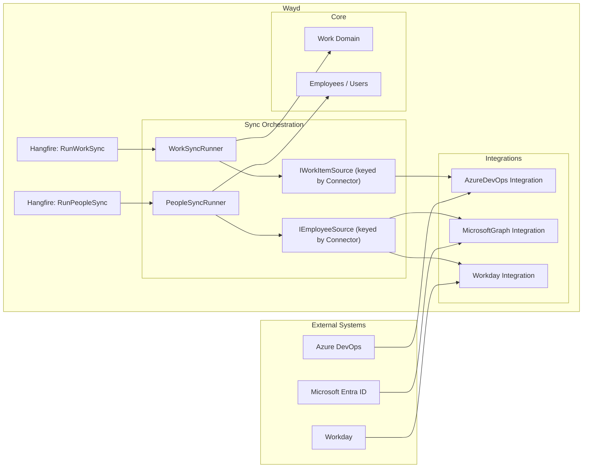

# Integrations

Wayd talks to external systems through two layers:

- **Connectors** are customer-configured at runtime via **Settings → System → Connections**. Each connection stores its own credentials (encrypted at rest) and runs against the target system on the customer's behalf.
- **Integration libraries** (`Wayd.Integrations.*`) are the low-level clients those connectors use. There are no always-on, configuration-driven integrations — every external system Wayd pulls data from is a connector you create in the UI.

## Connectors

Connectors are managed from **Settings → System → Connections**. The set of supported connector types is defined in code; adding one is described in the [Architecture guide](../../contributing/architecture.mdx#connector-framework).

| Connector | Category | Status | Purpose |
|---|---|---|---|
| [Azure DevOps](./azure-devops.mdx) | Work sync | GA | Syncs work items, processes, workspaces, and teams from Azure DevOps into Wayd. |
| [Entra](./entra.mdx) | People sync | GA | Syncs people (employees, contingent workers) from Microsoft Entra ID via Microsoft Graph into Wayd's `Employee` records. |
| [Workday](./workday.mdx) | People sync | GA | Syncs workers (employees, contingent workers) from a Workday tenant via the Staffing SOAP web service into Wayd's `Employee` records. |
| [Azure OpenAI](./azure-openai.mdx) | AI provider | Preview | Stores an Azure OpenAI endpoint, deployment, and API key. No data is synced, and no Wayd feature calls it yet. |

The `Connector` enum's value `2` belonged to an OpenAI connector that was removed before it shipped; the value is retired and must not be reused.

## Cross-cutting concerns

These behaviors apply to every connector — the per-connector pages link back here rather than repeat them.

### Capabilities drive orchestration

Each connector declares the `ConnectorCapability` values it supports (a multi-surface connector like GitHub can support several through one connection). The capability — not the specific connector type — determines which background runner picks the connection up:

- **`WorkItems`** ("Work Items") → `WorkSyncRunner` (background jobs **Work Full Sync** / **Work Differential Sync**, `BackgroundJobType.WorkFullSync` / `WorkDiffSync`).
- **`People`** → `PeopleSyncRunner` (background jobs **People Full Sync** / **People Differential Sync**, `BackgroundJobType.PeopleFullSync` / `PeopleDiffSync`). Connectors that don't support incremental fall back to Full transparently.
- **`AiProvider`** ("AI Provider") → not synced.

The global jobs run every active connection with the capability. No sync job is scheduled by default: an admin creates the recurring schedule under [Settings → System → Background Jobs](../../user-guide/settings/index.mdx#background-jobs), or runs a job on demand from there.

The detail page's **Sync History** section dispatches by capability too: its **Diff Sync** and **Full Sync** buttons enqueue a sync of that one connection (`POST /api/app-integrations/connections/{id}/run?syncType=…`), routed by the connector's capabilities. The connection must be active. A future BambooHR / Okta / Jira connector just declares the right `ConnectorCapability` values and gets the same plumbing. Each capability also carries a display category (the enum's `Display(GroupName)`: "Work Management", "People", "AI Provider") that groups the connector picker.

### Only one People Sync connection may be active at a time

Across all PeopleSync connectors (Entra, Workday, future BambooHR/etc.), at most one connection can be `IsActive=true` simultaneously. Activating a People Sync connection while another is already active is rejected by `ActivateConnectionCommand` ("Another PeopleSync connection (…) is already active. Deactivate it before activating this one."). This is a guardrail against the same person becoming two `Employee` rows.

Multiple People Sync connections may *exist* — admins can stage one, configure it fully, and only flip the active flag during the cutover. The single-active rule is checked only at activation time, and creation does not check it: a new connection starts active, so creating a second People Sync connection while one is active leaves two active. **Deactivate the new connection straight after creating it** when staging a cutover. While two are active, the global People sync jobs refuse to run (`PeopleSyncRunner` fails the run with "Multiple active PeopleSync connections found"); a per-connection sync from the detail page still runs.

Work Sync has no equivalent limit; multiple Azure DevOps / future Jira connections can be active concurrently. Each Azure DevOps organization can be linked by only one connection.

### Credentials are encrypted at rest

Every credential field on a connector (PAT, API key, client secret, ISU password, future OAuth refresh tokens) is marked `[Encrypted]` and round-tripped through AES-256-GCM via the `EncryptingJsonValueConverter` before being written to the `Connections` table. The master key is configured via `SecuritySettings:DataProtection:MasterKey` — see the [Configuration guide](../../contributing/configuration.mdx#data-protection-at-rest-secret-encryption) for setup and the [key rotation caveat](../../contributing/configuration.mdx#data-protection-at-rest-secret-encryption).

API responses never return a stored secret: `ConnectionSecret.Masked` replaces it with the fixed placeholder `********` (or an empty string when none is stored), so the response discloses neither the value nor its length. On edit, secret inputs start blank, and a blank or masked value submitted back means "keep the stored secret" (`ConnectionSecret.Resolve`) — a credential cannot be cleared, only replaced.

### Activation

New connections are **active by default**. Admins toggle this with **Activate** / **Deactivate** in the detail page's actions menu — `IsActive` is the single switch that controls whether a connection participates in sync runs; there is no separate "sync enabled" flag. A connection syncs only when it is active, its configuration is valid (`IsValidConfiguration`), and — for Azure DevOps — at least one project is set up and syncing (`ISyncableConnection.CanSync`). Activation transitions raise `ConnectionActivatedEvent` / `ConnectionDeactivatedEvent`, so the deliberate state change is recorded on its own rather than bundled into a config edit.

### Connection events

Every connector shares one family of events on `Connection`, all filed under the `Connection` aggregate: `ConnectionCreatedEvent`, `ConnectionDetailsUpdatedEvent` (name, description), `ConnectionConfigurationChangedEvent`, `ConnectionCredentialsChangedEvent`, `ConnectionActivatedEvent`, `ConnectionDeactivatedEvent` and `ConnectionDeletedEvent`, plus `ConnectionBaselinedEvent` for a connection that existed before creation was recorded. A connector describes its non-secret settings by overriding `DescribeSettings()`, as name/value pairs formatted invariantly in a fixed order; that list is what the created and configuration-changed events carry, before and after. It lists its credentials in `Credentials()`, which is compared in memory only — the credentials event names which ones were replaced and nothing else. A new connector implements both, and a setting it adds belongs in `DescribeSettings()` or it changes without a record.

State a connector syncs from its external system raises no event and is listed in `EventCoverageTests.UneventedMutators`: the Azure DevOps system id, workspaces, processes, teams and integration state, pending #956, and the Workday init-probe result (`WorkdayConnection.RecordInitResult`), which records a probe of the configuration rather than a change to it.

### Sync history

Every sync run — manual or scheduled, per-connection or global — produces a `SyncRun` row with status, timestamps, and a per-run `DetailsJson` blob. `SyncRuns` has no foreign key to `Connections`, so history survives deleting the connection. The **Sync History** section on each connection's detail page lists runs from the last 24 hours, 7 days or 30 days and renders the JSON with a connector-aware schema when a run is expanded (People sync shows employees fetched, upserted and excluded, the per-rule exclusion breakdown, and `errors[]`; Work sync shows per-workspace counts of work items, parent and dependency link changes, deletions, revisions read and history periods written).

**Individual records can be skipped without failing the run.** People sync reconciles data from a system we don't control, so a record that can't be applied — an ambiguous identity match, a value longer than its column allows — is skipped and reported rather than aborting the whole reconciliation. The rest of the payload still syncs. Check the run's `errors[]` for the per-record reason; each names the offending employee so it can be corrected at the source.

**People sync does not automatically retry.** Its failures are overwhelmingly deterministic — constraint violations, malformed source data, revoked credentials — so a retry would rebuild the identical change set and fail identically while consuming upstream API quota. A failed People sync goes straight to the Failed state, where it stays visible under **Settings → System → Background Jobs**; fix the cause and trigger the sync again.

Work sync *does* still retry (3 attempts, backing off 30s/60s/120s), because Azure DevOps REST produces genuinely transient failures where a later attempt succeeds. Transient *transport* faults are handled lower down for Azure DevOps and Workday, by an HTTP resilience pipeline (retries, a 90-second per-attempt timeout and a 5-minute total), and never reach the job layer. Azure DevOps uses the host's default pipeline (`ConfigureHttpClientDefaults`); Workday registers its own in `WorkdayConnectorModule`, which skips retrying SOAP faults that can never succeed. Entra calls go through a `GraphServiceClient` built per sync, outside `IHttpClientFactory`, so neither pipeline applies.

## Integration Architecture

Azure OpenAI is absent from the diagram because nothing calls it: `Wayd.Integrations.AzureOpenAI` contains no code yet. See [Azure OpenAI](./azure-openai.mdx).

## Adding a New Connector

For sync-shaped or AI-provider connectors that customers configure in Settings → System → Connections:

1. Add the connector type to `Connector` enum in `Wayd.Common.Domain.Enums.AppIntegrations`
2. Declare its `ConnectorCapability` values in `ConnectorExtensions.GetCapabilities()` — the capabilities determine which runners pick it up (work-sync, people-sync, AI-provider); a multi-surface connector declares several
3. Create a domain configuration class (e.g. `JiraConnectionConfiguration`) and connection aggregate (`JiraConnection : Connection<JiraConnectionConfiguration>`). Every sync connector also implements `ISyncableConnection` — both runners pick up only connections that implement it and report `CanSync` — and its `HasActiveIntegrationObjects` decides whether per-target integration state (workspaces, projects) must be active before it syncs. Implement `DescribeSettings()` and `Credentials()` (see [Connection events](#connection-events)). Mark credential fields with `[Encrypted]` for at-rest encryption — see [Architecture → Connector framework](../../contributing/architecture.mdx#connector-framework)
4. Create command/query handlers under `Wayd.AppIntegration.Application/Connections/Commands/{Connector}/` following the AzDO, Entra, Workday, and AOAI templates
5. Register the EF entity configuration in `Wayd.Infrastructure/src/Wayd.Infrastructure/Persistence/Configuration/AppIntegrationConfiguration.cs` (add a `HasValue<…>(Connector.X)` to the `Connections` discriminator) and add a migration (the migration is typically a no-op when the connector reuses the shared `Connections` TPH table — it just adds a discriminator value)
6. Add a `Wayd.Integrations.{SystemName}` project for the low-level client (only if the connector actually talks to a remote system — pure AI providers can use an existing SDK directly)
7. **For work-sync connectors:** implement `IWorkItemSource` (the port is in `Wayd.Integrations.Abstractions`; the implementation goes in `Wayd.AppIntegration.Application/Connections/Managers/{Connector}WorkItemSource.cs`) and an `ISyncableConnectionDescriptorBuilder`. The generic `WorkSyncRunner` picks up every registered source automatically. `GetWorkItemHistory` maps the system's revision history onto the connector-neutral contract; a connector without one returns `WorkItemHistoryBatch.Empty(watermark)` — see [Work item history](../../contributing/architecture.mdx#work-item-history).
8. **For people-sync connectors:** implement `IEmployeeSource` (an adapter in `Wayd.AppIntegration.Application/Connections/Managers/{Connector}EmployeeSource.cs` wrapping your low-level service) and an `ISyncableConnectionDescriptorBuilder`. Declare `SupportsIncremental` and `MatchBy` on the source. The generic `PeopleSyncRunner` picks it up automatically — no runner edits.
9. **Add the connector's module:** one `IConnectorModule` class in `Wayd.Infrastructure/src/Wayd.Infrastructure/ConnectorModules/` declaring the connector's capabilities and registering everything from steps 6–8 (keyed sources, descriptor builder, optional `IConnectionInitProbe`, HTTP clients). Modules are assembly-scanned at startup (`ConnectorModuleExtensions.DiscoverModules`); `ConnectorModulesTests` in `Wayd.Infrastructure.Tests` fails if the module is missing, its capabilities disagree with `GetCapabilities()`, or a declared sync capability lacks its keyed source.
10. On the frontend (`Wayd.Web/src/wayd.web.reactclient/src/`), register the connector in `app/settings/connections/_components/connector-registry.ts` (create/edit form), `app/settings/connections/[id]/_components/detail-registry.tsx` (detail page, including its `NAME_TO_TYPE` entry), and `types/connectors.ts` (enum + display names). See [Architecture → Connector framework](../../contributing/architecture.mdx#connector-framework) for the full checklist.
