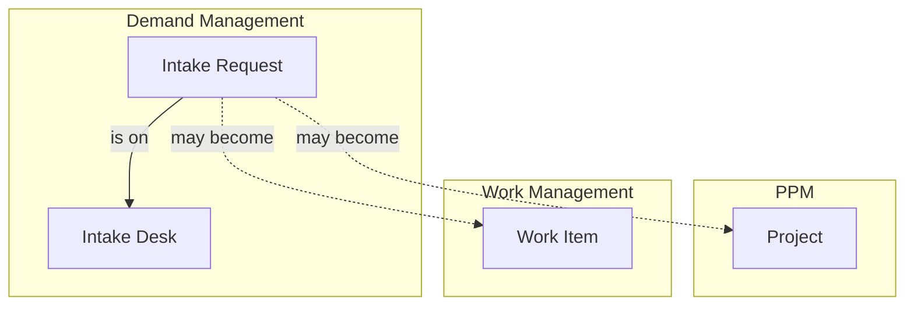

# Demand Management

Demand Management holds **what people are asking for before anyone has decided to do it**. A project in [PPM](../ppm/index.mdx) is a response already being shaped, and a work item in [Work Management](../work-management/index.mdx) is work a team has taken on. A request sits upstream of both: it is the ask itself, and it may never become either.

:::caution[In development]
Demand Management is being built and has no screens yet; its endpoints are under `/api/demand-management`. It is gated by the **Demand Management** feature flag, which is disabled when first deployed. Leave it off until this page describes a usable feature.
:::

## How Demand Management Connects Across Wayd

Recording what a request became, as a new project, scope added to an existing project or work items that deliver it, comes later.

## Key Concepts

### Intake requests

An **intake request**, shown as a **Request**, is one ask: a business need, customer feedback, an innovation idea, or a regulatory or contractual must-do. Every request has:

- **Number** — Sequential across the whole company, so moving a request to another desk never renumbers it
- **Title** and **description** — What is being asked for
- **Requester** — The employee the request is for, who may differ from the person who entered it
- **Desk** — Where it is reviewed. Every request is on exactly one desk
- **Channel** — Where it came from
- **Expected benefits** — What gets better, and for whom, if the request is delivered. Optional
- **Need-by date** — Optional, and always with its basis (see below)
- **Assigned reviewer** — Optional. Ownership, never an approver

:::warning[Titles are visible beyond the desk]
On most desks everyone who can view requests sees a request's title, even when its detail is kept to the desk. Write titles you would be comfortable with anyone in the company reading.
:::

### Intake desks

An **intake desk** is a review responsibility: what kind of ask it accepts, who reviews it, the process they follow and what they weigh requests on. A desk is not a team and not a department. One engineering team can serve two desks, and one person can review on several.

No desk is set up on install: an administrator creates the desks the company will staff, and a company that runs no review desk has none. A requester always chooses the desk their request goes to, by the desk's description of what kind of ask it takes rather than by the name of the group behind it.

### Channels

A **channel** records where a request came from: business stakeholder, customer feedback, support, sales and account management, innovation program, regulatory and compliance, security, or engineering. A channel is not the desk, so a request raised by support can be reviewed on any desk.

### Need-by date and its basis

A date on its own tells a reviewer nothing. Two requests can both say 31 December, one because a regulation sets the date and one because somebody picked it in a meeting. So a need-by date always carries its **basis**, the thing that makes it that date, and a reference saying what the date rests on.

| Basis | Family | What the reference records |
|---|---|---|
| Regulatory | Fixed for us | The regulation or standard, and the clause |
| Contractual | Fixed for us | The contract, and the clause |
| External event | Fixed for us | The event, such as an end of support or a customer go-live |
| Commitment | We chose it | A note on the commitment, plus who made it and on what date |
| Requester preference | We chose it | A free note |

A *fixed* date moves only if the world moves. A *chosen* date has an owner, so it can be renegotiated rather than silently missed. Clearing the date clears its basis and reference with it.

## Who Can See a Request

A request is read in three tiers:

- **Summary** — Number, title, desk, status, requester, channel, assigned reviewer, tags, and the need-by date with its basis and reference
- **Substance** — Description, expected benefits, who submitted it, its participants, where it came from, evidence, replies, score and ratings
- **Internal** — Internal notes and triage reasoning, for reviewers only

Each desk sets how much of that reaches the rest of the company:

| Desk visibility | Everyone who can view requests | The desk's reviewers and the request's own people |
|---|---|---|
| **Open** | Summary and substance | Everything their role allows |
| **Summary only** | Summary | Everything their role allows |
| **Private** | Nothing. The request appears in no list, search or count | Everything their role allows |

A request's own people are its **requester**, whoever **submitted** it on the requester's behalf, and any **participants** given access to it. Participants read the request and can join the discussion, but they cannot change it and never see internal notes.

A reviewer on any desk reads the substance of requests on every desk, because a reviewer cannot judge whether a request belongs on another desk without reading it.

A request's history shows only the changes to what you can read. If you can read only the summary, the history also leaves out who made each change, because whoever submitted a request on someone's behalf is part of its substance.

Request numbers run across the whole company, so a gap in the numbers you see can mean requests you cannot see: on a private desk, or deleted. The number never says what they are.

## Permissions

| Permission | What it allows |
|---|---|
| View | Read requests, within the desk visibility above |
| Create | Submit a request |
| Update | Edit requests |
| Delete | Delete a request that has not yet moved through review |
| Review | Review requests, on the desks where you are a reviewer |
| Administer | Manage desks and channels, and review on every desk |

Most people need only **View** and **Create**. A requester can edit their own request while it is still proposed, without Update.
