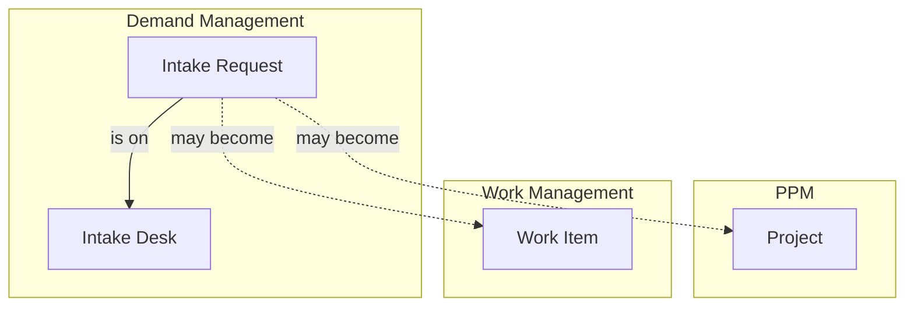

# Demand Management

Demand Management holds **what people are asking for before anyone has decided to do it**. A project in [PPM](../ppm/index.mdx) is a response already being shaped, and a work item in [Work Management](../work-management/index.mdx) is work a team has taken on. A request sits upstream of both: it is the ask itself, and it may never become either.

:::info[Feature flag]
Demand Management is gated by the **Demand Management** feature flag, which is disabled when first deployed. Until it is on, the menu section, its pages and its endpoints are absent.
:::

People can submit, browse and follow requests today, and agents can move them to the desk that should own them. Reviewing them, with statuses and a review workflow, comes later.

## How Demand Management Connects Across Wayd

Recording what a request became, as a new project, scope added to an existing project or work items that deliver it, comes later.

## Key Concepts

### Intake requests

An **intake request**, shown as a **Request**, is one ask: a business need, customer feedback, an innovation idea, or a regulatory or contractual must-do. Every request has:

- **Number** — Sequential across the whole company, so moving a request to another desk never renumbers it
- **Title** and **description** — What is being asked for
- **Requester** — The employee the request is for, who may differ from the person who entered it
- **Desk** — Where it is reviewed. Every request is on exactly one desk
- **Channel** — Where it came from
- **Expected benefits** — What gets better, and for whom, if the request is delivered. Optional
- **Need-by date** — Optional, and always with its basis (see below)
- **Assignee** — Optional. The member of the desk who owns the request: ownership, never an approver

:::warning[Titles are visible beyond the desk]
On most desks everyone who can view requests sees a request's title, even when its detail is kept to the desk. Write titles you would be comfortable with anyone in the company reading.
:::

### Intake desks

An **intake desk** is a review responsibility: what kind of ask it accepts, who works it, the process they follow and what they weigh requests on. A desk is not a team and not a department. One engineering team can serve two desks, and one person can work on several.

The people who work a desk are its **members**, each in one of two roles:

- **Agent** — Acts on the desk's requests: reads them in full, edits them, assigns them, manages their participants and, as later features arrive, moves them through review
- **Desk Admin** — Everything an agent does, plus runs the desk itself and is the only one who can delete its requests

Being named on a desk is all it takes: no permission is needed beside it, and working one desk gives you nothing on another. Someone whose employee record becomes inactive stops being a member of every desk.

No desk is set up on install: the Demand Management Admin creates the desks the company will staff, with their first members, and a company that runs no review desk has none. A requester always chooses the desk their request goes to, by the desk's description of what kind of ask it takes rather than by the name of the group behind it.

### Channels

A **channel** records where a request came from: business stakeholder, customer feedback, support, sales and account management, innovation program, regulatory and compliance, security, or engineering. A channel is not the desk, so a request raised by support can be reviewed on any desk.

### Need-by date and its basis

A date on its own tells an agent nothing. Two requests can both say 31 December, one because a regulation sets the date and one because somebody picked it in a meeting. So a need-by date always carries its **basis**, the thing that makes it that date, and a reference saying what the date rests on.

| Basis | Family | What the reference records |
|---|---|---|
| Regulatory | Fixed for us | The regulation or standard, and the clause |
| Contractual | Fixed for us | The contract, and the clause |
| External event | Fixed for us | The event, such as an end of support or a customer go-live |
| Commitment | We chose it | A note on the commitment, plus who made it and on what date |
| Requester preference | We chose it | A free note |

A *fixed* date moves only if the world moves. A *chosen* date has an owner, so it can be renegotiated rather than silently missed. Clearing the date clears its basis and reference with it.

## Using Demand Management

**Demand Management** sits next to PPM in the main menu, and holds:

- **Submit a Request** — Raise a new request. Shown to anyone whose account is linked to an employee record
- **My Requests** — The requests you asked for, and those you submitted on someone else's behalf
- **Requests** — Every request you can see: those on the desks you work, your own, and, if you can view requests, everyone else's that their desk lets you see
- **Desks** — Every desk, who works it, and what is waiting on the desks you work. Each desk is run from its own page

### Submitting a request

The first question is where the request goes, and it is asked only when more than one desk is taking requests. Each desk is offered by its own description of what kind of ask it takes, with its name and its members beneath. When only one desk is open, the form shows which desk the request goes to and asks nothing about it. When none is open, the page says so and nothing can be submitted.

The rest of the form is the same for every desk:

- **Who is this request for?** — You, unless you are submitting it on someone else's behalf. Either way, both of you can follow it
- **Title** — The form reminds you that everyone who can view requests sees the title, even on a desk that keeps the detail to itself
- **Description** and **Expected benefits** — The ask in full, and what gets better if it is delivered
- **Where did this come from?** — The [channel](#channels)
- **Need by** — Optional. Once you give a date, the form asks what makes it that date, with the bases grouped as *Fixed for us* and *We chose it*. Choosing a basis asks only what that basis needs: what the date rests on, and for a commitment, who made it and when. A preview shows the date as the desk will see it. Clearing the date clears the rest

Submitting opens the new request.

:::note
Submitting needs your account to be linked to an employee record, because every request names employees as its requester and submitter. If yours is not linked, the page says so; ask an administrator to link it.
:::

### Finding requests

**Requests** lists every request you can see, across desks, with its number, title, desk, requester, channel and need-by date and basis. Search and filter it to check whether someone has already asked for the same thing before you submit. Requests on a private desk you are not part of never appear, so the list and its count cover only what you can see.

**My Requests** shows the same columns, limited to requests you asked for or submitted.

### The request page

Opening a request shows its number and title. The panel opened from the header lists its desk, channel, requester and assignee and, where you can read them, who submitted it and where it came from.

- **Details** — The description, the expected benefits and the need-by date. On a desk that keeps its detail to itself, people outside it see a message saying the detail is limited to that desk, rather than empty fields
- **People** — The requester, the submitter when it is someone else, and the request's participants. Participants can read the request and reply to it, but cannot change it, and being one does not assign them any work. Shown only to people who can read the request's detail
- **Activity** — The request's history, limited to what you can read

**Edit** appears in the actions menu when you can change the request: the requester while it is proposed, or an agent on its desk. The desk cannot be changed here.

**Add Participant** appears when you can give someone access: an agent on the request's desk, or its requester or submitter unless the desk is private and does not allow it. Only an agent on the desk can remove a participant, and removing one takes away their access from then on; what they have already read stays read.

### Moving a request to another desk

A requester picks the desk they think fits, and an agent confirms it or moves the request to the desk that should own the decision. **Move to Another Desk** in the request's actions menu is offered to an agent on the desk the request is on now. The new desk does not have to be one you work: it can be any desk open to new requests, including one requesters cannot choose. Nothing moves a request automatically — editing its channel, for example, never changes its desk.

When you choose a desk, the form says what the move changes:

- **A less private desk.** Moving from Private to Summary Only, or from either to Open, publishes words the requester wrote expecting them to stay with the first desk. The form names what becomes visible to everyone who can view requests, and the move goes ahead only once you confirm it. A moved request is read by its new desk's rules from start to finish, so its history comes with it:
  - Reaching **Summary Only** from Private exposes the title, requester, channel, need-by date and assignee — with earlier titles, past assignees and every desk the request has been on, including the private one.
  - Reaching **Open** from Summary Only exposes the description, expected benefits and participants, who submitted it and where it came from, earlier versions of the description, and who made each change in its history.
  - Reaching **Open** from Private exposes both.
- **A desk the assignee does not work.** The request's assignee is always a member of its desk, so moving it to a desk they are not on unassigns it.

A move to an equally or more private desk needs no confirmation. Every move is recorded in the request's activity with both desks, and the requester always sees which desk has their request. If you move a request to a private desk you do not work, you will no longer be able to open it.

### Desks

**Desks** lists every desk with its visibility, how many members it has and whether it is open to new requests. On the desks you work, it also shows what is waiting there: how many requests, and how long ago the oldest was submitted. Nobody else sees those numbers — a private desk's requests are never counted for anyone outside it.

:::warning[A desk with no members]
A desk nobody works is flagged **No members** wherever desks are listed, and its page says so above its requests. Requests sent there have nobody looking at them, so name its agents or close it.
:::

#### Setting up a desk

The Demand Management Admin creates a desk from **Create Desk** on the **Desks** page, giving it:

- A **name**, which is what its members and administrators call it
- **What to bring here**, the description requesters choose by. Describe the kind of ask it takes rather than the group behind it
- Its **visibility** — see [Who Can See a Request](#who-can-see-a-request)
- Whether **requesters can choose it**, and whether it is **open to new requests**
- On a private desk, whether **requesters may add participants**
- Its **Desk Admins** and **Agents**. Someone holds one role on a desk, and a desk with no members has nobody to look at what arrives

#### Running a desk

A desk is run from its own page, opened from **Desks** or from the desk named on any request. The page has three sections:

- **Requests** — The requests on the desk that you can see
- **Members** — Who works the desk, and in which role
- **Settings** — Its name, what to bring here, who can see its requests (with what that exposes, in plain words), whether it is open, and what requesters may do on it

What you can change depends on your role:

| Change | Desk Admin | Demand Management Admin |
|---|---|---|
| Name and what to bring here | Yes | Yes |
| Open to new requests, requesters can choose it, requesters may add participants | Yes | Yes |
| Name or remove **Agents** | Yes | Yes |
| Name or remove **Desk Admins** | No | Yes |
| **Visibility** | No | Yes |
| **Delete** the desk | No | Yes, while no request is on it |

Removing someone from a desk unassigns them from the requests they own there.

If someone else changes the desk while you have its settings or members open, your save is refused with a message to reload, rather than quietly undoing their change — and saving again from the same form is refused too. Close the form, reopen it to see their change, and make yours again.

A desk with requests on it cannot be deleted, because every request is always on exactly one desk. To retire one, **close** it to new requests and turn off **Requesters can choose it**; the requests already there stay put.

## Who Can See a Request

A request is read in three tiers:

- **Summary** — Number, title, desk, status, requester, channel, assignee, tags, and the need-by date with its basis and reference
- **Substance** — Description, expected benefits, who submitted it, its participants, where it came from, evidence, replies, score and ratings
- **Internal** — Internal notes and triage reasoning, for the desk's members only

Each desk sets how much of that reaches the rest of the company:

| Desk visibility | Everyone who can view requests | The desk's members and the request's own people |
|---|---|---|
| **Open** | Summary and substance | Everything their role allows |
| **Summary only** | Summary | Everything their role allows |
| **Private** | Nothing. The request appears in no list, search or count | Everything their role allows |

A request's own people are its **requester**, whoever **submitted** it on the requester's behalf, and any **participants** given access to it. Participants read the request and can join the discussion, but they cannot change it and never see internal notes.

Working one desk gives you nothing on another: an agent reads other desks' requests only as far as those desks let everyone. Someone who cannot view requests sees only their own requests and those on the desks they work.

A request's history shows only the changes to what you can read. If you can read only the summary, the history also leaves out who made each change, because whoever submitted a request on someone's behalf is part of its substance.

Request numbers run across the whole company, so a gap in the numbers you see can mean requests you cannot see: on a private desk, or deleted. The number never says what they are.

## Permissions

Most of what happens to a request is decided by [desk roles](#intake-desks), not permissions, so Demand Management has only two:

| Permission | What it allows |
|---|---|
| View | Browse other people's requests, within the desk visibility above |
| Administer | The Demand Management Admin: create and delete desks, change a desk's visibility, name Desk Admins, manage channels, and act as Desk Admin on every desk |

Submitting a request, and reading, editing (while it is proposed) and replying to your own, need no permission. See [Demand Management: desk roles](../settings/permissions.mdx#demand-management-desk-roles).
