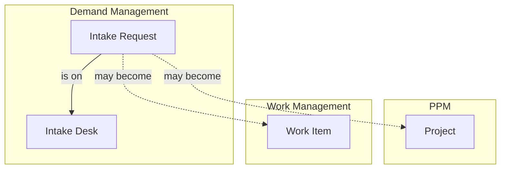

# Demand Management

Demand Management holds **what people are asking for before anyone has decided to do it**. A project in [PPM](../ppm/index.mdx) is a response already being shaped, and a work item in [Work Management](../work-management/index.mdx) is work a team has taken on. A request sits upstream of both: it is the ask itself, and it may never become either.

:::info[Feature flag]
Demand Management is gated by the **Demand Management** feature flag, which is disabled when first deployed. Until it is on, the menu section, its pages and its endpoints are absent.
:::

People submit, browse and follow requests. Each desk reviews its requests through a status workflow, agents move them through it and to the desk that should own them, and requesters see where their request stands and why.

## How Demand Management Connects Across Wayd

Recording what a request became, as a new project, scope added to an existing project or work items that deliver it, comes later.

## Key Concepts

### Intake requests

An **intake request**, shown as a **Request**, is one ask: a business need, customer feedback, an innovation idea, or a regulatory or contractual must-do. Every request has:

- **Number** — Sequential across the whole company, so moving a request to another desk never renumbers it
- **Title** and **description** — What is being asked for
- **Requester** — The employee the request is for, who may differ from the person who entered it
- **Desk** — Where it is reviewed. Every request is on exactly one desk
- **Status** — Where it stands in its desk's review (see [Statuses and the review workflow](#statuses-and-the-review-workflow))
- **Channel** — Where it came from
- **Expected benefits** — What gets better, and for whom, if the request is delivered. Optional
- **Need-by date** — Optional, and always with its basis (see below)
- **Assignee** — Optional. The member of the desk who owns the request: ownership, never an approver

:::warning[Titles are visible beyond the desk]
On most desks everyone who can view requests sees a request's title, even when its detail is kept to the desk. Write titles you would be comfortable with anyone in the company reading.
:::

### Intake desks

An **intake desk** is a review responsibility: what kind of ask it accepts, who works it, the process they follow and what they weigh requests on. A desk is not a team and not a department. One engineering team can serve two desks, and one person can work on several.

The people who work a desk are its **members**, each in one of two roles:

- **Agent** — Acts on the desk's requests: reads them in full, edits them, moves them through review, assigns them, moves them to other desks and manages their participants
- **Desk Admin** — Everything an agent does, plus runs the desk itself and is the only one who can delete its requests

Being named on a desk is all it takes: no permission is needed beside it, and working one desk gives you nothing on another. Someone whose employee record becomes inactive stops being a member of every desk.

No desk is set up on install: the Demand Management Admin creates the desks the company will staff, with their first members, and a company that runs no review desk has none. A requester always chooses the desk their request goes to, by the desk's description of what kind of ask it takes rather than by the name of the group behind it.

### Statuses and the review workflow

Each desk reviews its requests through a **status workflow**: the stages a request passes from submission to a decision. Every request starts in **Submitted**, and agents move it on from there. Wayd ships a default that every desk follows until it is given its own:

| Status | Category | Means |
|---|---|---|
| Submitted | Proposed | Received, and waiting for the desk to look at it |
| In Review | Proposed | Being reviewed by the desk |
| Waiting on Requester | Proposed | Waiting for the requester to answer a question |
| Deferred | Proposed | Worth doing, but not now |
| Accepted | Active | Accepted for delivery |
| Fulfilled | Done | Delivered |
| Declined | Removed | Not going ahead |
| Duplicate | Removed | Already asked for in another request |
| Withdrawn | Removed | Withdrawn by the requester |

A company shapes its own review — a single triage, staged assessment, a review board — by building workflows in [Settings → Status Workflows](../settings/status-workflows.mdx) and choosing one for each desk. What Wayd does with a status depends on its **category** and its well-known meaning, never its name, so the rules below hold whatever a desk calls its stages:

- **Proposed** and **Active** requests are **open**: they count as waiting on their desk and can be moved to another desk.
- Who can **edit** follows the category too. While a request is Proposed, its requester and the desk's agents can edit it; once it is Active, only the desk's agents; once it is **Done** or **Removed**, nobody, until an agent moves it back to an open status.
- **Declined**, **Deferred**, **Duplicate** and any **Done** status need a reason, which the requester reads on the request.
- A **Duplicate** names the request it gives way to.
- Only the requester reaches **Withdrawn**, by withdrawing their request.

### Channels

A **channel** records where a request came from: business stakeholder, customer feedback, support, sales and account management, innovation program, regulatory and compliance, security, or engineering. A channel is not the desk, so a request raised by support can be reviewed on any desk.

### Need-by date and its basis

A date on its own tells an agent nothing. Two requests can both say 31 December, one because a regulation sets the date and one because somebody picked it in a meeting. So a need-by date always carries its **basis**, the thing that makes it that date, and a reference saying what the date rests on.

| Basis | Family | What the reference records |
|---|---|---|
| Regulatory | Fixed for us | The regulation or standard, and the clause |
| Contractual | Fixed for us | The contract, and the clause |
| External event | Fixed for us | The event, such as an end of support or a customer go-live |
| Commitment | We chose it | A note on the commitment, plus who made it and on what date |
| Requester preference | We chose it | A free note |

A *fixed* date moves only if the world moves. A *chosen* date has an owner, so it can be renegotiated rather than silently missed. Clearing the date clears its basis and reference with it.

## Using Demand Management

**Demand Management** sits next to PPM in the main menu, and holds:

- **Submit a Request** — Raise a new request. Shown to anyone whose account is linked to an employee record
- **My Requests** — The requests you asked for, and those you submitted on someone else's behalf
- **Requests** — Every request you can see: those on the desks you work, your own, and, if you can view requests, everyone else's that their desk lets you see
- **Desks** — Every desk, who works it, and what is waiting on the desks you work. Each desk is run from its own page

### Submitting a request

The first question is where the request goes, and it is asked only when more than one desk is taking requests: **What kind of request is this?** Each desk is a card worded as the kind of ask it takes, saying which desk reviews it and who works there. Picking one only decides who looks at it first; a reviewer can move it if it belongs somewhere else. When only one desk is open, the form shows which desk the request goes to and asks nothing about it. When none is open, the page says so and nothing can be submitted.

The rest of the form is the same for every desk, in three steps. From the first step, **Back** returns to the desk question, and the last step shows which desk the request goes to:

1. **The ask** — What you are asking for.
   - **Title** — The form reminds you that everyone who can view requests sees the title, even on a desk that keeps the detail to itself
   - **Describe it in your own words** — The ask in full
   - **Where did this come from?** — The [channel](#channels)
   - **Requested by** — You, unless you are submitting it on someone else's behalf. Either way, both of you can follow it
2. **Why and when** — What reviewers weigh it on when capacity is short.
   - **What is it worth?** — Optional. What gets better, and for whom, if it is delivered
   - **Does it have to land by a date?** — Optional; **No particular date** clears it. Once you give a date, the form asks **What makes it that date?**, with the choices in two groups: *Fixed for us*, where something outside the company sets it (a regulation or standard, a contract, an event outside us), and *We chose it*, where a person here set it (a promise to someone, or when the requester would like it). Each choice asks the one follow-up it needs, such as which contract and clause, and for a promise, who made it and when. **Reviewers will see** previews the date as the desk will read it, and how it will be treated: a fixed date as immovable, a promise as movable by talking to whoever made it
3. **Check and submit** — The request as it will be sent. **Submit request** sends it and opens it.

**Continue** checks the step you are leaving; **Back** and the step names take you back without losing anything. Beside the form, **What happens next** lists the stages of the chosen desk's review workflow in order, each with the description its author wrote. Waiting on the requester and deferring are detours rather than steps, so they are mentioned beneath the path, along with the request being declined with a reason.

:::note
Submitting needs your account to be linked to an employee record, because every request names employees as its requester and submitter. If yours is not linked, the page says so; ask an administrator to link it.
:::

### Finding requests

**Requests** is where reviewers work from, and where anyone checks whether an ask already exists before raising it. It opens on the requests still open — those in a proposed or active status, whatever their desk calls it; **Everything** adds the closed ones. Requests on a private desk you are not part of never appear, so every list, count and total on the page covers only what you can see.

The same filters apply to both layouts, so switching between them never changes what is in scope:

- **View** — A ready-made set of filters: **My desks** (open requests on the desks you work, offered only if you work one), **All open requests**, **Needs triage** (open requests nobody is assigned to), **Assigned to me** and **Fixed dates, open** (open requests whose date something outside the company sets). While the page shows open requests, each view shows how many it holds. Changing any filter afterwards leaves the view
- **Desk**, **Status** and **Channel** — Pick one or more. **Desks I work** stands for your own desks, so a shared link with it shows each reader their own; status names are matched across desks, so *In Review* means every desk's *In Review*
- **Assignee** — Anyone, **Assigned to me**, or **Not assigned**. **Assigned to me**, as a filter and as a view, is offered only when your account is linked to an employee record
- **Need by** — Any date, **Fixed for us**, **We chose it**, or **No date given**

The filters and the layout are kept in the page's address, so a view can be bookmarked or sent to someone. If you work a desk, the page opens on **My desks**; otherwise it opens on every open request. Switch between **List** and **Board** with the icons at the right of the toolbar. **Reset filters**, the clear icon at the end of the filters, puts them all back to every open request. On a phone the filters fold behind a **Filters** button.

**List** shows each request's number, title, status, how long it has been in that status, its need-by date with what makes it that date, its age, assignee, desk, requester and channel. Need-by dates are coloured by their basis — red for a date fixed for us, amber for a promise — and time in status and age turn amber after a week and red after three. Sorting **Need By** ascending puts the earliest date first, a fixed date before a chosen one on the same day, and requests with no date last; descending reverses that. Hovering a status shows its category. The desk links to its page, and the requester and assignee link to theirs if you can view employees; otherwise they are plain names.

**Board** shows the same requests as cards in columns, one per stage of the desk's review workflow, in the workflow's order, so a stage with nothing in it still shows. A heading names the desk the board is for. Desks that follow different workflows have no single board, so with more than one such desk in scope the page asks you to pick one. Each card shows the number, title, need-by date, requester and time in its stage, with a red edge when the date is fixed for us; opening it opens the request. Moving a request between stages is done from the request, since some moves ask for a reason. On a phone the board shows one stage at a time, chosen from a list with each stage's count.

**My Requests** shows the list's columns, limited to requests you asked for or submitted.

### The request page

Opening a request shows its number and title, with its status beside the title; clicking the status opens its history. The trail beneath the title leads back to **Requests** through the desk the request is on, and beneath that a line says who raised it, when, and where it came from. The panel opened from the header lists its desk, channel, requester and assignee and, where you can read them, who submitted it and where it came from.

- **Details** — The reason for its current status, when it has one, then the description, the expected benefits and the need-by date, which says what makes it that date and whether it can move. On a desk that keeps its detail to itself, people outside it see a message saying the detail is limited to that desk, rather than empty fields
- **People** — The requester, the submitter when it is someone else, and the request's participants. Participants can read the request and reply to it, but cannot change it, and being one does not assign them any work. Shown only to people who can read the request's detail
- **Status History** — Every status the request has been in, as a timeline or drawn on its desk's workflow. Without the request's detail you see each change without its reason or who made it
- **Activity** — The request's history, limited to what you can read

**Edit** appears in the actions menu when you can change the request: the requester while it is proposed, or an agent on its desk while it is open. The desk cannot be changed here.

**Change Assignee** appears for an agent on the request's desk. The assignee owns the next move on the request; assigning someone does not make them its approver. Anyone who works the desk can be assigned, **Assign to me** fills in yourself when you work it, and clearing the field unassigns the request.

### Changing a request's status

**Move to**, beside the actions menu, is offered to an agent on its desk. It lists the statuses of the desk's workflow, in the order the desk laid them out, apart from the one the request holds and Withdrawn. A status that needs nothing more moves the request at once; one that does opens a form asking for it:

- A **reason** — required for declining, deferring, marking a duplicate and finishing a request, and optional otherwise. The requester reads it on the request, so write it for them
- For **Duplicate**, the request this one gives way to — any other request you can see. One that is itself a duplicate is refused, so a duplicate always leads straight to the request that survives

A closed request can be moved back to an open status the same way, which also lets it be edited again.

#### Duplicates

Once a request is marked a duplicate, anyone who opens it and can see the surviving request is taken there, and that request says which duplicate brought them. The desk's agents stay on the duplicate, with a link to the surviving request, so they can see why and reopen it.

Someone who cannot see the surviving request stays on the duplicate. They see it marked Duplicate, with your reason, and nothing about the other request. Whether the requester can see it depends on that request's desk, as [Who Can See a Request](#who-can-see-a-request) describes: a request on a private desk they are not part of is hidden from them, and so is one on any other desk if they cannot view requests. A request that others are marked duplicates of cannot be deleted.

### Withdrawing a request

**Withdraw Request** is offered to a request's requester while it is open. Withdrawing tells the desk you no longer need it; you can leave a note for the desk saying why. The request stays on record, marked Withdrawn, and an agent can reopen it. Whoever submitted a request on someone's behalf cannot withdraw it — it is the requester's ask.

**Add Participant** appears when you can give someone access: an agent on the request's desk, or its requester or submitter unless the desk is private and does not allow it. Only an agent on the desk can remove a participant, and removing one takes away their access from then on; what they have already read stays read.

Deleting a request is a Desk Admin's last resort, and the request page does not offer it yet; it is available through the API. It is allowed only while the request has never left the status it was submitted in and no other request is marked a duplicate of it. Once a request has moved through review it is part of the record of a decision: decline it instead, and the requester can withdraw it.

### Moving a request to another desk

A requester picks the desk they think fits, and an agent confirms it or moves the request to the desk that should own the decision. **Move to Another Desk** in the request's actions menu is offered to an agent on the desk the request is on now. The new desk does not have to be one you work: it can be any desk open to new requests, including one requesters cannot choose. Nothing moves a request automatically — editing its channel, for example, never changes its desk.

When you choose a desk, the form asks what the request **arrives as** there: one of that desk's open statuses that needs no reason and is neither Withdrawn nor Duplicate, since what to decide about it is the new desk's call. It starts at the status the request holds when both desks follow the same workflow, or the one with the same meaning or name when they do not; when nothing matches, you choose. A move onto a desk with a different workflow is recorded in the request's status history as a switch onto that workflow.

The form also says what the move changes:

- **A less private desk.** Moving from Private to Summary Only, or from either to Open, publishes words the requester wrote expecting them to stay with the first desk. The form names what becomes visible to everyone who can view requests, and the move goes ahead only once you confirm it. A moved request is read by its new desk's rules from start to finish, so its history comes with it:
  - Reaching **Summary Only** from Private exposes the title, requester, channel, need-by date and assignee — with earlier titles, past assignees and every desk the request has been on, including the private one.
  - Reaching **Open** from Summary Only exposes the description, expected benefits and participants, who submitted it and where it came from, earlier versions of the description, and who made each change in its history.
  - Reaching **Open** from Private exposes both.
- **A desk the assignee does not work.** The request's assignee is always a member of its desk, so moving it to a desk they are not on unassigns it.

A move to an equally or more private desk needs no confirmation. Every move is recorded in the request's activity with both desks, and the requester always sees which desk has their request. If you move a request to a private desk you do not work, you will no longer be able to open it.

### Desks

**Desks** lists every desk with its key, linking to the desk's page, its visibility, how many members it has and whether it is open to new requests. On the desks you work, it also shows what is waiting there: how many open requests, and how long ago the oldest of them was submitted. Nobody else sees those numbers — a private desk's requests are never counted for anyone outside it.

:::warning[A desk with no members]
A desk nobody works is flagged **No members** wherever desks are listed, and its page says so above its requests. Requests sent there have nobody looking at them, so name its agents or close it.
:::

#### Setting up a desk

The Demand Management Admin creates a desk from **Create Desk** on the **Desks** page, giving it:

- A **name**, which is what its members and administrators call it
- **What to bring here**, the description requesters choose by. Describe the kind of ask it takes rather than the group behind it
- Its **visibility** — see [Who Can See a Request](#who-can-see-a-request)
- Whether **requesters can choose it**, and whether it is **open to new requests**
- On a private desk, whether **requesters may add participants**
- Its **Desk Admins** and **Agents**. Someone holds one role on a desk, and a desk with no members has nobody to look at what arrives

#### Running a desk

A desk is run from its own page, opened from **Desks** or from the desk named on any request. The page has three sections:

- **Requests** — The requests on the desk that you can see
- **Members** — Who works the desk, and in which role
- **Settings** — Its name, what to bring here, its review workflow, who can see its requests (with what that exposes, in plain words), whether it is open, and what requesters may do on it

What you can change depends on your role:

| Change | Desk Admin | Demand Management Admin |
|---|---|---|
| Name and what to bring here | Yes | Yes |
| Open to new requests, requesters can choose it, requesters may add participants | Yes | Yes |
| Name or remove **Agents** | Yes | Yes |
| **Review workflow** | Yes, while no request is on it | Yes, while no request is on it |
| Name or remove **Desk Admins** | No | Yes |
| **Visibility** | No | Yes |
| **Delete** the desk | No | Yes, while no request is on it |

Removing someone from a desk unassigns them from the requests they own there.

#### Choosing a desk's review workflow

**Review Workflow** in the desk's Settings names the workflow its requests follow, marked **Organization default** while the desk follows the default. **Change Workflow** lets a Desk Admin or the Demand Management Admin choose any published intake workflow. The workflows themselves are built and changed in [Settings → Status Workflows](../settings/status-workflows.mdx), which needs the status workflow permissions.

Choosing a workflow other than the default gives the desk its own, so a later change to the default no longer reaches it. Choosing the default's workflow again puts the desk back on the default, and changes to it reach the desk once more. A desk's workflow can be chosen only while no request is on it, closed ones included — moving a desk's requests onto another workflow is not supported yet. Choose it when you set the desk up, before requesters can pick it.

If someone else changes the desk while you have its settings or members open, your save is refused with a message to reload, rather than quietly undoing their change — and saving again from the same form is refused too. Close the form, reopen it to see their change, and make yours again.

A desk with requests on it cannot be deleted, because every request is always on exactly one desk. To retire one, **close** it to new requests and turn off **Requesters can choose it**; the requests already there stay put.

## Who Can See a Request

A request is read in three tiers:

- **Summary** — Number, title, desk, status, requester, channel, assignee, tags, and the need-by date with its basis and reference
- **Substance** — Description, expected benefits, who submitted it, its participants, where it came from, the reason for its status, evidence, replies, score and ratings
- **Internal** — Internal notes and triage reasoning, for the desk's members only

Each desk sets how much of that reaches the rest of the company:

| Desk visibility | Everyone who can view requests | The desk's members and the request's own people |
|---|---|---|
| **Open** | Summary and substance | Everything their role allows |
| **Summary only** | Summary | Everything their role allows |
| **Private** | Nothing. The request appears in no list, search or count | Everything their role allows |

A request's own people are its **requester**, whoever **submitted** it on the requester's behalf, and any **participants** given access to it. Participants read the request and can join the discussion, but they cannot change it and never see internal notes.

Working one desk gives you nothing on another: an agent reads other desks' requests only as far as those desks let everyone. Someone who cannot view requests sees only their own requests and those on the desks they work.

A request's history shows only the changes to what you can read. If you can read only the summary, the history and the status history also leave out who made each change, because whoever submitted a request on someone's behalf is part of its substance, and the status history leaves out each change's reason.

A duplicate shows the request it gives way to only to readers who can see that request. Anyone else sees it marked Duplicate and nothing about the other request.

Request numbers run across the whole company, so a gap in the numbers you see can mean requests you cannot see: on a private desk, or deleted. The number never says what they are.

## Permissions

Most of what happens to a request is decided by [desk roles](#intake-desks), not permissions, so Demand Management has only two:

| Permission | What it allows |
|---|---|
| View | Browse other people's requests, within the desk visibility above |
| Administer | The Demand Management Admin: create and delete desks, change a desk's visibility, name Desk Admins, manage channels, and act as Desk Admin on every desk |

Submitting a request, and reading, editing (while it is proposed), withdrawing and replying to your own, need no permission. See [Demand Management: desk roles](../settings/permissions.mdx#demand-management-desk-roles).
