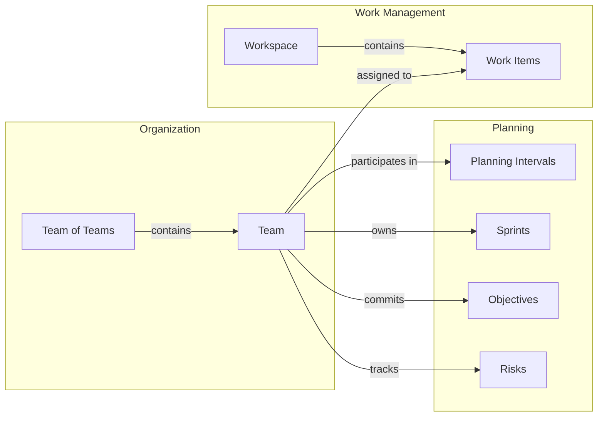
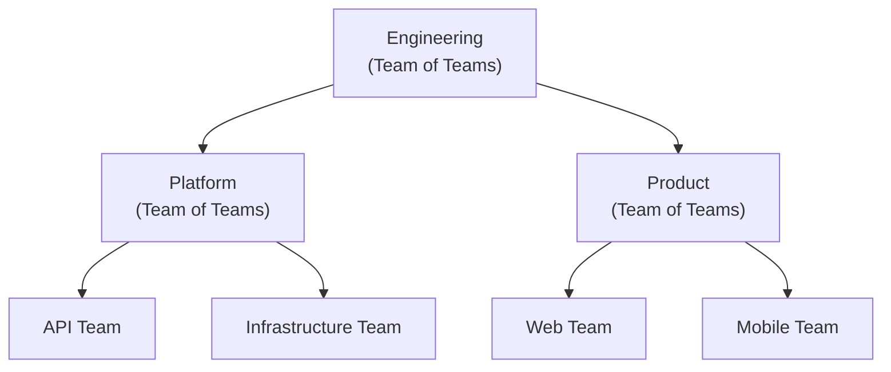

# Organizations

The Organization domain defines how people are grouped into teams and how those teams relate to each other through a hierarchical structure of teams and teams of teams. Teams are the central organizing concept in Wayd — they own work, participate in planning, manage risks, and track delivery metrics.

## How Teams Connect Across Wayd

Teams are not isolated to the Organization domain. They are a cross-cutting concept referenced throughout the system:

- **[Planning Intervals](../planning/planning-intervals.mdx)** — Teams participate in PIs, committing to [objectives](../planning/planning-intervals.mdx#objectives) and mapping [sprints](../work-management/sprints.mdx) to [iterations](../planning/planning-intervals.mdx#iterations-within-a-pi).
- **[Sprints](../work-management/sprints.mdx)** — Each team owns sprints that define their time-boxed delivery cadence. Sprint performance is measured with [sprint metrics](../work-management/sprints.mdx#sprint-metrics).
- **[Objectives](../planning/planning-intervals.mdx#objectives)** — Teams commit to objectives within each PI, tracked for [predictability](../planning/planning-intervals.mdx#predictability).
- **[Risks](../planning/risks.mdx)** — Teams identify and manage risks that could impact delivery using the [ROAM model](../planning/risks.mdx).
- **[Work Items](../work-management/work-items.mdx#work-items)** — Work items in [workspaces](../work-management/work-items.mdx#workspaces) are assigned to teams and team members.

## Key Concepts

### Teams

A **Team** is the fundamental organizational unit in Wayd. It represents a collection of people that work together to execute against a prioritized set of goals.

Every team has:
- **Name** — A descriptive name (up to 128 characters)
- **Code** — A unique 2-10 character uppercase alphanumeric identifier (e.g., `PLATFORM`, `MOBILE`)
- **Description** — Optional, formatted in the [document editor](../formatting-text.mdx); up to 1024 characters of the markdown it stores
- **Active Date** — When the team was formed
- **Inactive Date** — When the team was dissolved (if applicable)
- **Operating Model** — How the team works (methodology and sizing)

Teams can be members of a Team of Teams, establishing the organizational hierarchy.

### Teams of Teams

A **Team of Teams** is a higher-level organizational unit that groups multiple teams (or other teams of teams) together. This enables organizations to model their full hierarchy — from individual delivery teams up through departments and business units.

A Team of Teams shares the same core properties as a Team (name, code, dates) but has additional capabilities:
- It can contain child teams and child teams of teams
- It can also be a member of a parent Team of Teams
- It provides rollup visibility across its descendant teams

**Team of Teams** have a simplified detail page focused on hierarchy, members and risk management. They do not have backlogs, sprints or dependencies — those belong to the leaf-level delivery teams — but their [Work Distribution](#work-distribution-report) report rolls up the completed work of every team beneath them. They have their own [operating model](#team-of-teams-operating-model), holding the time zone for their own rollups.

### Operating Model

Each team has an **Operating Model** that defines how it works. The operating model tracks:

- **Methodology** — The team's delivery approach:
  - **Scrum** — Sprint-based with time-boxed iterations, sprint backlog, and sprint planning
  - **Kanban** — Continuous flow, pulling from a product backlog
- **Sizing Method** — Which estimate the team's metrics read from each work item:
  - **Story Points** — The work item's Story Points
  - **Effort** — The work item's Effort, which the Azure DevOps Scrum process uses to estimate backlog items
  - **Size** — The work item's Size, which the Azure DevOps CMMI process uses to estimate requirements
  - **Count** — Simple item count (each item = 1)

  A work item carries each estimate separately, and only the team's sizing method decides which one counts; the work item's process does not. A work item with no value in that estimate is unestimated, even when it has a different estimate. An estimate of 0 is a real estimate.
- **Time Zone** — The IANA time zone the team's sprint days are counted in, such as `America/Chicago`
- **Commitment Grace Period** — How many days after a sprint's planned start its commitment is taken when the team does not start the sprint itself (1 is the end of the first planned day)
- **Working Days** — The days of the week the team works, Monday to Friday by default. A sprint's [ideal burn-down line](../work-management/sprints.mdx) drops only on working days and stays flat on the rest
- **Holiday Calendar** — The [holiday calendar](../settings/index.mdx#holiday-calendars) whose holidays the team takes off, or none to use the default calendar from the scheduling settings. The ideal burn-down line stays flat on holidays too
- **Cadence** (Kanban only) — An optional reporting period for a Kanban team: a length of 1 to 8 weeks and an **anchor** date that one of the periods starts on, so every period starts on the anchor's day of the week. A two-week cadence anchored on a Monday reports the team's velocity in back-to-back two-week periods from Monday to the following Sunday. The periods are worked out from the length and anchor; nothing is created for them, and they have no commitment, start or complete. A Scrum team has no cadence, because its sprints are its cadence

Operating models have an effective date range, creating a history. When a team changes how it works (e.g., moving from Kanban to Scrum, relocating to another time zone, or changing its working week), a new operating model is added and the previous one is automatically closed the day before the new one starts.

A sprint uses the time zone, grace period, sizing method and working days of the operating model in effect on its planned start date, for the whole sprint. So a team that moves, or starts sizing in a different unit, keeps its old zone and unit for sprints planned before the change, while editing a model corrects every sprint in that model's period.

A cadence follows its operating model the same way. When a new model changes the cadence, time zone or sizing method partway through a cadence period, that period ends early, the day before the new model starts, and the new model's periods begin; earlier periods stay as they were. A new model that keeps all three, set to change something else such as the working days, leaves the open period running. Setting a new model fills in the current cadence; clear it to end the cadence. Correcting a model's cadence changes the periods for that model's whole period.

A new model's time zone is pre-filled from the team's parent Team of Teams — the zone that team of teams had on the new model's start date — or from the [scheduling settings](../settings/index.mdx) when the team had no parent then. The grace period and working days are pre-filled from the scheduling settings. These are suggestions only: changing the parent's zone or the scheduling settings never changes an existing team.

#### Team of Teams Operating Model

A Team of Teams has its own operating model with a single setting, its **Time Zone**, which its own rollups (such as day-by-day charts across its teams) count days in. Methodology and sizing stay with the child teams, which can mix Scrum and Kanban. The zone is not inherited by the child teams, which keep their own even when they are spread across several zones; it only pre-fills their new operating models.

It follows the same rules as a team's operating model: setting a new model from a date closes the previous one the day before, correcting a model changes its whole period, and there is always at least one.

The operating model affects what the team sees in the UI:
- **Scrum teams** see a **Current Sprint** card on their Overview. A team that has ever used Scrum keeps its **Sprints** section and **Sprint Metrics** report after moving to Kanban
- **Kanban teams** do not see sprint-related UI; a Kanban team with a cadence sees a [Velocity report](#velocity-report) and an Overview card instead
- The **Sizing Method** determines how work is measured in backlog views and metrics

### Team Members

**Team Members** represent the people assigned to a team and their roles on that team. Each membership records which employee is on the team and in what capacity.

A team member assignment has:
- **Employee** — The person assigned to the team
- **Roles** — One or more roles the employee holds on this team (e.g., Tech Lead, Engineer, Scrum Master)

Key rules:
- An employee can be a member of multiple teams simultaneously
- An employee can hold multiple roles on the same team
- An employee cannot hold the same role twice on the same team
- Members can only be added to active teams; inactive employees cannot be added

**Team Member Roles** are configurable per organization — see [Team Member Roles](../settings/index.mdx#team-member-roles) in Settings.

### Allocations

:::note
Allocations are part of **Team Capacity Management**, which an administrator turns on under **Settings > System > Feature Flags**.
:::

An **allocation** is the share of a person's time a team has over a stretch of days. It is separate from membership: membership says who belongs to a team and in what role, and an allocation says whose time the team has and when.

An allocation has:
- **Team** — A team or a team of teams
- **Role** — Optional. What the time is spent on, from the same list as team member roles
- **Start** and **End** — The days it covers. An allocation with no end runs until it is changed
- **Percent** — The share of the person's time, from 1 to 100

Key rules:
- A person's allocations never add up to more than 100% on any day, across all teams and roles
- A person does not have to be a member of a team to be allocated to it, such as someone borrowed for one sprint
- A person can have several allocations on one team in different roles, such as 30% as a lead and 70% as an engineer
- The role on an allocation need not match a role the person holds as a member
- Time cannot be given to an inactive team or an inactive role, but can always be taken away from one
- Time can be given to an inactive employee, so the history of someone who has left can be filled in or corrected, but only with an **End** date. On their employee page, End is required for them. When choosing someone to allocate on a team, sprint or planning interval page, only active people are offered
- When an employee is deactivated, their allocations end that day, and any that start later are removed. Wayd does not know the day someone actually left, so if they left on a different day, change their allocations to end on it. The [capacity report](#capacity-report-report) takes the last day an inactive person's allocations cover as the day they left
- When a team or team of teams is deactivated, everyone's allocations to it end on its inactive date, and any that start later are removed. Their time on other teams is unchanged, and from the next day it can be allocated elsewhere. Reactivating the team does not bring the allocations back

A team's Overview shows a **Capacity** tile with the time allocated to it today, in full-time equivalents (FTE): the allocations' percents added up, so two people at 100% and one at 50% read 2.5 FTE. It counts everyone allocated, member or not, in every role and whether or not they are away today, so it is the time the team has been given rather than the time it has available. It is left off when nobody is allocated today. Selecting it opens the team's Capacity section.

Who can change a team's allocations is covered under [Allocations: team membership](../settings/permissions.mdx#allocations-team-membership).

### Time Away and Holiday Calendars

:::note
Time away, the holiday calendar a person follows and their working day are part of **Team Capacity Management**, which an administrator turns on under **Settings > System > Feature Flags**.
:::

:::warning[Before turning on Team Capacity Management]
Once people are allocated, each person's holidays come from the calendar they follow, otherwise the system default, and no longer from their team's calendar. Before turning the feature on, set the **Default Holiday Calendar** in **Settings > System > Scheduling**, and assign the right calendar to everyone who works somewhere with different holidays. Otherwise their teams' capacity and sprint ideal lines count them as working on their holidays and off on the default's.
:::

How much of a person's allocated time a team really has on a day depends on whether they are there. Three things decide it, each kept where it belongs:

- **The team's working week** — from its [operating model](#operating-model). Nobody is counted on a day the team does not work
- **Holidays** — from the [holiday calendar](../settings/index.mdx#holiday-calendars) the person follows. Calendars are shared: an administrator assigns a person the calendar for where they work, such as their country's, and many people follow the same one. A person who follows none takes the system default calendar. The calendar they follow replaces the system default rather than adding to it, and applies on every team they are allocated to, so a person's holidays never depend on which team is asking. A team's own calendar is not used here; it decides the days a team is off when it is read as a whole, with nobody allocated
- **Time away** — leave, business travel, training. It is recorded for the person, not for a team

A stretch of **time away** has:
- **Date Range** — The first and last days it covers. Pick the same day twice for a single day
- **Away for** — **Full day**, **Half day** or a number of **Hours** each day. Hours are a share of the person's [working day](#working-day), so 2 hours away is a quarter of an 8-hour day and half of a 4-hour one. The share is what is kept, so a stretch reads back in hours to the nearest quarter hour
- **Reason** — Paid time off, Business travel, Training or Other

Key rules:
- Time away is not an allocation. It takes nothing from the person's 100%, and it lowers their time on **every** team they are allocated to in proportion: someone 60% on one team and 40% on another who is away for a day takes 0.6 of a person-day from the first and 0.4 from the second
- Being away from one team only is a change to that team's [allocation](#allocations), not time away
- Stretches may overlap, such as training in the morning and leave in the afternoon, but a day cannot add up to more than a whole day away
- Time away can be recorded, changed and removed for an inactive employee, so the history of someone who has left can be filled in
- A person on several teams is recorded away once. Every team they are on, and every sprint of those teams, takes it into account; nobody sets their allocation to 0
- Everyone who can see the person sees **that** they are away and for how much of the day. The **reason** is shown only to the person, the people they report up to and time away administrators, and is never written to the [activity log](../activity-log.mdx)

A person's availability to a team on a day is their allocation to it, times whether the day is in the team's working week, times whether it is a holiday in the calendar they follow, times the share of the day they are not away, times their [working day](#working-day) as a share of the system's. The team's [Capacity](#capacity) section and the [sprint burn-down's ideal line](../work-management/sprints.mdx#burn-up-and-burn-down) both read it.

Who can record a person's time away is covered under [Time away: the person and their managers](../settings/permissions.mdx#time-away-the-person-and-their-managers).

#### Working day

Everyone's working day is the system's, set under **Working day hours** in the [scheduling settings](../settings/index.mdx#scheduling) (8 hours unless an administrator sets another length), unless they are given one of their own. Give a person their own working day when it is shorter or longer than the system's, such as a part-timer contracted for 4 hours a day. It is set on the person, not on a team, so it is the same on every team they are allocated to.

A person's allocation and time away are shares of their own working day, and a [person-day](#capacity) is always one system working day. So against an 8-hour system day:

- A part-timer with a 4-hour day allocated 100% to a team adds **0.5** of a person-day to its capacity each working day, and reads **4 h/day** on a capacity plan in hours
- Allocated 50%, they add 0.25 of a person-day, **2 h/day**
- **2 hours** of time away is half of their day, and takes 0.25 of a person-day from a team they are on in full
- Their 100% is all of *their* time, so the 100% limit still stops anyone from allocating time they do not have

Everyone without a working day of their own is counted exactly as before. Changing a person's working day changes every figure that counts their time, past sprints included, since capacity is worked out when it is read and never stored. The same goes for changing the system's length: a person with their own working day is then a different share of it.

The working day is set from the **Working day** line on the employee page's [Capacity](#capacity-1) tab, and needs `Permissions.Employees.Update`. Clearing it gives the person the system's again. Each change is recorded in the person's [activity log](../activity-log.mdx).

### Team Memberships

**Team Memberships** define the parent-child relationships in the organizational hierarchy. Each membership has a date range, allowing the hierarchy to change over time.

Memberships have a state based on the current date:
- **Past** — The membership has ended
- **Active** — The membership is currently in effect
- **Future** — The membership hasn't started yet

Membership rules:
- A team can only have one active parent membership at a time
- Membership date ranges cannot overlap for the same team
- Circular references are not allowed (a team cannot be an ancestor of itself)
- Both the child and parent must be active for a membership to be created

## Team Detail Page

The team detail page is the central hub for understanding and managing a team. It has an identity bar naming the team, a **section rail** down the left, and a details panel holding the team's stable facts. Each section is addressable — the URL carries `?section=` so a link can point at the section you were reading.

The team's **code** appears in the key chip beside the name, since that is what people say out loud; the numeric key lives in the facts panel.

### Record facts panel

The details panel shows the team's core properties:
- Type and Key
- Current Methodology and Sizing Method (from the operating model), and its Cadence when it has one
- Active date, and the Inactive date for an inactive team
- Description (rendered as Markdown)
- **Relationships** — **Parent Team** (the current parent Team of Teams, or None) and, for a Team of Teams, **Teams**: the child teams whose membership has no end date
- **Links** — Web links kept on the team

Toggle it from the button at the right of the identity bar; below tablet width it moves into the page content.

### Overview

The **Overview** section summarises the team at a glance:
- Metric tiles for **Members**, **Backlog**, **Dependencies**, and **Open Risks**, each linking to the section it counts. Backlog, Dependencies and Open Risks are left out when they would read zero
- **Current Sprint** — For Scrum teams, shows the current sprint with timeline progress, completion rate, velocity, in progress count, and average cycle time
- **Sprint Metrics** — For teams that have used Scrum, the team's average velocity, predictability and say/do over its most recent completed standard sprints, each with its range. Select a card to open the [Sprint Metrics report](#sprint-metrics-report)
- **Velocity** — For a Kanban team with a [cadence](#operating-model), its average velocity over its most recent cadence periods, with its range. Select the card to open the [Velocity report](#velocity-report)
- **Members** — A card for each team member showing their name, job title and roles. Clicking a card opens the employee's detail page.

A Team of Teams' Overview has tiles for **Teams** (its child teams whose membership has no end date), **Members** and, when there are any, **Open Risks**, then a **Teams** grid of those child teams with their Code, Type and current Methodology, and the member cards.

### Members

The **Members** section shows all current members of the team in a grid with columns:
- Name (links to the employee's detail page)
- Title (job title)
- Email
- Roles (the roles the employee holds on this team, shown as tags)

A Team of Teams has the same section, for the people who are members of the team of teams itself.

Members are managed with `Permissions.Teams.Update`:
- **Add Member** (**Actions menu → Team Management**, on an active team) — Select an employee and one or more roles. Employees already on the team are excluded from the selection.
- **Edit** (row menu) — Update the roles assigned to a member.
- **Remove** (row menu) — Remove the employee from the team entirely (all role assignments).

### Capacity

With **Team Capacity Management** turned on, team and team of teams pages have a **Capacity** section. It shows whose time the team has over a date range, from their [allocations](#allocations), and what that comes to in person-days once the [holidays each person takes and their time away](#time-away-and-holiday-calendars) are left out. One person-day is one person allocated in full, and there, for one of the team's working days, as long as the system's [working day](#working-day). A person with a shorter working day of their own is worth that share of a person-day: half for a 4-hour day against an 8-hour one.

The section keeps no plan of its own: it is a view of people's allocations, and every edit made here changes the same allocations the [employee page](#employee-detail-page) shows.

- **Date range** — Any range of up to two years, starting on the current month, or on the current period for a Kanban team with a [cadence](#operating-model), both as of today in the team's time zone. The **This period** and **This month** shortcuts in the picker go back to either
- **Working days**, **People**, **Allocated person-days** and **Delivery person-days** — Totals for the range. Working days are the days of the team's working week that are not holidays in its own calendar; each person's person-days follow the calendar they follow, so they may be there on more or fewer of them. Delivery person-days leave out time in roles that do not count toward delivery capacity
- **Time away person-days** — What people's time away takes from the team in the range. It is already left out of the allocated and delivery person-days. A team of teams does not show it
- **By role** — Person-days for each role that counts toward delivery capacity, then one **Non-delivery** line for the roles that do not, so the lines add up to everything allocated
- A grid with a row for each allocation in the range: Person, Role, Delivery, Percent, Start, End, **Person-days** on this team, **Elsewhere**, the person-days the same person has allocated to other teams on the same days, and **Away**, the person-days their time away takes from this team. Hover over **Away** to see the days the person is away and how much of each, in hours of their working day. The reason is never shown here

A team of teams' section also covers the teams beneath it, at any depth:

- **Direct allocations** is the grid of people allocated to the team of teams itself. It works as it does on a team
- **Teams** lists the teams beneath it. Open a team to see the people allocated to it, and a team of teams to see its own people and then its teams. Each team name opens that team's page
- **In hierarchy** shows the days of the range a team counts for. A team counts only for the days it belonged to the team of teams, so one that joined or left part-way through, or left and came back, counts for those days alone. A team inside a nested team of teams counts only while that team of teams was itself in the hierarchy
- Each team is counted over its own **Working days**, so teams with different working weeks add up in person-days. A team with no one allocated is still listed, at 0
- **People**, **Allocated person-days**, **Delivery person-days** and **By role** total the direct allocations and every team beneath. **Working days (direct allocations)** is the team of teams' own
- Someone allocated to the team of teams and to a team beneath it has time at each level and none of it twice, and counts once in **People**

The teams beneath are read-only here. To change a team's allocations, open that team.

If you can change the team's allocations:

- **Initialize** is offered when no one is allocated in the range. It proposes each active member, one row per role they hold, at what is left of their time from the start of the range on, split evenly between their roles. Adjust the percents and click **Save**; nothing is saved before that. A member with nothing left is listed and marked **Nothing left**, not left out. A member who already has a later allocation to the team is proposed only up to the day before it, shown in an **Ends** column, so that allocation is left as it is. If some people cannot be saved, the form stays open on them with the reason for each, and everyone else is saved
- **Allocate Person** gives the team a share of anyone's time, member or not, with an optional role. A member's allocation has no end by default; a non-member's ends with the range
- **Change** on a row edits that allocation: its start, end and percent, opening on the values it has now whatever the date range shown. Entering 0 removes it
- **Rebalance** on a row moves a share of the person's time from another team to this one in one step, for someone who has nothing left. It is offered when the person has time on another team whose allocations you can also change

Anyone else sees the section read-only, as does everyone on an inactive team.

#### Capacity plans

A sprint's [Capacity section](../work-management/sprints.mdx#sprint-capacity), and a team's **Plan** in a [planning interval's Capacity section](../planning/planning-intervals.mdx#capacity), show the same allocations as a **capacity plan**: the team's people against the weeks of the sprint's or planning interval's dates. A plan stores nothing of its own either, and differs from this section in how it is laid out and edited:

- **Weeks** are counted from the plan's first day, so a sprint's first week is its first seven days whatever weekday it starts on. Expand a week to see its working days
- A **cell** shows the percent of the person's time the team has in that role, or the range of percents when the days differ. Hover over it for the person-days it is worth and any holidays, time away or time on other teams. A day shows **Holiday** or how long the person is away, such as **Away 2 h**, beneath its figure; a week with any is marked
- A sprint's **team days off** take their share of everyone's time: the day keeps its percent, since the allocation runs on, but a full day off is worth no person-days and reads **Team day off**, and a part day is worth the share the team works and reads how much it is off, such as **Team off half day**
- **% | Hours** switches the cells between percents and hours of each working day. A cell's hours are of that person's [working day](#working-day): 50% reads **4 h/day** for someone with an 8-hour day and **2 h/day** for a part-timer with a 4-hour one, and time away beneath a day reads in their hours too. The totals are person-days in hours of the system's working day, so they add up across people with different working days. A team day off reads in hours of the system's working day. Edits can be entered in either, and are kept as percents of the person's day. Your choice is remembered
- The calendar button beside a person's name records **time away** for them, with the same form as the [employee's page](#employee-detail-page). It is offered to those who may manage their time away. Time away is not an allocation, so it is never entered in the cells
- **Edit Plan** turns the cells into inputs. A week sets the person's allocation on all seven of its days, a day on that day alone, and the days before and after them keep what they have. **Save** makes each person's changes together; anyone whose changes are refused keeps their edits, with the reason, and everyone else is saved
- **Allocate Person** works as it does here, with the plan's dates as the range: a member's allocation has no end, so they are in the next sprint's plan too, and a non-member's ends with the sprint

### Backlog

The **Backlog** section shows all work items assigned to the team across all workspaces. This gives the team a unified view of their work regardless of which workspace it lives in.

The backlog is displayed as a grid with sortable and filterable columns. It pulls work items where the team is assigned, providing a single-pane view of everything the team needs to work on. Its estimate column follows the team's sizing method; see [Estimate columns](../work-management/work-items.mdx#estimate-columns).

### Sprints

> Only visible for teams that have ever used the Scrum methodology.

The **Sprints** section shows all sprints owned by the team — past, active, and future. Each sprint displays its key, name, state (Future, Active, Completed), type, planned start and end, and when it was started and completed. When some of the team's sprints have overlapping planned dates in Azure DevOps, a warning above the grid names them: unless it is completed earlier, each overlapping sprint ends when the next one starts, not on its planned end.

Sprints are the time-boxed delivery cadence for Scrum teams. They are synced from your work management system (such as Azure DevOps) along with the team's work items, and mapped to [PI iterations](../planning/planning-intervals.mdx#iterations-within-a-pi). See [Sprints](../work-management/sprints.mdx) for details on how sprints work and [Sprint Metrics](../work-management/sprints.mdx#sprint-metrics) for the metrics tracked per sprint.

### Dependencies

The **Dependencies** section shows all cross-work-item dependencies involving the team. Dependencies are predecessor/successor relationships between work items that help teams identify blockers and delivery risks.

The dependency grid is organized into three column groups:

| Group | Columns |
|-------|---------|
| **Dependency Info** | State (To Do, In Progress, Done), Health (Healthy, At Risk, Unhealthy), Scope (Intra-Team, Cross-Team) |
| **Predecessor Info** | Key, Title, Type, Status, Team, Sprint |
| **Successor Info** | Key, Title, Type, Status, Team, Sprint |

Dependencies are color-coded by health:
- **Healthy** — The dependency is done, or the predecessor is planned on or before the successor, or the predecessor is planned and the successor is not
- **At Risk** — Neither item is planned
- **Unhealthy** — The predecessor is planned after the successor, the successor is planned and the predecessor is not, or the successor has already started while the predecessor is not done

A planned date that has already passed counts as unplanned.

See [Work Item Dependencies](../work-management/work-items.mdx#work-item-dependencies) for details on how dependency health is calculated.

### Risks

The **Risks** section shows risks associated with the team. Risks represent potential circumstances that could impact delivery.

The risk grid supports:
- Viewing all open risks for the team
- Toggling **Include Closed** to see historical risks
- Creating new risks directly from the section with **Create Risk**

Each risk includes summary, status (Open/Closed), category (Resolved, Owned, Accepted, Mitigated), impact, likelihood, exposure, assignee, and follow-up date. See [Risks](../planning/risks.mdx) for details on the risk model.

### Team Memberships

The **Team Memberships** section shows the team's position in the organizational hierarchy — both the parent Team of Teams it belongs to and any child team relationships.

> The **Add Team Membership** action is available from the **Actions menu → Team Management** section.

Each membership displays:
- Child Team and Parent Team (with links)
- State (Past, Active, Future)
- Start and End dates

With `Permissions.Teams.ManageTeamMemberships`, a membership's dates are changed with **Edit Team Membership** in its row menu, and it is removed with **Delete Team Membership**. Only the record's own parent memberships have these; a child team's membership is changed from that team's page.

### Activity

The **Activity** section shows the team's recorded history: what changed, who changed it, and when. Teams of Teams carry the same section. Besides the team's details and activation, it records members joining, leaving or changing roles, the team joining, leaving or re-dating its membership in a team of teams, and operating models being set, corrected or removed. A team of teams also lists the membership changes of the teams under it. Member, membership and operating model changes are recorded from the release that began tracking them, so changes made before it do not appear. A Team of Teams that existed before it had an operating model starts its operating model history with a system entry recording the UTC model it was given then. Likewise, each operating model that existed before working days were tracked has a system entry recording the Monday-to-Friday week it was given, with no working days before it. See [Activity Log](../activity-log.mdx).

### Operating Model History (Report)

Listed under **Reports** at the bottom of the section rail, this shows the full history of the team's operating model changes over time. Each entry shows:
- Start and End dates
- Methodology (Scrum or Kanban)
- Sizing Method (Story Points, Effort, Size or Count)
- Time Zone and Grace Days
- Working Days and Holiday Calendar
- Cadence
- Status (Current or Historical)

Only the current operating model can be edited or deleted (and deletion is only possible if there are multiple models — a team must always have at least one).

A Team of Teams has the same report, showing the Start and End dates, Time Zone and Status of each of its models. Its current model is edited or deleted from the row menu.

### Sprint Metrics (Report)

> Only visible for teams that have ever used the Scrum methodology.

Listed under **Reports** in the section rail, the **Sprint Metrics** report shows the team's velocity, predictability and say/do over its most recent completed standard sprints: the average and range of each, every sprint's own values, and the sprints left out with the reason. Non-standard sprints, sprints with incomplete history and sprints with nothing committed are left out.

See [Team Sprint Metrics](../work-management/sprints.mdx#team-sprint-metrics) for which sprints count, how the averages are worked out, and what happens when a team changes its sizing method.

### Velocity (Report)

> Only visible for teams whose current operating model has a cadence.

Listed under **Reports** in the section rail, the **Velocity** report shows a Kanban team's velocity over its [cadence](#operating-model): the work it completed in each recent period, as a chart and a table, and the average and range across them. Velocity is the requirement-level work that reached a done status in the period, by its done date, counted in the team's time zone; work closed as removed is not counted. A cadence is for reporting only, so there is no commitment and no predictability or say/do.

- **Periods** — The current period comes first, then the ended ones, most recent first. Each period follows the cadence of the operating model it falls in, and stops where the cadence, time zone or sizing method changes.
- **What is averaged** — Only ended, whole periods. The current period is marked **In progress**, and a period cut short where the cadence, time zone or sizing method changed inside it is marked **Partial**; both are shown but not averaged.
- **Window** — The report opens at the organization's sprint window from the [Sprint Metrics settings](../settings/index.mdx), as a number of ended periods. Choose another number of periods for this visit only.
- **Unit** — Velocity is shown in the team's sizing method, or switch to **Count** to count work items. A period measured in an earlier sizing method shows no estimate, and is left out of the estimate average, because estimates in different units are never averaged. **Unestimated** is how many completed items had no value in the sizing method.

A team of teams has no cadence. A [planning interval](../planning/planning-intervals.mdx) slices every team by its own iteration dates, whatever a team's cadence.

### Cycle Time Report (Report)

Listed as **Cycle Time** under **Reports** in the section rail, the **Cycle Time Report** analyzes how long it takes the team's work items to complete. It uses the same report available on employee detail pages, but scoped to work items owned by the team.

See [Cycle Time Report](../work-management/cycle-time-report.mdx) for calculation rules, report controls, chart behavior, and usage guidance.

### Backlog Health (Report)

Listed under **Reports** in the section rail, the **Backlog Health** report grades the team's open backlog — runway, net flow, WIP load, stale and aging work, readiness gaps near the top of the backlog, carry-over, and work ranked above what it depends on — and lists the work items behind each problem.

See [Backlog Health Report](../work-management/backlog-health-report.mdx) for each check, how it is graded, and how to change the thresholds.

### Work Distribution (Report)

Listed under **Reports** in the section rail on both teams and teams of teams, the **Work Distribution** report shows where completed work went over a date range — by portfolio, program, project, strategic theme or work type — and how much of it was linked to no project. On a team of teams it covers every team beneath it, each counted toward the parent it had on the day the work was done.

See [Work Distribution Report](../work-management/work-distribution-report.mdx) for what it counts, each measure, and how themes and unestimated work are handled.

### Throughput Forecast (Report)

> Only visible on teams, with **Delivery Forecasting** turned on under **Settings > System > Feature Flags**.

Listed under **Reports** in the section rail, the **Throughput Forecast** forecasts how many of the team's backlog work items it finishes by a date you choose. See [Delivery Forecasting](../work-management/delivery-forecasting.mdx) for the options and how to read the results.

### Capacity Report (Report)

> Only visible with **Team Capacity Management** turned on.

Listed under **Reports** in the section rail on both teams and teams of teams, the **Capacity Report** looks back and across: whose time a team had over any date range, what holidays and time away took from it, and what was left. Like the [Capacity](#capacity) section it stores nothing, and works everything out from people's [allocations](#allocations), their [holidays and time away](#time-away-and-holiday-calendars) and the team memberships.

- **Date range** — Any range of up to two years. The report opens on the current month. The picker's shortcuts are **This month**, **Last month**, **This quarter** and **Last quarter**, and **This period** for a Kanban team with a [cadence](#operating-model). **Sprint** (on a team that has run Scrum) and **Planning interval** set the range to a sprint's or planning interval's dates; once a planning interval is picked, **Iteration** narrows it to one of its iterations
- **Group by** — **Team** shows the team with its people beneath it. On a team of teams, each team beneath it is an expandable row, and the team of teams' own people sit together under **Allocated directly**, apart from its teams. **Person** shows each person with every team in the report they have time on beneath them
- **Columns** — **Totals**, or **By week** (Monday to Sunday) or **By month**, which add a column of available time for each week or month, the first and last cut to the range
- **Show** — **Person-days** or **Hours** of the system's [working day](#working-day). Your choice is remembered
- The cards and grid give, for each row:
  - **Allocated** — the time allocated over the team's working days, before holidays and time away
  - **Holidays** and **Time Away** (the **Lost to Holidays** and **Lost to Time Away** cards) — what each took from it. A day that is a holiday for the person counts only as a holiday, even if they also recorded time away. Time away is shown as time lost, never why
  - **Available** — what is left, split into **Delivery** and **Non-Delivery** by whether the role counts toward delivery capacity
  - **Outside** and **Unallocated** (grouped by person) — the person's time allocated to teams outside the report, and their time allocated to no team. Both are over the system's default working week, before holidays and time away. Unallocated counts only the days the person was employed: from their hire date and, for someone deactivated, up to the last day their allocations covered
- **By Role** — the same figures for each team member role across the report

On a team of teams the report covers every team beneath it at any depth, including those inside nested teams of teams. Each team counts only for the days it was in the hierarchy, read from the team memberships as they were on each day, so a team that joined, left or moved part-way through counts for its days there alone, and its time on the other days shows under each person as **Outside**. An allocation counts once, on the team it was made to: someone allocated to a team of teams and to a team beneath it has time at each level and none of it twice. A person on two teams appears under both when grouped by team, and once with both teams beneath them when grouped by person, so both groupings give the same total.

Each grid exports to CSV. The export has a row for every team, person and **Allocated directly** row, expanded or not, with a **Path** column such as *Platform > Payments > Ada Lovelace* in place of the tree. Team rows hold the totals of everything beneath them, so add up the person rows only, not the whole column.

Picking a range any other way clears the **Planning interval** shortcut.

## Functional Organization Chart

Wayd renders a **Functional Organization Chart** that visualizes the complete team hierarchy as of a specific date. Navigate to **Organizations > Functional Org Chart** to see how teams are structured across the organization. It opens as of today; pick another date in the **As of date** picker to see the hierarchy on that day.

## Common Tasks

### Adding a Member to a Team

1. Navigate to the team's detail page
2. From the **Actions menu**, click **Team Management > Add Member**
3. Select an **Employee** (only employees not already on the team are shown)
4. Select one or more **Role(s)**
5. Click **Add**

### Editing a Team Member's Roles

1. Navigate to the team's **Members** section
2. Open the row menu for the member and click **Edit**
3. Add or remove roles as needed
4. Click **Save**

### Removing a Member from a Team

1. Navigate to the team's **Members** section
2. Open the row menu for the member and click **Remove**
3. Click **Remove** to confirm — all role assignments for that employee are removed

Removing a member does not change their [allocation](#allocations) on its own. When the person has time allocated to the team that you can change, the confirmation offers **Also end their allocation to this team from today**, which is on by default. The allocation is ended first, so if that fails the member is not removed.

### Creating a Team

1. Navigate to **Organizations > Teams**
2. Click **Create Team** (needs `Permissions.Teams.Create`)
3. Set **Team Type** to **Team**
4. Enter a **Name**, **Code**, and **Active Date**
5. Optionally add a **Description** (see [Formatting long text](../formatting-text.mdx))
6. Click **Create**. The team is created with a default operating model (Kanban and Count, with the time zone, grace period and working days from the scheduling settings)

### Creating a Team of Teams

1. Navigate to **Organizations > Teams** (Team of Teams are listed alongside teams)
2. Click **Create Team**
3. Set **Team Type** to **Team of Teams**
4. Enter a **Name**, **Code**, and **Active Date**, and optionally a **Description**
5. Click **Create**. The team of teams is created with an operating model in the scheduling settings' time zone

### Editing a Team

1. Navigate to the team's or team of teams' detail page
2. From the page actions menu, click **Edit** (needs `Permissions.Teams.Update`)
3. Change the **Name**, **Code** or **Description**, and click **Save**

### Managing Team Hierarchy

To add a team to a Team of Teams:
1. Navigate to the team's detail page
2. Go to the **Team Memberships** section
3. From the **Actions menu**, click **Team Management > Add Team Membership** (needs `Permissions.Teams.ManageTeamMemberships`)
4. Select the **Parent Team**
5. Set the **Start** date (required) and **End** date (optional for ongoing membership), and click **Create**

### Changing a Team's Operating Model

1. Navigate to the team's detail page
2. From the page actions menu, choose **Operating Model > Set Operating Model**
3. Set the **Start Date** — the previous model will automatically close the day before
4. Select the new **Methodology** and **Sizing Method**, and check the **Time Zone**, **Commitment Grace Period**, **Working Days** and **Holiday Calendar**. For a Kanban team, optionally set a **Cadence** length in weeks and its **Cadence Anchor**. The time zone is suggested from the parent Team of Teams' zone on the start date, or from the scheduling settings, and follows the start date until you change it.

To correct the current model without creating a new one:
1. From the page actions menu, choose **Operating Model > Update Operating Model**
2. Change the **Methodology**, **Sizing Method**, **Time Zone**, **Commitment Grace Period**, **Working Days**, **Holiday Calendar** or, for a Kanban team, **Cadence**

A correction applies to the model's whole period, including past sprints. If the team actually moved to another time zone or changed its working week, set a new operating model from the date of the change instead.

### Changing a Team of Teams' Operating Model

1. Navigate to the team of teams' detail page
2. From the page actions menu, choose **Operating Model > Set Operating Model**
3. Set the **Start Date** and check the **Time Zone** (suggested from its own parent's zone on that date, or from the scheduling settings)

To correct the current model instead, open **Operating Model History** from the Reports and choose **Edit** from its row menu.

### Deactivating a Team

1. Navigate to the team's detail page
2. From the page actions menu, click **Deactivate**
3. Set the **Inactive Date**

> The inactive date must be after the team's active date, and on or after the end of its latest parent membership; a membership with no end date blocks deactivation until it is given one. For a team of teams, the same applies to its latest child team membership.

Deactivating a team or team of teams also ends people's [allocations](#allocations) to it on the inactive date. With **Team Capacity Management** turned on, the dialog says so. This happens a moment after the team is deactivated. Each person's change is recorded in the [activity log](../activity-log.mdx) against whoever deactivated the team.

> An inactive date in the past cuts allocations back to that date. Time people had on the team after it is removed, so the team's capacity for those days drops to nothing.

### Viewing Team Metrics

1. Navigate to the team's detail page
2. Under **Reports** in the section rail, open **Cycle Time**
3. Configure the date range and filters to analyze delivery performance

### Viewing Employee Cycle Time

1. Navigate to the employee's detail page
2. Under **Reports** in the section rail, open **Cycle Time**
3. Configure the date range and filters to analyze completed work assigned to that employee

## Employee Detail Page

Each employee's detail page has a section rail like a team's, and a details panel with the person's Email, Additional Emails, Employee Number, Employee Type, Hire Date (with their tenure) and Office Location, and under **Relationships** their **Manager** and **Direct Reports**. Their job title and department appear beneath the name.

- **Overview** — Tiles for **Teams**, **Assigned Work Items**, their average **Cycle Time** over the last 90 days and **Direct Reports**, each left out when it would read zero except Teams, then a list of their teams with their roles and a list of their direct reports
- **Teams** — Every team the employee is a member of, with columns for Team, Type and Roles, and with **Team Capacity Management** turned on an **Allocation** column with the share of their time that team has today. Team names link to their respective detail pages
- **Capacity** — Their [allocations and time away](#capacity-1), with **Team Capacity Management** turned on
- **Assigned Work Items** — The open work items assigned to them: those not yet done or removed

Listed as **Cycle Time** under **Reports** in the section rail, the same [Cycle Time Report](../work-management/cycle-time-report.mdx) used on team pages, scoped to Requirement-tier work items assigned to the employee.

With `Permissions.Employees.Delete`, the page actions menu offers **Delete**, which removes the employee after a confirmation.

### Capacity

With **Team Capacity Management** turned on, the employee detail page has a **Capacity** section showing how the person's time is [allocated](#allocations) to teams:

- **Allocated today** and **Unallocated today** — The share of their time that is and is not allocated today
- A timeline with a **Total** lane, a **Time away** lane when the person has any, and a lane for each team. A team's lane shows each allocation as a bar with its percent and role, and one with no end runs to the edge. The Total lane adds every team up, starting a new bar wherever the total changes and marking the stretches where all of the person's time is allocated; a gap is time with nothing allocated. The Time away lane shows each stretch as **Away**, with the share of the day when it is not the whole day. This is where you see whether someone has time free in a given period
- A grid of every allocation, past and future, with its Team, Type, Role, Start, End and Percent

For teams whose allocations you can change:

- **Allocate** gives a team a share of the person's time over a date range. On a team and role the person already has time on, it sets the percent for just the dates you enter: days outside them keep what they had, so one week of a longer allocation at a different percent splits it
- **Change** on a row, or clicking an allocation on the timeline, edits that allocation: its start, end and percent. The team and role are fixed; entering 0 removes it
- **Move** takes a share from one team and role and gives it to another over a date range in one step. Use it for someone who is fully allocated, where raising one team first would exceed 100%

Below the allocations, **Time away** shows the person's [time away, holiday calendar and working day](#time-away-and-holiday-calendars):

- **Holiday calendar** — The calendar the person follows, or **System default** when they follow none. **Change** sets it, and needs `Permissions.Employees.Update`
- **Working day** — The hours of the person's own [working day](#working-day), or **System default** with the system's hours when they have none. **Change** sets it, from 1 to 24 hours; leave it empty for the system default. It needs `Permissions.Employees.Update`
- A grid of every stretch of time away, past and future, with its First day, Last day and how long each day: **Full day**, **Half day** or hours of the person's working day

If you are the person, someone they report up to, or a time away administrator, the grid also shows each stretch's **Reason**, and:

- **Record Time Away** adds a stretch
- **Change** on a row edits its days, how long each day or reason
- **Remove** on a row deletes it, so the person counts as there on those days again

## Teams List Page

The **Teams** page (**Organizations > Teams**) shows all teams in a grid with columns:
- Key, Name, Code, Type, Team of Teams (parent), Active

Features:
- Sortable and filterable columns, and export to CSV
- **Include Inactive**, in the grid's control menu, to show/hide inactive teams
- Click a team name to navigate to its detail page
- **Create Team**, with `Permissions.Teams.Create`, creates a team or a team of teams

## Employees List Page

The **Employees** page (**Organizations > Employees**) shows every active employee in a grid with columns:
- Key, Name, Email, Employee Number, Employee Type, Job Title, Department, Manager, Office Location, Active

Turn on **Include Inactive** in the grid's control menu to list former employees too. Click a name, or a manager, to open that employee's detail page. The grid sorts, filters and exports to CSV like the teams list.

## Business Rules

| Rule | Description |
|------|-------------|
| Unique name | Team names must be unique across all teams and teams of teams |
| Unique code | Team codes must be unique across all teams and teams of teams |
| Code format | Codes must be 2-10 uppercase alphanumeric characters |
| Single parent | A team can only have one active parent membership at a time |
| No circular refs | A team cannot be a member of itself or create circular hierarchies |
| Active required | Both teams must be active to create a membership |
| Deactivation check | The inactive date must be after the active date, and a team cannot be deactivated before the end of its latest membership (for a team of teams, parent or child), or while that membership has no end |
| Operating model history | A team must always have at least one operating model |
| Operating model dates | New operating model start date must be after the current model's start date |
| Member role uniqueness | An employee cannot hold the same role twice on the same team |
| Active member required | Only active employees can be added to teams |
| Active team required | Members can only be added to active teams |
| Role required | A role must be selected when adding or editing a team member |
| Allocation limit | A person's allocations cannot add up to more than 100% on any day, across all teams and roles |
| Allocation needs an active team and role | Time cannot be given to an inactive team or role, but can always be taken away from one |
| Inactive employees need an end | Time given to an inactive employee must have an end date |
| Employee deactivation ends allocations | Deactivating an employee ends their allocations that day and removes any that start later |
| Team deactivation ends allocations | Deactivating a team or team of teams ends allocations to it on its inactive date and removes any that start later; reactivating does not restore them |
| Time away is not allocation | Time away never counts toward the 100% allocation limit, and lowers the person's time on every team they are allocated to in proportion |
| Time away limit | A person's time away cannot add up to more than a whole day on any day |
| Time away reason is private | The reason is shown only to the person, the people they report up to and time away administrators, and is not recorded in the activity log |
| Plans change allocations | Editing a week or day of a capacity plan changes the person's allocation for those days only; nothing is stored per day |
| A person's holidays follow their calendar | A person takes the holidays of the calendar assigned to them, otherwise the system default, on every team; a team's own calendar only applies when it is read as a whole |
| A person's working day | A person has the system's working day unless given their own, from 1 to 24 hours, the same on every team. Their allocation and time away are shares of it, and a person-day is one system working day, so a 4-hour part-timer in full is half a person-day a day against an 8-hour system day |

## Related

- **[Bulk Import](./bulk-import.mdx)** — Loading employees, teams, the team hierarchy, and team staffing from CSV, in **Settings → System → Imports** or through the import API.
