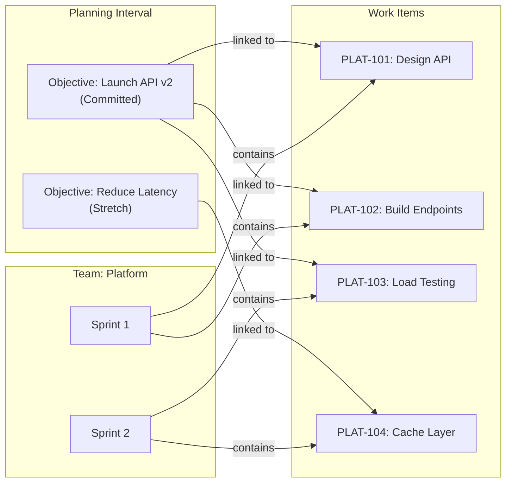

# Planning Intervals

A **Planning Interval** (PI) is a fixed timeframe — typically 8-12 weeks — during which a group of teams delivers value toward committed objectives. It is the primary unit of scaled planning in Wayd.

Every planning interval has:
- **Name** and optional **Description**
- **Date Range** — Start and end date for the PI
- **Teams** — The [teams](../organizations/index.mdx#teams) and [teams of teams](../organizations/index.mdx#teams-of-teams) participating
- **Iterations** — Time-boxed periods within the PI (typically 2-week sprints)
- **[Objectives](#objectives)** — Team commitments for the PI
- **Objectives Locked** — Flag that freezes the set of objectives after PI planning: no objectives can be added or deleted, and each objective's name and stretch flag stay as they are. Set it with **Edit** on the PI (**Objectives Locked?**)

A PI has a state based on the current date:
- **Future** — Start date hasn't arrived yet
- **Active** — Currently in progress
- **Completed** — End date has passed

## PI Detail Page

The PI detail page is the command center for a planning interval. It has an identity bar naming the PI, a **section rail** down the left, and a details panel holding the PI's stable facts. Each section is addressable — the URL carries `?section=` so a link can point at the section you were reading.

The rail provides:

- **Overview** — At-a-glance metrics, iteration cards, and team performance
- **[Plan Review](#plan-review)**
- **[Objectives](#objectives)**
- **[Risks](./risks.mdx)**
- **Backlog** — Every work item across the PI's sprints
- **[Capacity](#capacity)** — Each team's capacity for the PI and each of its iterations, with Team Capacity Management turned on
- **Activity** — The PI's recorded history: edits, date and iteration changes, teams joining and leaving, sprint mappings, and objectives being locked or unlocked. See [Activity Log](../activity-log.mdx).
- **Objectives Health** — under **Reports**, below the divider

**Record facts panel** — Start and end dates, length, [predictability](#predictability), whether objectives are locked, description, and links. Toggle it from the button at the right of the identity bar; below tablet width it moves into the page content.

Team setup lives in the **Actions** menu rather than a section, since both are configuration rather than something to read:

- **Manage Teams** — Choose which [teams](../organizations/index.mdx#teams) participate in the PI
- **Team Sprints** — Map each team's [sprints](../work-management/sprints.mdx) to PI iterations

### Overview

The Overview section composes four blocks that adapt based on PI state.

#### At a Glance

A summary card showing the PI's current health at a single glance:

- **Timeline progress bar** — Visual bar showing how much of the PI's date range has elapsed
- **Teams** — Number of delivery teams participating (Teams of Teams excluded)
- **Objectives** — For Future PIs only: the number of objectives, with a breakdown of regular (non-stretch) / stretch counts
- **PI Predictability** — The PI's [predictability](#predictability), with a breakdown of completed / regular / stretch counts. Hidden for Future PIs and when no objectives exist.
- **Avg Cycle Time** — Average cycle time of the completed (Done) work items across all team sprints in every iteration of the PI. Only shown for Active and Completed PIs when cycle time data is available.

When objectives exist (Active and Completed PIs only), three charts are shown beneath the metrics:

- **Team Predictability** — Radar chart showing each team's predictability score
- **Objectives By Status** — Pie chart grouping all PI objectives by status (Not Started, In Progress, Completed, Missed, Canceled)
- **Objectives By Health** — Pie chart grouping open objectives (not Completed, Canceled or Missed) by health check status (Healthy, At Risk, Unhealthy, Unknown)

#### Iterations

A row of clickable cards — one per iteration — sorted chronologically. Each card shows:

- Iteration name and category (Development, or IP for Innovation and Planning)
- Date range
- For the **active** iteration: current day and total days (e.g. "Day 4/10") and a **health flag** (green = On Track, orange = At Risk, red = Off Track) calculated from sprint completion progress
- Cards are highlighted: active iterations use the primary colour, Innovation and Planning iterations use a warning/amber tint

Click an iteration card to navigate to its detail page, where you can see the aggregated sprint backlog and metrics across all participating teams.

#### Teams

A responsive grid of team performance cards, one per participating team. Each card links to that team's view on the [Plan Review](#plan-review) section and shows:

- **Predictability** for the PI with a breakdown of completed / regular (non-stretch) / stretch objective counts
- **Avg Cycle Time** for the team's sprints
- **Objectives By Status** and **Objectives By Health** charts for the team's objectives (shown when the team has objectives)

This section is hidden for Future PIs.

#### Needs Attention — Objectives

Only shown for **Active** PIs. Highlights objectives that are At Risk or Unhealthy and have not yet been completed, so the team can take action before the PI ends.

- Sort the list by **health** (Unhealthy first), **progress**, or **team** using the segmented control
- Click an objective card to open its details drawer for inline updates and health checks
- The section is hidden if no objectives currently need attention

## Iterations within a PI

Each PI contains **Iterations** that define the sprint schedule. Iterations have:
- **Name** — Descriptive name (e.g., "Sprint 1", "IP Sprint")
- **Category** — Purpose of the iteration:
  - **Development** — Standard delivery sprint
  - **Innovation and Planning** — Time for planning, innovation, and technical debt
- **Date Range** — Must fall within the PI's date range

Iterations are generated when the PI is created, from **Iteration Weeks** (1 to 10) and an optional **Iteration Prefix**: iterations of that many weeks run back to back from the PI's start, named the prefix followed by the iteration number (`Sprint 1`, `Sprint 2`, …). The last one ends on the PI's end date, however short that leaves it, and is categorized IP. Change names, categories and dates afterwards, add iterations with **Add Iteration** or remove them, with **Manage Dates** in the PI's **Actions** menu.

#### Iteration Health

The active iteration's card on the Overview page shows a colour-coded health flag. It compares the work items still to finish in the iteration's mapped sprints with an even burn-down from the iteration's start to its end, and measures the difference as a share of the iteration's total work items:

- **On Track** (green) — No more than 10% behind the even burn-down, or ahead of it
- **At Risk** (orange) — More than 10% and up to 25% behind
- **Off Track** (red) — More than 25% behind

No flag shows while the iteration has no work items.

### PI Iteration Detail Page

A PI iteration groups all matching [sprints](../work-management/sprints.mdx) from participating teams into a single aggregate view. When multiple teams participate in a PI, each team's sprint is mapped to the corresponding iteration (see [Sprint Mapping](#sprint-mapping)). The iteration detail page rolls up metrics from all mapped sprints, giving you a cross-team view of progress.

**Overview:**
- **Timeline progress bar** — Visual indicator of time elapsed from start to end date
- **Teams** — Number of teams measured in this iteration: teams with sprints mapped to it, and the PI's Kanban teams
- **Total** — Work items across all team sprints in the iteration; Kanban teams are not included
- **Aggregate Metrics** (for Active/Completed iterations, see [Sprint Metrics](../work-management/sprints.mdx#sprint-metrics) for definitions):
  - Completion Rate percentage, from the sprints alone
  - Velocity, including what Kanban teams completed
  - In Progress and Not Started work items
  - Average Cycle Time across all teams' sprints and Kanban teams
- **Team sprint cards** show each team's sprint in its own [sizing method](../organizations/index.mdx#operating-model), labelled with the unit, or switch to counting work items with the **Team Sizing / Count** selector. Teams that size in different units are never added together
- Each started sprint's card shows the same figures as the team's sprint card on Home: **Predictability**, **Velocity**, **In Progress** (with what's not started) — or **Carried Over** once the sprint has ended — and **Say/Do**, from the sprint's [scope](../work-management/sprints.mdx#sprint-scope), and its health tag [measures delivery against the commitment](../work-management/sprints.mdx#the-sprint-overview). Until a sprint has a commitment, Completion Rate and Avg Cycle Time stand in. A future sprint shows its planned total
- **Kanban team cards** — A [Kanban](../organizations/index.mdx#operating-model) team has no sprints, so each Kanban team in the PI is measured by the iteration's dates, counted in the team's time zone, and its card is marked **Measured by dates**. **Velocity** is the requirement-level work it moved to a Done status within those dates; work moved to Removed is not counted. **In Progress** is what was in progress at the iteration's end, or what is in progress now for the current iteration. Nothing is scoped to an iteration for a Kanban team, so **Scope** shows as not applicable, and the team adds nothing to the iteration's Total, Not Started or Completion Rate. Its completed and in-progress work does count toward the iteration's Velocity, In Progress and Avg Cycle Time. The team's reporting cadence plays no part, and work counts for the team an item is on now
- A past iteration's in progress is read from work item history. Until a workspace's [history is complete](../work-management/sprints.mdx#sprint-scope), a Kanban team with work in it is marked **History incomplete**, as its in-progress figure may be short; a full sync of the connection completes it

**Backlog:**
- Combined sprint backlog grid showing [work items](../work-management/work-items.mdx#work-items) from all mapped sprints
- Columns: Rank, Key, Type, Title, the teams' estimate ([Story Points, Effort or Size](../work-management/work-items.mdx#estimate-columns)), Status, Status Category, Team, Sprint, Parent Key, Parent, Assigned To, Project, Tags

> **Tip:** Click on an iteration card on the Overview section to navigate directly to its detail page.

**Business rules:**
- Iteration names must be unique within a PI
- Iteration dates must fall within the PI's date range
- Iteration dates cannot overlap with each other

## Sprint Mapping

Team [Sprints](../work-management/sprints.mdx) are mapped to PI iterations. This mapping connects each team's delivery cadence to the broader PI schedule, enabling aggregate views and cross-team coordination.

**Rules:**
- A team can only have one sprint per iteration
- The sprint must belong to a team that is part of the PI
- Removing a team from a PI also removes its sprint mappings
- Removing an iteration removes the sprints mapped to it; the sprints themselves are untouched

### Automatic mapping

When a Scrum team is added to a PI, Wayd tries to map its sprints for you, shortly after the save; any it cannot match are left for you to map. A sprint is mapped to the iteration that holds more than half of its days, so sprints that start or end a day or two away from the iterations still line up. When more than one sprint belongs to the same iteration, as with one-week sprints in two-week iterations, the one with the most days in it is mapped and the rest are left for you.

- Only fills gaps: an iteration the team already has a sprint in, and a sprint already mapped here or in another PI, are left as they are
- Skips a sprint without both a start and an end date, and one split evenly between two iterations
- Counts the team as Scrum for an iteration when its [operating model](../organizations/index.mdx#operating-model) on the iteration's first day is Scrum; Kanban teams get no mappings, and nor do teams of teams, which have no sprints
- Runs once, when the team joins: sprints synced, or iterations added, after that are mapped on **Team Sprints**

The mappings appear in the PI's [Activity](../activity-log.mdx) as **Automation**, started by whoever added the team. When the team came in with a PI import, no person is named. Change or remove any of them on **Team Sprints**.

A mapped sprint takes its [sprint type](../work-management/sprints.mdx#sprint-type) from the iteration's category unless its team set one: a Development iteration's sprint is standard, and an Innovation and Planning iteration's is non-standard, left out of the [team's sprint metrics](../work-management/sprints.mdx#team-sprint-metrics).

## Objectives

**Planning Interval Objectives** represent commitments from teams to deliver specific outcomes within a PI. They are the core mechanism for PI-level planning and tracking.



Objectives bridge the gap between strategic intent and execution. A team commits to objectives during PI planning, then links [work items](../work-management/work-items.mdx#work-items) that fulfill those objectives. As work items are completed in [sprints](../work-management/sprints.mdx), objective progress is tracked.

Each objective has:
- **Team** — The [team](../organizations/index.mdx#teams) committing to the objective
- **Type** — Team or Team of Teams, from the kind of team that owns it. **Create Objective** offers only the PI's teams, not its teams of teams, so a Team of Teams objective comes from the [objectives import](./bulk-import.mdx#planning-interval-objectives-import)
- **Start** and **Target** dates — Optional, and within the PI's dates; the start must be before the target
- **Progress** — Percent complete, 0–100
- **Status** — A new objective starts Not Started; change it with **Edit**. Moving an objective to Completed, Canceled or Missed records its **Closed** date, and moving it back to Not Started or In Progress clears it:
  - **Not Started** — Work hasn't begun
  - **In Progress** — Actively being worked on
  - **Completed** — Successfully delivered
  - **Canceled** — Removed from scope
  - **Missed** — Not delivered by PI end
- **Is Stretch** — Whether this is a stretch goal (aspirational) vs. a committed objective
- **Health Check** — Optional health indicator (Healthy, At Risk, Unhealthy) with expiration. See [Health checks](#health-checks)
- **Order** — Position among the team's objectives; drag objectives on [Plan Review](#plan-review) to reorder them

**Business rules:**
- Objectives can only be created or deleted while the PI's objectives are not locked
- While objectives are locked, an objective's name and stretch flag cannot be changed; its description, status, progress and dates still can
- Creating, editing and deleting objectives, and recording health checks, needs the **Create, update, and delete Planning Interval Objectives** permission. A health check also needs your account to be linked to an employee, since it records who reported it

### Health checks

A health check records how an objective is tracking: a **Status** (Healthy, At Risk or Unhealthy), an optional **Note**, and an **Expiration** date and time, which must be in the future. Create one with **Create Health Check** on the objective or from the objective grid's row menu. An objective shows its latest health check until it expires, and then has no health (shown as Unknown in the charts). Recording a new check while the previous one is still current ends the previous one at that moment, so an objective has at most one current check.

### Objectives Section

The **Objectives** section offers two views, switched with the selector in the grid's toolbar:

**List View** — Data grid with columns: Key, Name, Stretch, Status, Team, Health, Progress (bar), Start Date, Target Date, Order. Each row's menu offers **Edit Objective**, **Create Health Check** and **Health Report**.

**Timeline View** — Visual timeline grouped by team, showing objectives as bars across the PI timeline, with the iterations behind them. Only shows delivery teams (not Teams of Teams), and leaves out Canceled objectives. Click an objective to open its details drawer.

**Create Objective** appears in the section's header while the PI has at least one team (not a team of teams) and its objectives are not locked.

### Objective Detail Page

Each objective has its own detail page. Its sections are:
- **Overview** — Progress bar (colored red for Canceled/Missed objectives), the linked [work items](../work-management/work-items.mdx#work-items) with the ability to link and unlink them, and a chart of the objective's health checks over time
- **Work Items** — The linked work items
- **Activity** — The objective's recorded history: edits, status and progress changes, stretch and date changes, reordering, and health checks. See [Activity Log](../activity-log.mdx).

Under **Reports**:
- **Health Report** — Every health check recorded on the objective, with Health, Note, Reported By, Reported On and Expiration
- **Forecast** — With Delivery Forecasting turned on, when the linked work items will be done. See [Delivery Forecasting](../work-management/delivery-forecasting.mdx)

The details panel shows Status, Type, Stretch, Start, Target and Closed dates, Description, the planning interval and team, and links.

Actions: Edit, Delete, Create Health Check

### Objectives Health Report

The **Objectives Health** report (under **Reports** on the PI) shows all PI objectives in a grid with Key, Name, Stretch, Status, Team, Progress, Health, Note, Reported On, and Expiration. This provides a single view of objective health across all teams.

### Predictability

Wayd calculates **Predictability** for each PI and each of its teams — how much of what the teams committed to they delivered:

```
Predictability = (Completed objectives / Committed (non-stretch) objectives) × 100, capped at 100
```

- **Only committed objectives set the target.** Stretch objectives are left out of the denominator, so missing one does not lower predictability.
- **Completed stretch objectives still count toward the numerator**, so delivering stretch objectives can make up for a missed committed one. The result never goes above 100%.
- **Across the PI**, only Team objectives count; Team of Teams objectives are left out. **Per team**, all of that team's objectives count.
- With objectives but none of them committed, predictability is 0%. With no objectives at all, there is none.

Predictability is only calculated for Active or Completed PIs (not Future). It is shown on the Overview section as a metric with a completed / regular / stretch breakdown, in the PI's details panel, visualized per-team in the **Team Predictability** radar chart, on each team's card in the Teams section, and next to the team's name on [Plan Review](#plan-review).

## Plan Review

The **Plan Review** section provides a team-by-team view of the PI, with one tab per participating team. This is designed for PI planning ceremonies and plan review sessions.

Each team tab, labelled with the team's code, shows:
- The team's [predictability](#predictability) for this PI, next to its name, once it has objectives
- Two view modes:
  - **List View** — An **Objectives** card and a **Risks** card for the team. Drag objectives to change their order. The **+** on each card creates an objective (while objectives are not locked) or a [risk](./risks.mdx) for the team. The risks are the team's open risks reported before the PI ended
  - **Timeline View** — Objectives displayed on a timeline

Click an objective to open its details drawer. The plan review only shows delivery teams (not Teams of Teams). The selected team is held in the URL as `?team=` (the team code, lowercased), alongside `?section=plan-review` — so a link can point directly at one team's plan.

## Capacity

With **Team Capacity Management** turned on, the PI has a **Capacity** section showing how much time each of its teams has, from the people [allocated](../organizations/index.mdx#allocations) to them.

- A row per team in the PI, teams first and then teams of teams, against a column per **iteration** and one for the whole **planning interval**. The IP iteration is marked
- Each figure is **delivery person-days**: time in roles that count toward delivery capacity, after each person's holidays and [time away](../organizations/index.mdx#time-away-and-holiday-calendars), with a part-timer's time counted as their [working day's](../organizations/index.mdx#working-day) share of a system working day, and with the team's [sprint team days off](../work-management/sprints.mdx#team-days-off) taking their share of everyone's time: nobody working a full day off, half of everyone's time on a half day. Hover over it for the person-days allocated in every role and what time away took
- **Iterations are read by the PI's own dates**, whatever each team's sprint length or cadence, so teams on different cadences, or with no sprints at all, compare over the same days
- **A team of teams** is its rollup: its own allocations and those of the teams beneath it, for the days they were in its hierarchy. A team beneath it that is also in the PI has its own row as well, so the rows are not added up
- A **dash** is a team with no one allocated in the PI: it has nothing to plan with, rather than no time
- **Plan** on a row, for those who may view teams, opens the team's [capacity plan](../organizations/index.mdx#capacity-plans) over the PI's dates: its people against the PI's weeks. Those who may change the team's allocations can edit it there. For a team of teams it shows the people allocated to it directly

Capacity is worked out each time it is read; nothing is stored for the PI.

## Common Tasks

### Creating a Planning Interval

1. Navigate to **Planning > Planning Intervals**
2. Click **Create Planning Interval**
3. Enter **Name**, **Date Range**, **Iteration Weeks**, and optional **Description** and **Iteration Prefix** — the iterations are generated from them
4. Use **Manage Dates** in the **Actions** menu to adjust the generated iterations, or add and remove them
5. Use **Manage Teams** in the **Actions** menu to add participating teams

### Managing Team Objectives

1. Navigate to the PI detail page
2. Click **Objectives** in the section rail
3. Click **Create Objective** and choose the team
4. Set whether it is a stretch objective with **Is Stretch?**
5. Update status and progress with **Edit** as the PI progresses
6. Add **Health Checks** to track objective health over time

### Reviewing PI Health at a Glance

1. Navigate to the PI detail page — the **Overview** section opens by default
2. Check the **At a Glance** section for timeline progress, predictability, and cycle time
3. Scan the **Iterations** row for the active iteration's health flag
4. Review the **Teams** section for per-team predictability and objective charts
5. On an Active PI, check **Needs Attention** for objectives that are At Risk or Unhealthy

### Reviewing the PI Plan

1. Navigate to the PI detail page
2. Click **Plan Review** in the section rail
3. Review each team's objectives and [risks](./risks.mdx), team by team
4. Switch between List and Timeline views for different perspectives
