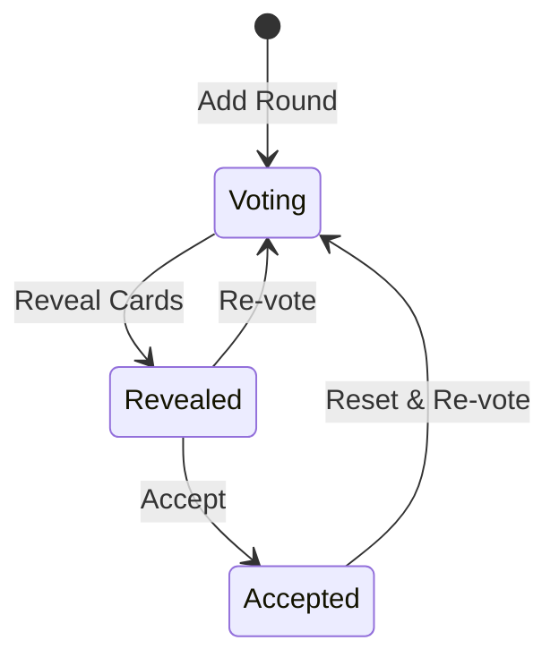

# Planning Poker

> This feature is behind the `planning-poker` feature flag. See [Feature Flags](../settings/index.mdx#feature-management) for details.

**Planning Poker** enables [teams](../organizations/index.mdx#teams) to estimate work collaboratively using estimation scales. It uses real-time communication (SignalR) for live voting.

## Estimation Scales

An **Estimation Scale** defines the set of values available for voting (e.g., Fibonacci: 1, 2, 3, 5, 8, 13, 21). Each value is an **estimate** — a size — or a **card** such as `?`, `∞` or `☕`, which can be voted but is never a size. Scales are configured in [Settings > Planning > Estimation Scales](../settings/index.mdx#estimation-scales) and need at least 2 estimates.

A scale's values are published as numbered [versions](../settings/index.mdx#versions). A session is pinned to the version of its scale that was current when the session was created, and keeps voting on it when the scale's values later change.

## Poker Sessions

A **Poker Session** is a real-time estimation event:
- Run by one or more **Facilitators** — the person who created it first, and anyone they add
- **Public** or **Private** — see [who can see and join a session](#who-can-see-and-join-a-session)
- Uses a specific **Estimation Scale**, pinned to one of its versions (the scale cannot be changed after rounds begin)
- Contains **Rounds** — each round represents one item being estimated, with an optional label such as a work item ID and an optional description (up to 2,048 characters) for detail the team should read before voting, such as acceptance criteria
- Has **Participants** — the people who joined it. Each participant is either **Voting** or not, and a participant can also be a **Facilitator**
- Sessions are immediately **Active** on creation, and stay Active until completed

The **Planning Poker** page lists the sessions you can see, with Name, Status, Facilitators, Participants (everyone who joined), Visibility and Rounds. Completed sessions are hidden until **Include Completed** is switched on. For the sessions you facilitate, the row menu offers **Edit**, **Complete** while the session is active, and **Delete**.

### Who can see and join a session

| Visibility | Who can see and join it |
|---|---|
| **Public** | Anyone with the **View Poker Sessions** permission |
| **Private** | Its facilitators, the people invited to it, and the members of the teams invited to it |

Inviting a team invites its current members and the members of its current team of teams, the same rule that decides who can [start a sprint](../work-management/sprints.mdx#starting-completing-and-reopening-a-sprint). Someone who leaves the team loses access at once, though a session page they already have open keeps receiving live updates until they reload it. An invite only lets someone in: they still need the **View Poker Sessions** permission. A private session is missing from the list for anyone it does not admit, and its link shows that the session was not found.

Changing a session's visibility or invites takes effect at once: anyone it no longer admits is disconnected from its live updates.

Facilitators, visibility and invites are set when the session is created and changed from **Edit**, on an active or a completed session.

### Participants, Facilitators and Voting

Everyone in a session is a participant. Some participants are **Facilitators**, who run it, and each participant chooses whether they are **Voting**:

- **Voting** (the default) — you estimate, and count toward a round's voted and waiting totals
- **Not voting** — you take part in the discussion without estimating, such as a product manager answering the team's questions, and are left out of those totals. Turning voting off withdraws your vote in any round not yet revealed

Opening an active session joins you, voting. Turn voting on or off at any time while the session is active; your choice stays when you come back, as there is no leaving a session. An assistant voting for you through the [MCP server](../../getting-started/mcp-server.mdx) joins you, voting, on its first vote. Facilitators join like anyone else, and can run a session without voting.

Joining needs an account linked to an employee. Without one you can watch an active session but not join it or vote.

## Poker Session Detail Page

The session page has a real-time, multi-column layout:

**Presence row** — The people connected to the session. While the session is active, it also shows your **Voting** switch.

**Center Column** — Changes based on round status:
- **Lobby** (no rounds yet) — **Ready to estimate**, with a box for the first round's label and **Start**. Those who do not facilitate the session see **Waiting for the facilitator to start a round.**
- **Voting** — Cards for the voting participants showing who has voted (values hidden until reveal), **Reveal Cards**, and **Your Estimate**: the card deck for choosing your vote. Choose a card again to withdraw it. Participants who are not voting do not get a card and do not see the deck
- **Revealed** — All votes shown, with **Average**, **Mode**, **Low** and **High**, and a **Consensus** tag when the votes agree or **Spread — discuss** when they do not. Votes agree when the numeric votes are no more than 3 apart, or, on a scale without numbers, when everyone chose the same card. **Re-vote** clears the votes; **Accept** takes the mode, and its dropdown accepts any other value on the session's version of the scale, cards included
- **Accepted** — The accepted estimate, marked **Estimated**, with **Reset & Re-vote**

Above the cards, the round's label and description are shown. Facilitators edit both in place, and the changes are saved as they type and appear for everyone in the session; a long description can be expanded with **Expand**.

After an estimate is accepted, a new round starts automatically unless another round is already waiting for votes.

**Right Sidebar** — The **Timeline** of rounds, where you can select a round, add a round by label, or remove one, and the **Complete Session** button. Before the first round it lists the people connected to the session instead, tagged **Facilitator** and **Voting**. On a phone, the timeline opens from **Session Timeline**.

The header shows a **Private** tag on a private session, and offers:
- **Participants** — who facilitates the session, who has joined it, tagged **Facilitator** and **Voting**, and its visibility and invites. Select an invited team to see its members
- **Edit** — for facilitators: the session's name and, until rounds have started, its scale, while it is active; its facilitators, visibility and invites at any time
- **Copy Invite Link** — while the session is active

**Export CSV**, in the header once the session has a round with a label, a description or votes, downloads one row per such round (empty rounds are left out) with its number, label, description, status, consensus estimate, vote count and votes (each voter's name and card). It is available for active and completed sessions. Votes are written only for revealed or accepted rounds; a round still voting shows its vote count but not the votes, which are hidden until reveal.

### Round Workflow

- **Voting** — Voting participants submit estimates from the card deck, and can change or withdraw them until the votes are revealed
- **Reveal** — All votes are revealed simultaneously
- **Re-vote** — Clear votes and any accepted estimate, and return to voting (for re-estimation)
- **Accept** — Set the agreed estimate, which must be a value on the session's version of the scale. A card is allowed: a team agreeing on `?` is a real outcome

### Real-time Features

- Live participant presence indicators
- Real-time vote, participant and voting updates via SignalR
- Copy invite link to share session

### Business Rules

- Sessions are immediately activated on creation
- Rounds can only be added, changed or removed, votes cast, and participants join or turn voting on or off, while the session is active
- The estimation scale cannot change after rounds begin. Changing it before then pins the session to the chosen scale's current version
- Votes and the accepted estimate must be values on the session's version of its scale
- A session stays on its version when the scale publishes a new one or is deactivated
- Only active sessions can be completed. Completing a session deletes its empty rounds — those with no label, no description and no votes, such as the round started automatically after the last estimate was accepted
- A session always has at least one facilitator. A facilitator can remove themselves while others remain
- Only facilitators run a session: starting, revealing, re-voting and accepting rounds, editing it, changing its facilitators, visibility and invites, completing it and deleting it. The **Administer Poker Sessions** permission lets its holder do the same in every session, private ones included
- Only voting participants vote; a participant who is not voting must turn voting on first
- Everything but creating a session needs only the **View Poker Sessions** permission; creating one needs **Create Poker Sessions** and an account linked to an employee, since the creator becomes its first facilitator. **Create Session** is not shown without both. See [Permissions](../settings/permissions.mdx#planning-poker-facilitators-and-invites)

## Common Tasks

### Running a Planning Poker Session

1. Navigate to **Planning > Planning Poker**
2. Click **Create Session**
3. Enter a session **Name** and select an **Estimation Scale**
4. Add any other **Facilitators**, and choose **Public** or **Private**. For a private session, choose the **Invited People** and **Invited Teams**
5. Share the link with participants using **Copy Invite Link**
6. Enter the first item's label and click **Start**; add further rounds from the timeline
7. **Reveal Cards** when all voting participants have voted
8. **Accept** an estimate or **Re-vote**
9. **Complete Session** when estimation is done

### Joining a Session

1. Open the session from **Planning > Planning Poker**, or from its invite link
2. You join, voting, when the session opens. To take part without estimating, turn off **Voting**
3. Turn voting back on at any time from the same place
