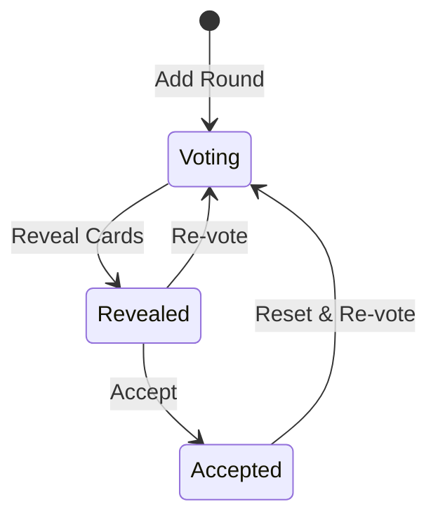

# Planning Poker

> This feature is behind the `planning-poker` feature flag. See [Feature Flags](../settings/index.mdx#feature-management) for details.

**Planning Poker** enables [teams](../organizations/index.mdx#teams) to estimate work collaboratively using estimation scales. It uses real-time communication (SignalR) for live voting.

## Estimation Scales

An **Estimation Scale** defines the set of values available for voting (e.g., Fibonacci: 1, 2, 3, 5, 8, 13, 21). Scales are configured in [Settings > Planning > Estimation Scales](../settings/index.mdx#estimation-scales) and require at least 2 values.

## Poker Sessions

A **Poker Session** is a real-time estimation event:
- Created by a **Facilitator** — the person who created it, shown in the sessions list
- Uses a specific **Estimation Scale** (cannot be changed after rounds begin)
- Contains **Rounds** — each round represents one item being estimated, with an optional label such as a work item ID and an optional description (up to 2,048 characters) for detail the team should read before voting, such as acceptance criteria
- Sessions are immediately **Active** on creation, and stay Active until completed

The **Planning Poker** page lists sessions with Name, Status, Facilitator and Rounds. Completed sessions are hidden until **Include Completed** is switched on. A session's row menu offers **Edit** and **Complete** while it is active, and **Delete**.

## Poker Session Detail Page

The session page has a real-time, multi-column layout:

**Center Column** — Changes based on round status:
- **Lobby** (no rounds yet) — **Ready to estimate**, with a box for the first round's label and **Start**. Those who cannot run the session see **Waiting for the facilitator to start a round.**
- **Voting** — Participant cards showing who has voted (values hidden until reveal), **Reveal Cards**, and **Your Estimate**: the card deck for choosing your vote. Choose a card again to withdraw it
- **Revealed** — All votes shown, with **Average**, **Mode**, **Low** and **High**, and a **Consensus** tag when the votes agree or **Spread — discuss** when they do not. Votes agree when the numeric votes are no more than 3 apart, or, on a scale without numbers, when everyone chose the same card. **Re-vote** clears the votes; **Accept** takes the mode, and its dropdown accepts any other value on the scale
- **Accepted** — The accepted estimate, marked **Estimated**, with **Reset & Re-vote**

Above the cards, the round's label and description are shown. Those who can run the session edit both in place, and the changes are saved as they type and appear for everyone in the session; a long description can be expanded with **Expand**.

After an estimate is accepted, a new round starts automatically unless another round is already waiting for votes.

**Right Sidebar** — The **Timeline** of rounds, where you can select a round, add a round by label, or remove one, and the **Complete Session** button. Before the first round it lists the participants connected to the session instead. On a phone, the timeline opens from **Session Timeline**.

The header offers **Edit** (the session's name and, until rounds have started, its scale) and **Copy Invite Link** while the session is active.

**Export CSV**, in the header once the session has a round with a label, a description or votes, downloads one row per such round (empty rounds are left out) with its number, label, description, status, consensus estimate, vote count and votes (each voter's name and card). It is available for active and completed sessions. Votes are written only for revealed or accepted rounds; a round still voting shows its vote count but not the votes, which are hidden until reveal.

### Round Workflow

- **Voting** — Participants submit estimates from the card deck, and can change or withdraw them until the votes are revealed
- **Reveal** — All votes are revealed simultaneously
- **Re-vote** — Clear votes and any accepted estimate, and return to voting (for re-estimation)
- **Accept** — Set the agreed estimate value

### Real-time Features

- Live participant presence indicators
- Real-time vote updates via SignalR
- Copy invite link to share session

### Business Rules

- Sessions are immediately activated on creation
- Rounds can only be added, changed or removed, and votes cast, while the session is active
- The estimation scale cannot change after rounds begin
- Only active sessions can be completed. Completing a session deletes its empty rounds — those with no label, no description and no votes, such as the round started automatically after the last estimate was accepted
- Running a session — starting, revealing, re-voting and accepting rounds, and completing it — needs the **Update Poker Sessions** permission, and so does voting. It is not limited to the facilitator

## Common Tasks

### Running a Planning Poker Session

1. Navigate to **Planning > Planning Poker**
2. Click **Create Session**
3. Enter a session **Name** and select an **Estimation Scale**
4. Share the link with participants using **Copy Invite Link**
5. Enter the first item's label and click **Start**; add further rounds from the timeline
6. **Reveal Cards** when all participants have voted
7. **Accept** an estimate or **Re-vote**
8. **Complete Session** when estimation is done
