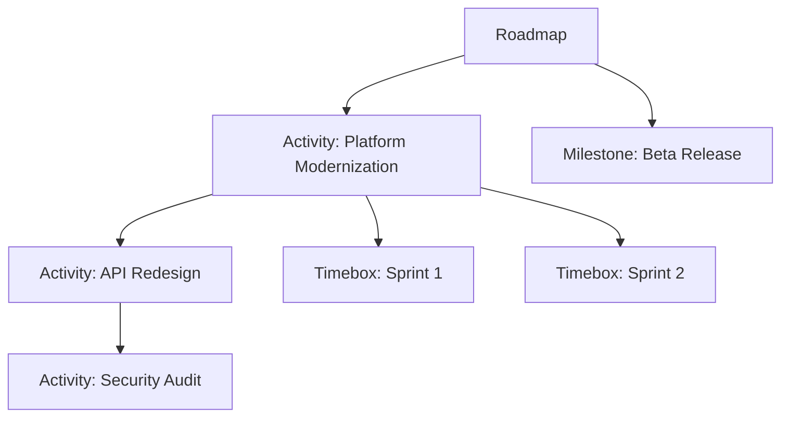

# Roadmaps

**Roadmaps** provide a visual timeline for planning and communicating work across time periods. They support hierarchical items and access-controlled editing.

Every roadmap has:
- **Name** and optional **Description**
- **Date Range** — The time period the roadmap covers
- **Visibility** — Public (visible to all users) or Private (visible to its owners and Roadmaps administrators only)
- **Owners** — The employees who can change the roadmap (at least one required). You must be among the owners of a roadmap you create, and stay among them when you edit it
- **State** — Active or Archived. An archived roadmap is read-only until it is activated again; the Roadmaps list filters by state
- **Items** — The content of the roadmap

Seeing roadmaps needs the **View Roadmaps** permission. Creating or copying one needs **Create Roadmaps** and your account to be linked to an employee, since owners are employees. Changing, archiving or deleting a roadmap and its items needs **View Roadmaps** and being one of its owners. **Administer Roadmaps** lets someone see and manage every roadmap, private ones included, without being an owner — for example to take over a roadmap whose owners have left. See [Permissions](../settings/permissions.mdx#roadmaps-owners).

## Roadmap Items

Roadmaps contain three types of items, which can be nested hierarchically:

- **Activity** — A deliverable or initiative with a date range. Activities can contain child items (other activities, milestones, or timeboxes), enabling a hierarchical work breakdown.
- **Milestone** — A point-in-time marker representing a key date or achievement. Milestones are created through the API rather than the roadmap screens; on the timeline and Gantt chart they show, open in the drawer, and can be dragged to a new date.
- **Timebox** — A time-bounded period (e.g., a sprint or phase).

Roadmap and item date ranges are inclusive: the end date can be the same as the start date, which creates a single-day range.

All items support an optional **Color** property for visual differentiation. When a roadmap has a [color palette](#roadmap-colors) configured, activities are colored by choosing from those named colors; otherwise any color can be picked freely.

## Activity Date Rollup

Activities automatically stay large enough to contain their child items:

- Creating or moving a child item outside its parent activity expands the parent activity to include it.
- Updating a child activity, milestone, or timebox outside its parent also expands the parent. The change rolls up through ancestor activities when needed.
- Editing an activity to shrink it inside any of its children is blocked. The activity date range must contain every direct child item.
- Moving an activity without changing its duration shifts the whole subtree by the same number of days, preserving the relative dates of descendant activities, milestones, and timeboxes.

When a form detects that a child date falls outside the selected parent activity, it shows an informational hint before saving so owners know the parent will expand.

## Roadmap Detail Page

The roadmap detail page offers two views:

**Timeline View** (default) — Visual timeline showing activities, milestones, and timeboxes. Owners can drag items to change their dates (see [Editing Items](#editing-items-owners-only)). Single-day activity and timebox ranges use a compact marker treatment with the label beside the marker.

**List View** — Hierarchical tree grid showing all items with Name, Type, Start, End, and Color, paired with a [Gantt chart](#gantt-chart). It can be used without a mouse — arrow keys move between cells, and Right and Left on a Name expand and collapse. Without edit rights, Enter on a Name moves to its link, and Enter again opens the item. Owners edit items cell by cell (see [Editing in the List View](#editing-in-the-list-view-owners-only)), add items with **Create Item**, drag activities to reorder them or move them under another activity, and open a row's menu with Shift+F10: **View Details**, **Add Child Item** (activities), **Edit** (activities and timeboxes) and **Delete**. The grid's **?** button lists every key.

Clicking an item's name opens the **Roadmap Item Details** drawer with its full details and, for owners, **Edit**.

### Editing in the List View (owners only)

The list edits like a spreadsheet: one cell at a time, saved as soon as you leave it. There is no Save button and no confirmation message.

- **Open a cell** with Enter, F2, a double-click, or a click on the cell that is already selected. Typing a character in Name starts over with that character.
- **Save** with Enter (and move down), Tab (and move to the next cell), or by clicking anywhere else. Escape closes an open list or calendar, then undoes the edit.
- **Name, Start, End and Color** can be edited on any item. A milestone's single date is in the Start column, and timeboxes have no color. Color is picked from the roadmap's palette when it has one (Delete clears it); otherwise type a hex value such as `#1677FF`, or press ↓ to pick a swatch. **Type** is chosen only for a new item.
- **Start and End are saved together.** Tab from Start to End holds Start until you leave the pair, then both are checked: End can't be before Start, and an activity can't be shortened behind one of its children. Moving both dates by the same number of days is a shift, which moves the children along (see [Activity Date Rollup](#activity-date-rollup)).
- **A cell that is waiting or failed is marked.** An underline means not yet saved, a bar on the left means saving, and a tinted cell with a bar means it failed. Select a failed cell to see why. Its value stays until you fix it (Enter) or discard it (Escape).
- **New items.** **Create Item**, or **Add Child Item** on an activity, adds a row with its Name open. The item is created once it has a Name, a Start and an End, filled in any order; until then, the cells it still needs are marked, and Enter on the Name opens the first of them. Escape on an empty new row removes it.

**Actions:**
- **Edit** — name, description, dates, owners and visibility (owners)
- **Archive** — make the roadmap read-only; **Activate** returns an archived roadmap to Active (owners)
- **Delete** (owners)
- **Configure Colors** — define the roadmap's named color palette, see [Roadmap Colors](#roadmap-colors) (owners)
- **Copy** — anyone who can create roadmaps
- **Create Activity**, **Create Timebox** (owners)

An archived roadmap offers only **Activate** and **Copy**.

**Copy** creates a new, active roadmap with the name, owners and visibility you give it, keeping the original's description, dates and full hierarchy of items, with their colors. The color palette is not copied.

## Roadmap Colors

By default, activity colors are picked freely and mean whatever each person intends — which makes it hard to read a roadmap at a glance. To give colors a shared meaning, owners can define a **color palette** for the roadmap: an ordered list of named colors (for example, *Platform Team*, *At Risk*, *Customer Commitment*).

Open **Actions → Configure Colors** to manage the palette:

- **Add a color** — pick a color and give it a caption describing what it represents.
- **Reorder** — drag colors to change the order they appear in the picker and the legend.
- **Set a default** — mark one color (★) as the default. Activities that have no color of their own are shown in this color.
- **Remove** — delete a color from the palette.

Each color must have a caption (up to 32 characters), a color can only be used once per roadmap, and a palette holds up to 30 colors.

### How the palette is used

Once a palette is configured:

- **Activity colors** are chosen from the palette's named colors instead of a free color picker. Leaving an activity's color empty lets it fall back to the roadmap's default color.
- A **legend** appears beneath the timeline, showing each color and its caption so viewers can interpret the roadmap at a glance.

The default color is applied when the timeline is displayed — it is not written onto the activities. Changing the default (or any color in the palette) instantly updates every activity that relies on it, with no need to edit items individually.

:::note
Color palettes apply to **activities**. Milestones and timeboxes still use their own colors. If a roadmap has no palette configured, activities use the standard free color picker and no legend is shown.
:::

## Gantt Chart

The List view pairs the item grid with a Gantt chart on the right, sharing the same rows: each grid row draws its dates on a common date axis. The chart is shown by default and can be hidden from the toolbar.

| Row | Drawn as |
|-----|----------|
| Activity | A bar from start to end, in its [roadmap color](#roadmap-colors) |
| Timebox | A lighter banded bar |
| Milestone | A diamond on its date |

A parent activity with no dates of its own is drawn as a summary bar spanning its children.

**Toolbar controls:**

| Control | Action |
|---------|--------|
| Chart button | Show or hide the chart pane |
| **+** / **−** buttons | Zoom in / out |
| Reset zoom button | Return to the default zoom |
| Ctrl/Cmd + scroll | Zoom in / out over the chart |
| Drag the divider | Resize the chart pane |

Showing or hiding the chart is remembered on your device and applies to **every roadmap**, not just the one you toggled it on. Project plan charts keep a separate preference of their own.

**Editing (owners only):**

| Control | Action |
|---------|--------|
| Drag a bar | Move the item, keeping its duration |
| Drag a bar's left/right handle | Change the start or end date |
| Drag a diamond | Change a milestone's date |
| Esc during drag | Cancel without saving |

Dragging saves immediately and follows the same [parent/child date rules](#activity-date-rollup) as editing dates in a form — moving a child past its parent's range expands the parent.

## Timeline Controls

The timeline view includes a toolbar with controls for navigation, zoom, and display settings.

### Navigation

| Control | Action |
|---------|--------|
| Click + drag on empty space | Pan the timeline |
| Scroll wheel | Pan vertically |
| Shift + scroll | Pan horizontally |
| Ctrl/Cmd + scroll | Zoom in / out |
| **+** / **−** buttons | Zoom in / out (toolbar) |
| Reset view button | Return to the default window and zoom |

### Zoom

The timeline starts with the roadmap's date range filling the viewport. Zoom in for day-level detail or zoom out to see the full domain (earliest item start to latest item end). The reset view button always returns to the original window.

### Editing Items (owners only)

| Control | Action |
|---------|--------|
| Drag bar | Move the item |
| Drag left/right handle | Resize start or end date |
| Esc during drag | Cancel the drag without saving |

Moving a parent activity by dragging its bar keeps the same duration, so all descendant items move with it. Resizing a parent activity changes only the parent's range and must still leave every child item inside that range.

### Settings Menu

Click the **gear icon** to toggle display options:

- **Show Current Time** — Red vertical line marking today
- **Show Vertical Gridlines** — Gridlines aligned to the current zoom unit (month, week, or day)
- **Highlight Weekends** — Shaded columns for Saturday and Sunday (visible at week/day zoom)
- **Compact Mode** — Reduces row height to fit more items without scrolling

### Help

Click the **? icon** to see a summary of keyboard and mouse controls.

## Common Tasks

### Creating a Roadmap

1. Navigate to **Planning > Roadmaps**
2. Click **Create Roadmap**
3. Enter **Name**, **Dates**, and **Visibility**
4. Choose the **Owners** — you must be one of them
5. Add **Activities** and **Timeboxes** with **Create Activity** and **Create Timebox**, or **Create Item** in the List view, to populate the timeline
