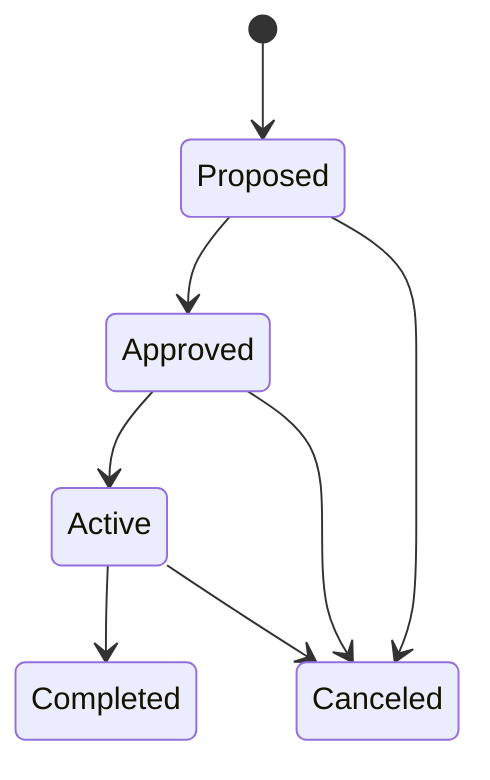

# Strategic Initiatives

**Strategic Initiatives** are high-level strategic efforts within a [portfolio](./portfolios-programs.mdx#portfolios), tracked with KPIs (Key Performance Indicators). They bridge the gap between [strategic themes](../strategic-management/index.mdx#strategic-themes) and [project](./projects.mdx) execution by defining measurable outcomes.

Each initiative has:
- **Name** and **Description**
- **Status** — Proposed, Approved, Active, On Hold, Completed, or Canceled
- **Date Range** — Timeline for the initiative
- **Roles** — Sponsor and Owner
- **[KPIs](#kpis)** — Measurable indicators with targets, checkpoints, and measurements
- **[Projects](./projects.mdx)** — Associated projects that contribute to the initiative

**On Hold** is a defined status, but no action moves an initiative into it or out of it, and the import does not accept it.

**Business rules:**
- Can only be created in Active or On Hold [portfolios](./portfolios-programs.mdx#portfolios)
- An initiative must be approved before it can be activated
- Can be deleted only in Proposed or Approved states
- Completed and Canceled initiatives are read-only: their page offers no **Edit**, **Manage Projects**, or KPI actions, and KPIs and linked projects cannot be added, changed, or removed

## Strategic Initiative Detail Page

The detail page has an identity bar naming the initiative, a section rail down the left, and a details panel holding the initiative's stable facts.

**Record facts panel** — [Portfolio](./portfolios-programs.mdx#portfolios) link, date range, timeline progress bar, sponsors/owners, description, and links.

**[KPIs](#kpis)** — The default section, with **Card** and **List** views:
- **Card View**: Visual cards showing KPI name, description, current/target values, checkpoint timeline, health status, and trend indicator. An **Add KPI** card appears when the initiative is editable.
- **List View**: Grid with Key, Name, Target Value, Actual Value, Format (prefix and suffix), and Target Direction. Click a KPI name to open its detail drawer. Each row's menu offers **Edit KPI**, **Delete KPI**, **Manage Checkpoint Plan**, and **Add Measurement**, and KPIs can be dragged to reorder them once sorting, filters, and search are cleared.

A **Create KPI** button sits beside the section heading when the initiative is editable. The KPI detail drawer shows the starting, target, and actual values with the KPI's checkpoints and measurements, and offers **Edit**, **Delete**, **Checkpoint Plan**, and **Add Measurement**; a measurement can be deleted from the drawer.

**[Projects](./projects.mdx)** — Card/List/Timeline views showing linked projects. **Actions → Manage Projects** chooses which projects the initiative is linked to.

**Activity** — The initiative's recorded history: edits, role and status changes, KPIs added, edited, reordered and removed, checkpoint plans, measurements, and linked projects. See [Activity Log](../activity-log.mdx).

KPIs and Projects show their count in the rail.

## KPIs

Each KPI tracks progress toward a measurable outcome:
- **Name** (up to 64 characters) and optional **Description** (up to 512)
- **Starting Value** — Optional baseline measurement. It must be below the target when the direction is Increase, and above it when the direction is Decrease
- **Target Value** — Goal to achieve
- **Actual Value** — Automatically set from the most recent measurement
- **Prefix** and **Suffix** — Unit display (e.g., "$" prefix, "%" suffix), up to 8 characters each
- **Target Direction** — Whether higher or lower values are better (Increase or Decrease)

When a KPI has a starting value, its progress is how far the actual value has moved from the starting value toward the target.
- **[Checkpoints](#checkpoints)** — Planned target values at specific dates with optional at-risk thresholds
- **[Measurements](#measurements)** — Actual recorded values over time

### Checkpoints

Checkpoints define expected KPI values at specific dates, creating a plan for measuring progress:
- **Checkpoint Date** — When the target should be reached
- **Date Label** — Human-readable label for the date, up to 16 characters
- **Target Value** — Expected value on that date
- **At-Risk Value** — Optional threshold between on track and unhealthy. It must be below the checkpoint's target when the direction is Increase, and above it when the direction is Decrease

Checkpoint dates must be unique within a KPI. Checkpoints are managed together from **Manage Checkpoint Plan** (or **Checkpoint Plan** in the KPI drawer).

Each checkpoint is judged against the latest measurement taken on or before its date and after the previous checkpoint's date:

- **Healthy** — the measurement meets the checkpoint's target (at or above it for Increase, at or below it for Decrease)
- **At Risk** — it misses the target but meets the at-risk value
- **Unhealthy** — it misses both, or misses the target when there is no at-risk value
- The **trend** compares that measurement with the one judged at the previous checkpoint: Improving, Worsening, or Stable

A checkpoint with no measurement in its window has no health. The KPI card shows the health and trend of the next checkpoint once it has a measurement, and otherwise those of the last measured checkpoint.

### Measurements

Measurements record actual KPI values over time:
- **Measurement Date** — When the value was recorded; it cannot be in the future
- **Actual Value** — The measured value
- **Note** — Optional, up to 1024 characters

The person who records a measurement is kept with it. The most recent measurement automatically becomes the KPI's **Actual Value**. Measurement dates must be unique within a KPI.

## Common Tasks

### Creating a Strategic Initiative

1. Navigate to **PPM > Strategic Initiatives**
2. Click **Create Strategic Initiative**
3. Choose an Active or On Hold **Portfolio**, then enter **Name**, **Description**, and **Planned Date Range**
4. Optionally assign **Sponsors** and **Owners**
5. Add **[KPIs](#kpis)** with target values and [checkpoints](#checkpoints)
6. Link **[Projects](./projects.mdx)** that contribute to the initiative with **Actions → Manage Projects**
7. **Approve** and then **Activate** the initiative from its **Actions** menu
8. Record **[Measurements](#measurements)** over time to track KPI progress
