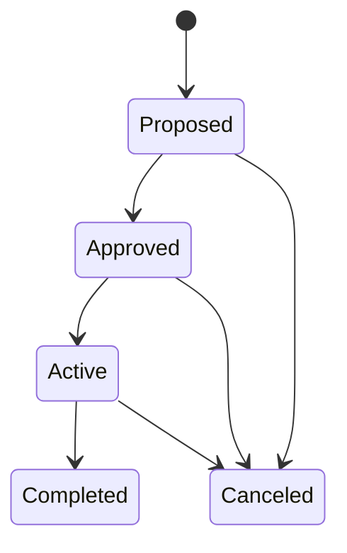

# Strategic Initiatives

**Strategic Initiatives** are high-level strategic efforts within a [portfolio](./portfolios-programs.mdx#portfolios), tracked with KPIs (Key Performance Indicators). They bridge the gap between [strategic themes](../strategic-management/index.mdx#strategic-themes) and [project](./projects.mdx) execution by defining measurable outcomes.

Each initiative has:
- **Name** and **Description**
- **Status** — Proposed, Approved, Active, On Hold, Completed, or Canceled
- **Date Range** — Timeline for the initiative
- **Roles** — Sponsor and Owner
- **[KPIs](#kpis)** — Measurable indicators with baselines, targets, checkpoint plans, and measurements, read together as its scorecard
- **[Projects](./projects.mdx)** — Associated projects that contribute to the initiative

**On Hold** is a defined status, but no action moves an initiative into it or out of it, and the import does not accept it.

**Business rules:**
- Can only be created in Active or On Hold [portfolios](./portfolios-programs.mdx#portfolios)
- An initiative must be approved before it can be activated
- Can be deleted only in Proposed or Approved states
- Completed and Canceled initiatives are read-only: their page offers no **Edit** or **Manage Projects**, and linked projects cannot be added or removed. Their KPIs stay open to change, so benefits can be measured after the initiative closes
- Deleting an initiative also removes its KPIs, with their measurements and checkpoint plans

## Strategic Initiative Detail Page

The detail page has an identity bar naming the initiative, a section rail down the left, and a details panel holding the initiative's stable facts.

**Record facts panel** — [Portfolio](./portfolios-programs.mdx#portfolios) link, date range, timeline progress bar, sponsors/owners, description, and links.

**Scorecard** — with the `kpis` feature flag on, the first section: the initiative's [KPIs](#kpis), grouped by category. Without the flag the page opens on **Projects**.

**[Projects](./projects.mdx)** — Card/List/Timeline views showing linked projects. **Actions → Manage Projects** chooses which projects the initiative is linked to.

**Activity** — The initiative's recorded history: edits, role and status changes, KPIs added, edited, reordered and removed, checkpoint plans, measurements, and linked projects. See [Activity Log](../activity-log.mdx).

Projects show their count in the rail.

## KPIs

An initiative's KPIs are [scorecard KPIs](../organizations/scorecards.mdx), the same as a team's or a project's: a baseline, a target, an optional at-risk threshold and checkpoint plan, a measurement window, and measurements over time. They need the `kpis` feature flag; while it is off, an initiative shows no scorecard and its KPIs cannot be read or changed. Who can change them is under [Who can change a strategic initiative's KPIs](../organizations/scorecards.mdx#who-can-change-a-strategic-initiatives-kpis).

KPIs recorded before initiatives moved onto scorecards were carried across as they were:

- **Starting value** became the baseline and **target value** the target.
- Each measurement kept its moment, so these KPIs measure **at a moment** (see [Measurement windows](../organizations/scorecards.mdx#measurement-windows)), and two readings on one day are kept apart.
- Each checkpoint's date became the calendar day it falls on in the [system time zone](../settings/index.mdx#general), with its label, planned value and at-risk value.
- A KPI with a starting value leads with its progress to target; one without leads with its value.
- Each carried-across KPI's Activity starts with a baseline entry. What happened to it before is in the initiative's own Activity.

## Common Tasks

### Creating a Strategic Initiative

1. Navigate to **PPM > Strategic Initiatives**
2. Click **Create Strategic Initiative**
3. Choose an Active or On Hold **Portfolio**, then enter **Name**, **Description**, and **Planned Date Range**
4. Optionally assign **Sponsors** and **Owners**
5. With the `kpis` feature flag on, add **[KPIs](#kpis)** on the **Scorecard**, with targets and, optionally, [checkpoint plans](../organizations/scorecards.mdx#checkpoint-plans)
6. Link **[Projects](./projects.mdx)** that contribute to the initiative with **Actions → Manage Projects**
7. **Approve** and then **Activate** the initiative from its **Actions** menu
8. Record [measurements](../organizations/scorecards.mdx#measurements) over time to track KPI progress
