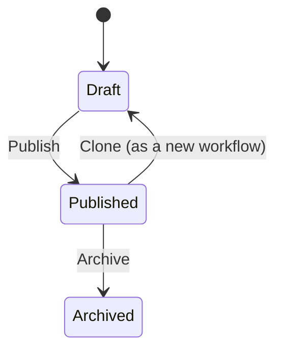

# Status Workflows

A **status workflow** is the set of statuses one kind of record moves through — the stages a product passes from Concept to Retired, or a deployment from In Progress to Succeeded. Wayd ships a default workflow for each kind, and this is where you change them.

Workflows are managed under **Settings → Status Workflows** and require the `Permissions.StatusWorkflows.*` permissions.

:::note[Status is data, meaning is code]
Renaming a status changes what people read; it does not change what Wayd does. The behaviour is carried by a status's **category** and its **alias**, which are described below. That separation is what lets you call a status whatever your organization calls it without breaking the reports built on it.
:::

## What a workflow is made of

### Record types

Every workflow governs exactly one **record type**, chosen when the workflow is created and fixed thereafter. Today those are Product, Version, Release, Release Package and Deployment.

The record type also decides the vocabulary available to the workflow's statuses — a Release has a meaning for "Released" that a Product does not.

### Statuses

A **status** is one stage. Each has:

- **Name** — what people see. Yours to choose.
- **Description** — what it means, shown when picking a status.
- **Category** — the rollup it belongs to. One of Proposed, Active, Done or Removed.
- **Alias** — an optional well-known meaning, drawn from the record type's vocabulary.
- **Order** — the display position.

### Categories

The **category** is how a status rolls up when something counts records rather than listing them. A board grouping by category puts every Active status in one column whatever each is called.

| Category | Means |
| --- | --- |
| Proposed | Not yet in play |
| Active | In play |
| Done | Finished successfully |
| Removed | Finished without succeeding |

### Aliases

An **alias** marks the one status that carries a specific meaning for that record type. Wayd's own logic looks for the alias, never the name — so a deployment's change failure rate counts whichever status is aliased **Failed**, whether you call it Failed, Errored or Did Not Ship.

Each record type declares aliases it cannot function without, and a workflow missing one cannot be published:

| Record type | Required aliases |
| --- | --- |
| Product | Active, Retired |
| Version | Ready, Released, Withdrawn |
| Release | Ready, Released, Withdrawn |
| Release Package | Released, Withdrawn |
| Deployment | In Progress, Succeeded, Failed, Rolled Back |

An alias can be held by only one status in a workflow — two statuses both meaning Released would make "is it released?" unanswerable.

### Transitions

A **transition** is a move a workflow allows: from one status to another. By default a workflow allows **any move** — a record can go from any status to any other, which is how every workflow behaves until you change it.

Switch a workflow to **Only allowed moves** and it allows just the transitions you tick. A product workflow can then say that a product reaches Active only from Concept, or never goes straight from Concept to Retired.

The **Transitions** section of a workflow's detail page holds the switch and a grid with a row for each status a record moves **from** and a column for each status it moves **to**. Tick a box to allow that move; clear it to forbid it. Each change saves straight away.

- **Only a draft can change.** The mode and the transitions are part of the workflow's structure, frozen once it is published like its statuses. Clone a published workflow to change them.
- **Removing a status removes its transitions**, in both directions.
- **Cloning copies the transitions** onto the copy's statuses.
- **Switching back to Any move keeps the ticks**, so switching again restores them, with their conditions.

A record governed by a restricted workflow can only make an allowed move. Anything else is refused with both statuses named — "The workflow does not allow a move from 'Concept' to 'Retired'." The status picker on a product offers only the moves allowed from its current status, and a version, release or release package page does not offer an action whose move its workflow does not allow.

Two things are never checked against the transitions:

- **A new record's first status.** Entering the workflow is not a move.
- **A reassignment.** Moving records onto another workflow must take every record across, whatever the new workflow's transitions allow.

#### Conditions on a move

A move can also carry **conditions**: things a record needs before it may make that move. Each allowed move in the grid has a conditions button beside its box; a highlighted button marks a move that has conditions, and hovering it lists them. Click it to tick or clear the conditions for that move. Like the transitions, conditions change only on a draft, are copied by **Clone**, go with their move when it is removed, and are enforced only while the workflow allows **Only allowed moves**.

| Condition | What the move needs |
| --- | --- |
| **Requires a reason** | A reason, recorded on the record's status history. A move without one is refused — "Moving from 'Sunset' to 'Retired' needs a reason." |

A condition belongs to one move, not to the status it leads to: Sunset → Retired can require a reason while Active → Retired does not. When a product's next move requires a reason, its status picker asks for one; for any other move it does not.

Conditions follow the same exemptions as transitions: a new record's first status and a reassignment are never checked against them.

Only the conditions Wayd can check are offered. Requiring a passed approval is planned and will appear once approvals exist. Moves in a version, release, release package or deployment workflow carry no conditions: the actions that make them have no way to supply one.

#### Publishing a restricted workflow

Wayd refuses to publish a restricted product workflow that would strand a record, and names the status at fault:

- **Every status must be reachable** from the initial status — the first Proposed status, or the first status when none is Proposed — through allowed moves.
- **Every Proposed or Active status needs a way out.** Done and Removed statuses may be final.

A restricted delivery workflow is checked differently; see the next section. The Transitions section and the publish dialog list each problem.

#### Restricting delivery workflows

Versions, releases, release packages and deployments do not move to a status you pick. They move through their actions — **Cut**, **Mark Released**, **Revert**, **Withdraw**, **Record Success**, **Record Failure**, **Roll Back** — each of which goes to the status carrying a particular alias. Restricting one of these workflows decides which of those actions it allows.

Some moves are **required**: the actions, imports and delivery figures depend on them, so a restricted workflow must allow them. The rest are **optional**: leave one out and the action that makes it is refused, with both statuses named, and is no longer offered on the record's page. In the Transitions grid a required move is ticked and marked with a lock, and cannot be cleared. Choosing **Only allowed moves** adds any that are missing, and so does every later change in the grid. A required move that appears after that — because an alias was moved to another status — shows unticked until the next change adds it or you tick it, and publish names it meanwhile.

| Record | Action | Move | |
| --- | --- | --- | --- |
| Version | Cut | initial → Ready | Required |
| Version | Mark Released | initial → Released, Ready → Released | Required |
| Version | Revert Version | Released → Ready (Released → initial for a version never cut) | Optional |
| Version | Withdraw | initial → Withdrawn, Ready → Withdrawn | Required |
| Version | Withdraw | Released → Withdrawn | Optional |
| Release | Mark Released | initial → Released, Ready → Released | Required |
| Release | Revert Release | Released → Ready | Optional |
| Release | Withdraw | initial → Withdrawn, Ready → Withdrawn | Required |
| Release | Withdraw | Released → Withdrawn | Optional |
| Release Package | Mark Released | initial → Released | Required |
| Release Package | Withdraw | initial → Withdrawn | Required |
| Release Package | Mark Released, Withdraw | Ready → Released, Ready → Withdrawn | Optional; one is needed while the workflow keeps Ready |
| Release Package | Withdraw | Released → Withdrawn | Optional |
| Deployment | Record Success | In Progress → Succeeded | Required |
| Deployment | Record Failure | In Progress → Failed | Required |
| Deployment | Roll Back | Succeeded → Rolled Back | Required |

*Initial* is the workflow's initial status — Planned in the default workflows. Releasing a version that was never cut is required because a production deployment releases the version it shipped, and an import records versions that shipped without being cut. Every deployment move is required so that every outcome can be recorded whatever the workflow: change failure rate counts failures and rollbacks, and would be meaningless if a company could forbid recording them.

A draft can be in any state while you build it. Wayd refuses to publish a restricted delivery workflow, and the Transitions section and the publish dialog name the problem, when:

- **It leaves out a required move.** "A restricted Version workflow must allow 'Ready' to 'Released', which Mark Released makes."
- **It has a status of its own.** Every status must be the initial status or carry one of the record type's aliases. The actions only ever move a record into an aliased status, but [changing which workflow is used](#changing-which-workflow-is-used) can map records into any status, and no action could move them out of one of its own. For instance, adding a Proposed status "Idea" ahead of Planned makes Idea the initial status, and Planned is then neither: "'Planned' is neither the initial status nor an aliased one, so no Version action can move a record out of it." Remove the status, give it an alias, or allow any move. A workflow that allows any move may keep statuses of its own.
- **An unfinished status has no way out.** A Proposed or Active status needs at least one allowed move that an action makes; a move no action makes doesn't count. The message names the moves to allow — a release package workflow that keeps Ready must allow Ready → Released or Ready → Withdrawn. Where no action leaves the status at all, as with a deployment workflow given its own initial status (a deployment always starts in In Progress), remove the status or allow any move instead.

It does not check whether every status can be reached, because a delivery record never enters a status by following a move.

### Seeing a workflow as a diagram

The **Diagram** section of a workflow's detail page draws the workflow: its statuses as boxes, grouped into columns by category — Proposed, Active, Done, Removed, left to right — and each allowed move as an arrow. Within a column, statuses follow their order. The same workflow always draws the same way, so a dead end or a skipped review step shows up at a glance. The diagram is read-only; change moves in the **Transitions** grid.

- **Start** marks the initial status, where a new record begins.
- A status with an alias shows it beneath its name.
- A move with conditions is marked with the same conditions icon the grid uses; hover or tab to it to see what the move needs. A move that skips a column runs above the columns, and one back to an earlier column below them, so no arrow crosses a status it does not join.
- In a version, release, release package or deployment workflow, each arrow is labelled with the action that makes the move — Cut, Mark Released, Withdraw — and a lock marks a required one, as in the grid. A move an action makes that the workflow leaves out is drawn dashed and faint, so you can see which actions it refuses; hovering it names the action.
- A workflow that allows **any move** draws its statuses without arrows, with a note saying any move is allowed. In a delivery workflow the note adds that records still move only through their actions.

Drag the canvas to pan, and use its zoom, fit and fullscreen controls to read a large workflow; **Esc** leaves fullscreen. The boxes cannot be moved.

#### On a record

The **Status History** section of a product, version, release, release package or deployment has a **Timeline / Diagram** switch. **Diagram** draws the workflow the record uses now, with its current status ringed and marked **Current**, and the statuses and moves it has passed through highlighted. Everything else is set back. Under a workflow that allows any move, only the moves the record made are drawn.

The diagram draws only what happened under the current workflow. Changes made under an earlier one — and the move onto this workflow when its records were reassigned — are listed beneath the diagram, under **Under an earlier workflow**. A record that left this workflow and was later moved back has both of its stays on it drawn; only the time spent elsewhere is listed. Anyone who can see the record can see its diagram; it does not need the status workflow permissions.

## The lifecycle of a workflow

A workflow is **Draft**, **Published** or **Archived**.

**Draft** is the only state in which statuses can be added, removed or reclassified, and the only one in which the [transitions](#transitions) can change. Nothing uses a draft yet, so restructuring it is free.

**Published** means records can be assigned to it — and its **structure is frozen**. Statuses cannot be added or removed, none can change category or alias, and the transitions are fixed. Renaming the workflow, renaming or re-describing a status, and reordering statuses are still allowed: they change what people read, not what any record holds.

:::note[Why published workflows are frozen]
Every record carries a copy of its status's category and alias. Changing a published status would leave every record holding it disagreeing with the status it points at — a product would report as Active while the status said Done. Moving records is a [reassignment](#changing-which-workflow-is-used), not an edit.
:::

**Archived** retires a workflow. It can no longer be changed in any way. A workflow that a record type is still assigned to cannot be archived — reassign that record type first.

### Platform workflows

The workflows Wayd seeds are marked **System**. They cannot be edited, published or archived, so an upgrade always finds them as it left them. To diverge from one, clone it.

## Changing a published workflow

Renames and reordering apply directly. Anything structural — adding or removing a status, changing its category or alias, or changing the transitions — cannot be made in place. You clone the workflow, change the copy, publish that, and reassign.

1. Choose **Clone** from the workflow's row, or from its detail page. The copy carries every status and transition and arrives as a Draft.
2. Edit the draft — add, rename, reclassify, remove, reorder.
3. **Publish** it. Wayd refuses if a required alias is missing, or if restricted transitions would strand a status, and names what needs fixing.
4. **Reassign** the record type to it, which is where existing records move across.

This is the same shape Jira and Azure DevOps use, and for the same reason: the workflow in use has records depending on it, so changes are staged on a copy rather than applied underneath them.

## Changing which workflow is used

A record type can have several workflows — the one in use, a draft being prepared, and any it has retired — so the list's **Assigned** column marks the one actually governing records. **Change workflow**, on that row's actions menu, moves the record type to another workflow and brings every existing record with it.

This is the only operation in Wayd that rewrites every record of a type at once, so it runs in three reviewed steps.

### 1. Choose a target

Only published workflows for the same record type are offered, excluding the one in use.

### 2. Review the mapping

Every status in the current workflow must be given a destination in the new one. Wayd maps what it can and shows how each row was decided:

| Matched by | Means | Trust |
| --- | --- | --- |
| **Alias** | Both statuses carry the same well-known meaning | Unambiguous |
| **Name** | Both are spelled the same | Reliable |
| **Category** | The target has exactly one status in that category | A guess — check it |
| **Unresolved** | Nothing could be chosen | You must decide |
| **Chosen** | You overrode the automatic choice | Yours |

Each row shows how many records currently hold that status, so you can see what is actually at stake. Unresolved rows sort to the top, and you cannot continue until every row has a destination.

Any automatic choice can be overridden — a Category match in particular deserves a look, since it was picked only because there was one candidate.

### 3. Confirm

The final step states how many records will move, and from which workflow to which. Every moved record gains an entry in its status history, so the change is traceable afterwards.

:::warning[Reassignment is not undone automatically]
Moving back is another reassignment. The records will carry both moves in their history.
:::

## Common tasks

### Creating a workflow

1. Navigate to **Settings → Status Workflows**
2. Click **Create Workflow**
3. Enter a **Name**, choose a **Record Type**, and optionally a **Description**
4. Add statuses, then **Publish**

### Adding a status to a draft

1. Open the workflow
2. Click **Add Status**
3. Enter a **Name**, choose a **Category**, and optionally an **Alias** and **Description**

Aliases already held by another status are not offered.

### Fixing a workflow that will not publish

The publish dialog names the required aliases the workflow is missing. Edit the status that should carry one and set its **Alias** — there is no need to delete and recreate it.

For a restricted product workflow it also names each status no move reaches and each Proposed or Active status with no move out; for a restricted delivery workflow, each required move it does not allow, each status that is neither the initial one nor aliased, and each Proposed or Active status no action can leave. Each message says what to do: tick the moves it names in the **Transitions** section, remove or re-alias the status it names, or switch the workflow back to **Any move**.

### Restricting the moves a product can make

1. Clone the product workflow in use, or open a draft one
2. Open the **Transitions** section and choose **Only allowed moves**
3. Tick each move a product may make
4. Optionally, use a move's conditions button to require a reason for it — for instance on the move into Retired
5. **Publish**, then **Reassign** the Product record type to the workflow

### Forbidding a delivery action

To say, for instance, that a released version is never withdrawn:

1. Clone the version workflow in use
2. Open the **Transitions** section and choose **Only allowed moves**. The required moves are ticked and locked.
3. Tick the optional moves the company allows — here, every one except Released → Withdrawn
4. **Publish**, then **Reassign** the Version record type to the workflow

A released version then offers no **Withdraw** action, and an attempt through the API or an agent is refused.

### Retiring a workflow

Reassign every record type using it to another workflow, then **Archive** it. Archiving is refused while anything still points at it.

## Activity

A workflow's detail page carries an **Activity** section holding its recorded history — created or cloned, renamed, statuses added, removed, renamed, reordered and reclassified, the transition mode switched, transitions added or removed and their conditions changed, published, archived, and assigned to a record type — with who made each change and when. The default workflows Wayd seeds record their creation too, attributed to the system. See [Activity Log](../activity-log.mdx).

## Permissions

| Action | Permission |
| --- | --- |
| View workflows and their statuses | `Permissions.StatusWorkflows.View` |
| Create a workflow, or clone one | `Permissions.StatusWorkflows.Create` |
| Edit a draft, publish, and reassign a record type | `Permissions.StatusWorkflows.Update` |
| Archive a workflow | `Permissions.StatusWorkflows.Delete` |
| See a record's workflow diagram | The permission to view that record — `Permissions.Products.View`, `Permissions.Delivery.View` or `Permissions.Releases.View` |
