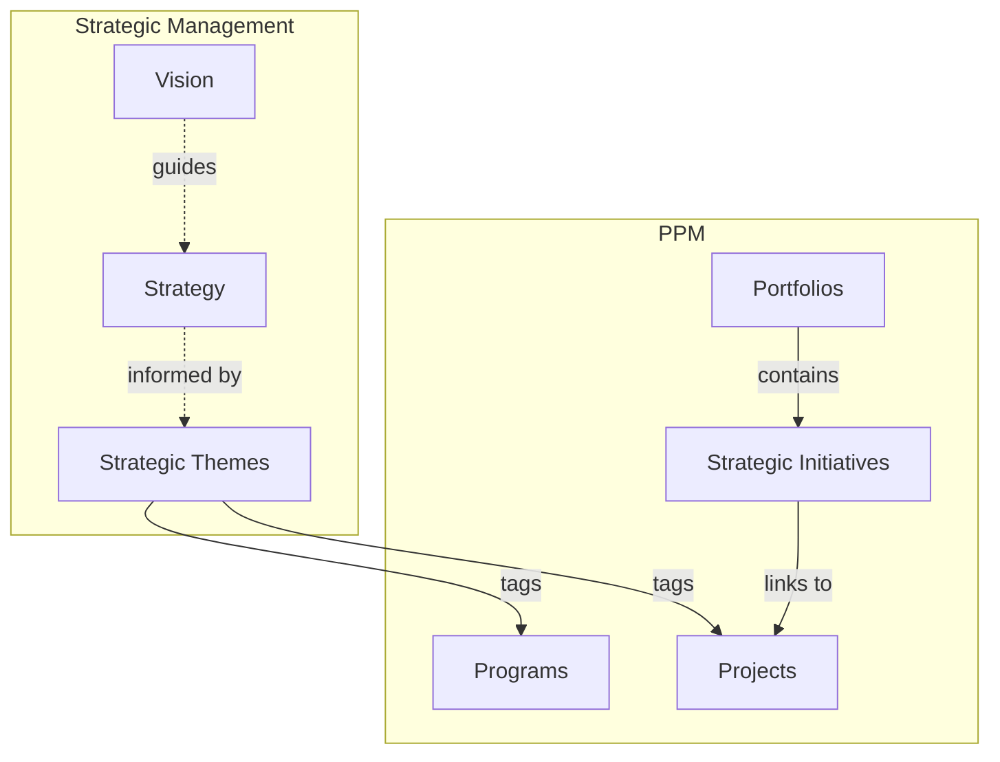
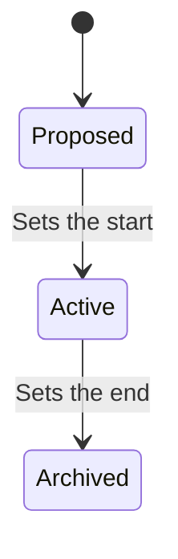
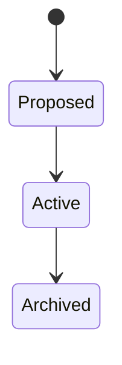

# Strategic Management

The Strategic Management domain supports high-level strategic planning and alignment across the organization. It provides the framework for defining organizational vision, strategies, and themes that guide investment decisions and work prioritization.

## How Strategic Management Connects Across Wayd

Strategic Management provides the "why" behind the "what" in PPM and Planning:

- **[Projects](../ppm/projects.mdx)** and **[Programs](../ppm/portfolios-programs.mdx#programs)** are tagged with strategic themes to show alignment.
- **[Strategic Initiatives](../ppm/strategic-initiatives.mdx)** within [portfolios](../ppm/portfolios-programs.mdx#portfolios) track [KPIs](../ppm/strategic-initiatives.mdx#kpis) that measure strategic progress.
- Strategic themes appear in PPM navigation under **PPM > Strategic Themes**.

:::note[Visions and strategies have no screens yet]
Strategic themes are managed in the app. Visions and strategies are managed only through the API: there is no page or menu entry for them.
:::

## Key Concepts

### Visions

A **Vision** describes the desired future state of the organization. It provides the overarching direction that strategies and themes support.

Every vision has:
- **Description** — The vision statement
- **State** — Proposed, Active, or Archived
- **Dates** — Start and optional end timestamps, set by its transitions

**Lifecycle:**

- **Proposed** — Being drafted
- **Active** — The current organizational vision. Activating stamps the moment it happens as the start
- **Archived** — A previous vision kept for historical reference. Archiving stamps the moment it happens as the end

**Business rules:**
- Only **one vision** can be Active at any time — activating a new vision requires archiving the current one first
- Only a Proposed vision can be activated, and only an Active one archived
- Archived visions cannot have overlapping date ranges, and a vision cannot be activated inside the most recently archived vision's range
- Archived visions cannot be updated

### Strategies

A **Strategy** defines the approach for achieving the vision. Strategies are independent of visions, allowing flexible use cases.

Every strategy has:
- **Name** and optional **Description**
- **Status** — Draft, Active, Completed, or Archived
- **Date Range** — Optional start date, with an optional end date

A strategy's status is set directly when it is created or updated. Wayd enforces no order between Draft, Active, Completed, and Archived, and no dates for any of them.

### Strategic Themes

**Strategic Themes** are the primary organizing concept in Strategic Management. They represent high-level organizational priorities that guide investment decisions and work prioritization.

Every theme has:
- **Name** and **Description**
- **State** — Proposed, Active, or Archived

**Business rules:**
- Only Proposed themes can be deleted
- State transitions publish domain events consumed by other domains (PPM maintains a synchronized copy)
- Active themes can be used to tag projects and programs

A theme's detail page carries an **Activity** section holding its recorded history: what changed, who changed it, and when. See [Activity Log](../activity-log.mdx).

### How Strategic Themes Connect to Other Domains

Strategic themes are referenced across Wayd to ensure organizational alignment:

- **[Projects](../ppm/projects.mdx)** can be tagged with strategic themes to show which priorities they support
- **[Programs](../ppm/portfolios-programs.mdx#programs)** can be tagged with strategic themes for portfolio-level alignment
- **[Strategic Initiatives](../ppm/strategic-initiatives.mdx)** within portfolios track [KPIs](../ppm/strategic-initiatives.mdx#kpis) to measure strategic progress. Initiatives carry no themes of their own

This cross-domain tagging enables organizations to answer questions like:
- "Which projects support our Digital Transformation theme?"
- "How much of our portfolio is aligned to each strategic priority?"
- "Are we investing proportionally across our strategic themes?"

Strategic themes appear as filterable tags in PPM grids and timelines, making alignment visible in portfolio, program, and project views.

#### Program Themes and Project Themes

Programs and projects each carry their own themes. A program's themes state what it was set up to pursue, often before any of its projects exist; a project's themes describe the work it delivers.

Where a project's work is attributed to themes, such as in the [Work Distribution Report](../work-management/work-distribution-report.mdx), Wayd uses the project's **effective themes**: its own themes when it has any, and otherwise its program's. A project's own themes replace its program's rather than adding to them. A project's themes are not required to be among its program's.

## Common Tasks

### Defining a Vision

Through the API:

1. Create a new vision with a description of the desired future state
2. Review and refine the vision statement
3. **Activate** the vision (only one vision can be Active)
4. When the vision evolves, **Archive** the current vision and create a new one

### Defining Strategic Themes

1. Navigate to **PPM > Strategic Themes**
2. Click **Create Strategic Theme**
3. Enter a **Name** and **Description**
4. The theme is created in **Proposed** state
5. **Activate** the theme when ready for use across the organization

### Tagging Projects with Themes

1. Navigate to a project's detail page
2. Choose **Edit** from the **Actions** menu
3. Add one or more active strategic themes in **Strategic Themes**, and save
4. The project is now aligned to those themes, visible in portfolio and program views

Programs are tagged the same way, from **Edit** on the program's detail page. Themes can also be chosen when a project or program is created.

### Viewing Strategic Alignment

Portfolio and program views aggregate strategic theme tags from their child projects. Use the following views to assess alignment:

- **[Portfolio > Overview](../ppm/portfolios-programs.mdx#portfolio-detail-page)** — The Programs and Projects tabs chart their collection by strategic theme
- **[Portfolio > Projects section](../ppm/portfolios-programs.mdx#portfolio-detail-page)** — Filter the Strategic Themes column to see investment distribution
- **[Portfolio > Programs section](../ppm/portfolios-programs.mdx#portfolio-detail-page)** — See which programs support which themes
- **[Program Detail](../ppm/portfolios-programs.mdx#program-detail-page)** — View the program's own themes, and its Overview's chart of its projects by theme

## Business Rules Summary

| Rule | Description |
|------|-------------|
| Single active vision | Only one vision can be Active at any time |
| Vision dates | Activating sets the start; archiving sets the end |
| No overlapping archives | Archived visions cannot have overlapping date ranges |
| Archived immutability | Archived visions cannot be updated |
| Theme deletion | Only Proposed themes can be deleted |
| Cross-domain sync | Theme changes publish events to keep PPM copies synchronized |
