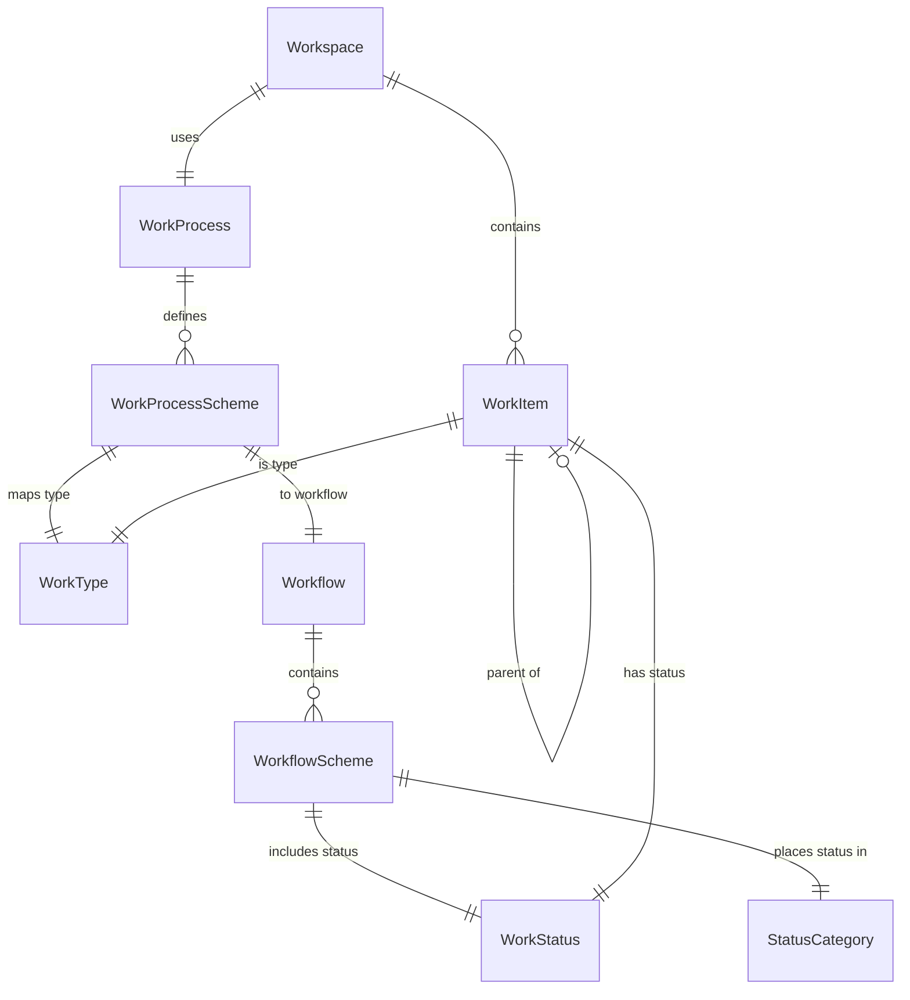

# Work Configuration

Work configuration defines the rules for how [work items](./work-items.mdx#work-items) are categorized and how they flow through stages. These settings are managed in [Settings > Work Management](../settings/index.mdx#work-management-settings).

## How It All Fits Together

## Work Processes

A **Work Process** defines the configuration of [work types](#work-types) and their [workflows](#workflows) used within a [workspace](./work-items.mdx#workspaces). Think of it as a template that determines what kinds of work can be created and how that work flows through stages.

A work process contains a **Work Process Scheme** that links:
- **[Work Types](#work-types)** — What categories of work are available
- **[Workflows](#workflows)** — What status transitions each work type follows

Work processes come from a [connection](../settings/index.mdx#connections) to an external system — an Azure DevOps process — together with their work types and workflows. Wayd has no screen for creating one or changing which work types and workflows it holds.

**Business rules:**
- A work type can only appear once within a work process
- A single work process can be used by multiple [workspaces](./work-items.mdx#workspaces)
- Only active work processes can be assigned to workspaces: a workspace is created and activated only with an active work process
- A work process cannot be deactivated while an active workspace uses it

A work process detail page shows its Key, Ownership, Active state and Description, a **Work Types and Workflows** section listing each Work Type with its Description, Workflow and Active state, and an **Activity** section holding its recorded history, which for a work process is its integration state changing as an external system syncs it. See [Activity Log](../activity-log.mdx). Those with permission to update work processes can **Activate** or **Deactivate** it from the page's actions.

## Work Types

A **Work Type** represents a category of [work item](./work-items.mdx#work-items). Common examples include:
- **Epic** — Large body of work that can be broken into features
- **Feature** — A product capability or deliverable
- **User Story** — A user-centric requirement
- **Task** — A discrete unit of work
- **Bug** — A defect to be fixed

### Work Type Tiers

Work types are organized into **Tiers** that group them by purpose and define [hierarchy rules](./work-items.mdx#work-item-hierarchy-rules):

| Tier | Purpose | Hierarchy | Examples |
|------|---------|-----------|----------|
| **Portfolio** | Container work types. Multiple hierarchy levels allowed. | Can be parents | Epic, Feature |
| **Requirement** | Base-level work types representing team work. | Cannot be parents | User Story, Bug |
| **Task** | Child work types owned by a parent (typically a Requirement). | Cannot be parents | Task, Sub-task |
| **Other** | Non-standard work types. Not shown in backlog/iteration views. Work types synced from Azure DevOps start in this tier. | Cannot be parents, and never take a project | Impediment, Risk Item |

A work type's tier comes from its [level](#work-type-levels): choose the level, and the tier follows.

### Work Type Levels

**Work Type Levels** allow work types to be hierarchically ordered and normalized across the system. The system provides default levels:

| Tier | Default Levels |
|------|---------------|
| Portfolio | Epics (Level 1), Features (Level 2) |
| Requirement | Stories (Level 1) |
| Task | Tasks (Level 1) |
| Other | Other (Level 1) |

Custom Portfolio-tier levels can be added to support deeper hierarchies (e.g., a "Theme" level above Epic). Only the Portfolio tier takes new levels. A new level is added at the bottom of the tier; drag the Portfolio levels into order, top level first. Level names must be unique, and any level's name and description can be edited.

## Workflows

A **Workflow** defines the set of [statuses](#work-statuses) and their ordering that a [work item](./work-items.mdx#work-items) goes through from creation to completion. Each work type in a [work process](#work-processes) is assigned a workflow.

A workflow contains a **Workflow Scheme** that defines:
- **[Work Statuses](#work-statuses)** — The available states
- **[Work Status Categories](#work-status-categories)** — The normalization group for each status in this workflow
- **Order** — The sequence of statuses

Workflows come from the external system with their work process: each Azure DevOps work item type's states become a workflow named after the process and the type, and each state's Azure DevOps category is mapped to a [work status category](#work-status-categories). Wayd has no screen for creating or editing a workflow.

**Business rules:**
- Each work status can only appear once in a workflow
- A status's category is set in each workflow, so the same status can belong to different categories in different workflows

**Example workflow:**

| Order | Status | Category |
|-------|--------|----------|
| 1 | New | Proposed |
| 2 | Ready | Proposed |
| 3 | In Progress | Active |
| 4 | In Review | Active |
| 5 | Done | Done |
| 6 | Removed | Removed |

## Work Statuses

A **Work Status** represents a specific state within a [workflow](#workflows) (e.g., "New", "In Progress", "Done"). Work statuses are reusable — the same status can appear in multiple workflows.

**Business rules:**
- The name of a work status cannot be changed — a new name requires creating a new status
- A work status has no category of its own: each [workflow](#workflows) places it in a [Work Status Category](#work-status-categories)

## Work Status Categories

**Work Status Categories** normalize statuses across different [workflows](#workflows) for consistent reporting and metrics. They are a fixed set:

| Category | Order | Purpose |
|----------|-------|---------|
| **Proposed** | 1 | Work has been proposed but not yet started |
| **Active** | 2 | Work is currently being performed |
| **Done** | 3 | Work has been completed |
| **Removed** | 4 | Work has been removed from scope without completion |

This normalization enables Wayd to calculate metrics like [cycle time](./cycle-time-report.mdx), throughput, and [completion rates](./sprints.mdx#sprint-metrics) across [teams](../organizations/index.mdx#teams) that may use different workflow configurations.

## Configuration Tasks

Work types, work statuses and work processes are synced from the external system. In Wayd you place each work type in the hierarchy and turn work processes on or off.

### Configuring Work Types

1. Navigate to [Settings > Work Management > Work Types](../settings/index.mdx#work-types). The grid lists each work type's Name, Description, Level and Active state; **Include Inactive** shows inactive ones too
2. Choose **Edit** on a work type to change its Description and its **Level**, which sets its [tier](#work-type-tiers) (Portfolio, Requirement, Task, or Other). A work type's name cannot be changed
3. Open **Work Type Hierarchy** to add, rename and reorder [work type levels](#work-type-levels)

### Viewing Work Statuses

Navigate to [Settings > Work Management > Work Statuses](../settings/index.mdx#work-statuses) to see each status's Name, Description and Active state; **Include Inactive** shows inactive ones too. A status's [category](#work-status-categories) is set by each workflow that uses it.

### Configuring Work Processes

1. Navigate to [Settings > Work Management > Work Processes](../settings/index.mdx#work-processes) to see each work process's Key, Name, Ownership and Active state
2. Open a work process to see its [work types](#work-types) and the [workflow](#workflows) each one follows
3. **Activate** or **Deactivate** the work process. Only an active work process can be assigned to [workspaces](./work-items.mdx#workspaces), and one in use by an active workspace cannot be deactivated
